# Ders Kitabı: Deprem Hasar Haritası'nı sıfırdan öğrenmek

**Sürüm:** 1 (7 Kasım 2026, Faz 2 sonu)

Bu kitap projeyi bir ders gibi anlatır. Hiçbir ön bilgi varsaymaz: radarın ne olduğundan başlar, sinir ağının
nasıl öğrendiğine, ChangeMamba'nın içine, modeli nasıl eğiteceğimize, sonucu nasıl ölçeceğimize, kodun nasıl
kurulduğuna ve 10 fazın her birinde ne yapacağımıza kadar gider.

Her ders aynı düzende ilerler:

- **Bu derste:** neyi öğreneceğin.
- **Anlatım:** basit dille, örnekle, çoğu zaman elle yapılmış bir hesapla.
- **Projede nerede?** Anlatılan şeyin bizim kodda ya da planda nereye denk geldiği.
- **Akılda kalsın:** üç beş cümlelik özet.
- **Kendini sına:** sorular; cevaplar tıklayınca açılır.

> **Öteki belgelerle ilişkisi.** [proje-haritasi.md](proje-haritasi.md) kuşbakışı harita,
> [ogrenme-rehberi.md](ogrenme-rehberi.md) konu konu başvuru kitabıdır. Bu kitap ise sırayla okunacak derslerdir.
> Kurallar [tasarim.md](tasarim.md) ve [protokol.md](protokol.md)'de bağlayıcıdır; çelişki olursa onlar geçerlidir.
> Belgedeki sayılar `results/` dosyalarından ve bu belgelerden alındı.

---

## Ders haritası

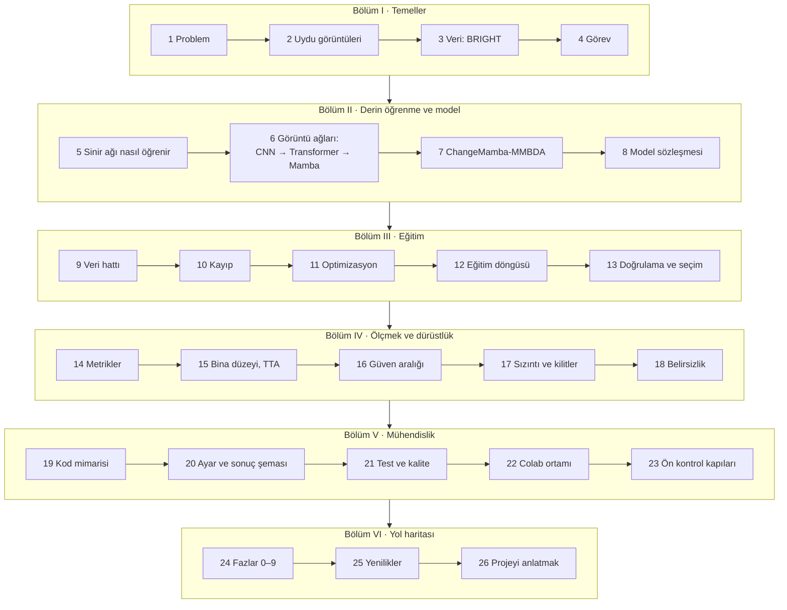

## İçindekiler

**Bölüm I · Temeller**
[Ders 1: Problem](#ders-1-problem-ve-projenin-sorusu) ·
[Ders 2: Uydu görüntüleri](#ders-2-uydu-görüntüleri-optik-ve-radar) ·
[Ders 3: Veri](#ders-3-veri-bright) ·
[Ders 4: Görev](#ders-4-görev-bilgisayara-tam-olarak-ne-yaptırıyoruz)

**Bölüm II · Derin öğrenme ve model**
[Ders 5: Sinir ağı](#ders-5-bir-sinir-ağı-nasıl-öğrenir) ·
[Ders 6: Görüntü ağları](#ders-6-görüntü-ağları-cnn-transformer-mamba) ·
[Ders 7: ChangeMamba-MMBDA](#ders-7-changemamba-mmbda-içeriden) ·
[Ders 8: Model sözleşmesi](#ders-8-model-sözleşmesi-ve-kayıt-defteri)

**Bölüm III · Eğitim**
[Ders 9: Veri hattı](#ders-9-veri-hattı-diskten-modele) ·
[Ders 10: Kayıp](#ders-10-kayıp-fonksiyonu-ce-ve-lovász) ·
[Ders 11: Optimizasyon](#ders-11-optimizasyon-adamw-zamanlama-bf16-ema-kırpma) ·
[Ders 12: Eğitim döngüsü](#ders-12-eğitim-döngüsü-baştan-sona) ·
[Ders 13: Doğrulama](#ders-13-doğrulama-ve-kayıt-noktası-seçimi)

**Bölüm IV · Ölçmek ve dürüstlük**
[Ders 14: Metrikler](#ders-14-metrikler-karışıklık-matrisi-iou-miou) ·
[Ders 15: Bina düzeyi](#ders-15-bina-düzeyi-tta-ve-oylama) ·
[Ders 16: Güven aralığı](#ders-16-güven-aralığı-ve-bootstrap) ·
[Ders 17: Sızıntı ve kilitler](#ders-17-sızıntı-ve-kilitler) ·
[Ders 18: Belirsizlik](#ders-18-belirsizlik-ve-kalibrasyon)

**Bölüm V · Mühendislik**
[Ders 19: Kod mimarisi](#ders-19-kod-mimarisi) ·
[Ders 20: Ayar ve sonuç şeması](#ders-20-yapılandırma-config-hash-ve-sonuç-şeması) ·
[Ders 21: Test ve kalite](#ders-21-test-kalite-ve-orkestra) ·
[Ders 22: Colab](#ders-22-colab-ortamı-ve-kopmaya-dayanıklılık) ·
[Ders 23: Ön kontrol](#ders-23-ön-kontrol-kapıları)

**Bölüm VI · Yol haritası**
[Ders 24: Fazlar](#ders-24-fazlar-09-hikâye-olarak) ·
[Ders 25: Yenilikler](#ders-25-yenilik-paketi-ve-fikir-havuzu) ·
[Ders 26: Projeyi anlatmak](#ders-26-projeyi-anlatmak-ve-savunmak)

---

# Bölüm I · Temeller

## Ders 1: Problem ve projenin sorusu

**Bu derste:** Ne yaptığımızı, neden yaptığımızı ve projenin asıl sorusunu.

### 1.1 Depremden sonraki ilk saatler

6 Şubat 2023'te Kahramanmaraş merkezli iki deprem 11 ili etkiledi. Böyle bir felakette ilk sorulardan biri şudur:
**Hangi binalar yıkıldı?** Bunu bilmek arama-kurtarma ekiplerinin nereye önce gideceğini, yardımın nereye
yönlendirileceğini belirler.

Sahadan tek tek bina kontrolü günler sürer. Uydular ise geniş bir bölgeyi birkaç saatte görüntüleyebilir. Ama bir
sorun var: Deprem kış gecesi olduysa ve hava bulutluysa normal (optik) uydu fotoğrafı hiçbir şey göstermez. Radar
uyduları ise buluttan ve geceden etkilenmez.

### 1.2 Bizim kurgumuz

```
  DEPREMDEN ÖNCE                       DEPREMDEN SONRA
  ┌─────────────────────┐              ┌─────────────────────┐
  │ Optik uydu fotoğrafı │              │ Radar (SAR) görüntüsü│
  │ arşivde hazır        │              │ hava/gece fark etmez │
  └──────────┬──────────┘              └──────────┬──────────┘
             └──────────────┬─────────────────────┘
                            ▼
                    ┌───────────────┐
                    │     MODEL     │
                    └───────┬───────┘
                            ▼
          Her piksel için: arka plan · sağlam · hasarlı · yıkık
```

Neden bu ikili? Çünkü gerçek hayatta en gerçekçi senaryo bu. Afetten önceki optik görüntü dünyanın neredeyse her
yeri için arşivde var. Afetten hemen sonra en hızlı ve havadan bağımsız elde edilen görüntü radar.

### 1.3 Projenin asıl sorusu

Model eğitmek projenin yarısı. Asıl soru şu:

> **Model eğitimde hiç görmediği bir depremde ne kadar işe yarıyor ve bu sonuca ne kadar güvenebiliriz?**

"Hiç görmediği" kısmı kritik. Modeli Türkiye görüntüleriyle eğitip Türkiye'de test edersek çok iyi bir sayı çıkar,
ama bu sayı yeni bir depremde ne olacağını söylemez. Gerçek hayatta bir sonraki deprem her zaman modelin hiç
görmediği bir yerde olacak. Bu yüzden Türkiye'yi eğitimde tamamen kilitli tutuyor ve sonunda **bir kez** test
ediyoruz. Buna **zero-shot** (sıfır atış) değerlendirme denir.

### 1.4 Çıpa: 41,28

BRIGHT veri setinin makalesinde aynı kurguyla eğitilen en iyi model ChangeMamba, Türkiye'de **41,28**
`[ZS-EVENT mIoU]` almış. Bu bizim **çıpamız**: kıyaslayacağımız yayımlanmış sayı. Köşeli parantezdeki etiket
sayının türüdür (Ders 14'te ayrıntısı var). Gerçekçi hedef bu sayıyı ezip geçmek değil; aynı modeli aynı kurguyla
dürüstçe yeniden eğitip sonucun ne kadar güvenilir olduğunu göstermek.

### 1.5 Bu proje neyi göstermek için?

- Segmentasyon modeli eğitebilmek.
- Yayımlanmış bir sonuçla **dürüst** kıyas yapabilmek.
- Bir sayının neden güvenilir olduğunu kanıta dayanarak savunabilmek.

Bunun için projenin öbür yarısı **sonucun dürüstlüğünü garanti eden düzen**: kilitler, önceden yazılmış kurallar
(protokol), güven aralıkları, yeniden üretim ve üç farklı referansla kıyas.

**Akılda kalsın**

- Girdi: depremden önce optik, depremden sonra radar. Çıktı: piksel başına hasar sınıfı.
- Türkiye eğitimde hiç görülmez ve sonunda bir kez test edilir.
- Çıpa 41,28 `[ZS-EVENT mIoU]`; amaç dürüst kıyas ve güvenilirliği göstermek.

**Kendini sına**

<details><summary>1. Neden modeli Türkiye görüntüleriyle de eğitip daha yüksek bir sayı almıyoruz?</summary>

Çünkü o sayı "yeni bir depremde ne olur?" sorusuna cevap vermez. Bir sonraki deprem modelin görmediği bir yerde
olacak. Türkiye'yi eğitimde görmüş bir modelin Türkiye skoru, ezberin skorudur.
</details>

<details><summary>2. Afet sonrası için neden optik değil de radar?</summary>

Radar kendi sinyalini gönderdiği için güneşe ihtiyaç duymaz (gece çalışır) ve mikrodalgalar bulutu geçer.
Depremden hemen sonra görüntü alabilmenin en güvenilir yolu bu.
</details>

---

## Ders 2: Uydu görüntüleri: optik ve radar

**Bu derste:** Optik ve radar görüntünün nasıl oluştuğunu, radarda hasarın neye benzediğini, radarın tuzaklarını
ve coğrafi görüntü dosyalarını.

### 2.1 Optik görüntü

Optik uydu bir fotoğraf makinesi gibidir: Güneş ışığının yeryüzünden yansıyan kısmını kaydeder. Bizim optik
görüntülerimiz **3 bantlı** (kırmızı, yeşil, mavi) ve çözünürlükleri çok yüksek: bir piksel yaklaşık **0,35 m**.
Yani bir arabanın uzunluğu yaklaşık 13 piksel.

Optikte bir binanın çatısı, şekli, ayak izi nettir. Bu yüzden "bina nerede?" sorusunun cevabı en iyi optikte
bulunur. Ama güneş yoksa ya da bulut varsa optik işe yaramaz.

### 2.2 Radar (SAR) görüntüsü

**SAR** (Synthetic Aperture Radar, sentetik açıklıklı radar) aktif bir algılayıcıdır: Uydu kendi mikrodalga
darbesini yere gönderir ve geri dönen yankıyı ölçer. Görüntüdeki parlaklık, o noktadan uyduya ne kadar enerji
döndüğünü gösterir.

```
            uydu (yandan bakar)
              ╲
               ╲  mikrodalga
                ╲
                 ▼
     ┌────┐            Radar yandan baktığı için:
     │bina│            · duvar + zemin köşesi sinyali uyduya geri yollar (çift sekme, parlak)
     │    │            · binanın arkası radar görmez (gölge, karanlık)
  ───┴────┴──────      · yüksek binanın tepesi yere göre kayık görünür (bindirme / layover)
```

**Yansımayı ne belirler?**

| Yüzey | Radarda görünüş | Neden |
|---|---|---|
| Durgun su, düz asfalt | Çok karanlık | Ayna gibi yansıtır; sinyal uyduya dönmez |
| Çimen, toprak | Orta gri | Sinyali her yöne dağıtır |
| Sağlam bina | Çok parlak çizgiler | Duvar ile zemin bir köşe yansıtıcı oluşturur: **çift sekme** |
| Yıkık bina, moloz | Dağınık, benekli, parlak çizgi yok | Köşe bozulmuştur; yüzey pürüzlüdür |

**Hasar radarda böyle görünür:** Sağlam binanın parlak "L" izi yıkılınca dağılır. Model, öncesi optikte bina olan
yerde sonrası radarda bu izin durumuna bakarak hasarı tahmin etmeyi öğrenir.

### 2.3 Radarın üç tuzağı

1. **Benek (speckle):** Bir pikseldeki birçok küçük yansıtıcının dalgaları birbirini rastgele güçlendirip
   zayıflatır. Sonuç tuz-biber gibi görünen bir gürültüdür. Bu gürültü **çarpımsaldır**: parlak bölgede büyük,
   karanlık bölgede küçük.
2. **Bindirme (layover):** Radar mesafeyi ölçer. Yüksek bir binanın tepesi uyduya tabanından daha yakın olduğu için
   görüntüde tabanından önce görünür. 5 katlı bir binanın tepesi 0,35 m pikselde yaklaşık **60 piksel** kayabilir.
   Yani radardaki iz optikteki ayak izinin tam üstünde olmayabilir.
3. **Gölge:** Binanın radara bakmayan arkası hiç sinyal almaz; karanlık kalır. Gölgedeki küçük bir yıkık bina
   radarda görünmeyebilir.

### 2.4 Bir ölçüm hikâyesi: SAR değerlerimiz hangi ölçekte?

BRIGHT'taki SAR görüntüleri 0–255 arası tam sayılar (uint8). Soru şu: Bu sayılar doğrudan yansıma gücü mü
(**doğrusal genlik**), yoksa logaritması mı (**dB benzeri**)? Bu, normalizasyonu nasıl yapacağımızı etkiler.

Faz 2'de bunu Türkiye'ye dokunmadan, 13 olayın verisiyle ölçtük. Fikir şuydu:

- Benek **çarpımsal** ise doğrusal ölçekte parlak bölgelerin oynaklığı da büyüktür: standart sapma ortalamayla
  orantılıdır. Küçük 8×8 bloklarda `log(std)` ile `log(ortalama)` arasındaki eğim **~1** çıkar.
- Değerlerin logaritması alınmışsa çarpım toplama döner; oynaklık parlaklıktan bağımsızlaşır ve eğim **~0**'a yaklaşır.

Ölçülen eğim **0,2** (`results/arastirma/sar_olcek.json`). Değerler doğrusal genlik değil, log/dB benzeri bir
ölçekte. Ayrıca olayların ortalama parlaklığı 41 ile 104 arasında değişiyor; her olaya farklı bir germe uygulanmış
olabilir. Bu bulgu iki karar doğurdu: dB'ye çevirme adımına gerek yok, ve "SAR'ı veri setinin kendi istatistiğiyle
standartlaştırma" fikri (A3) desteklendi.

> Bu küçük hikâye projenin çalışma biçimini özetliyor: Bir varsayımı tahmin etmek yerine, Türkiye'ye dokunmadan
> ölçüyoruz ve sonucu dosyaya yazıyoruz.

### 2.5 Coğrafi görüntü: GeoTIFF ve koordinat sistemleri

Uydu görüntüsü sıradan bir resim değildir; her pikselin yeryüzünde nereye denk geldiği bilinir. **GeoTIFF**, bu
konum bilgisini dosyanın başlığında taşıyan bir TIFF türüdür. Başlıkta şunlar yazar: sol üst köşenin koordinatı,
bir pikselin metre ya da derece cinsinden boyu ve hangi **koordinat sistemi** kullanıldığı.

Koordinat sistemleri **EPSG** kodlarıyla anılır. Örnekler:

- **EPSG:4326:** Enlem-boylam (derece). GPS'in kullandığı sistem.
- **EPSG:32637:** UTM bölge 37 Kuzey (metre). Türkiye karelerimiz bu sistemde.

Faz 2'de Türkiye karelerinin yalnız başlıklarını okuyarak (piksellerine ve etiketlerine dokunmadan) hangi
şehirlerde olduklarını bulduk: 7 şehir, 2 km'lik ızgarada 64 blok. Bu bilgi güven aralığı hesabında kullanılacak
(Ders 16).

**Akılda kalsın**

- Optik "bina nerede?" sorusunda, radar "bina ne durumda?" sorusunda güçlü.
- Sağlam binanın radar izi çift sekmeden gelen parlak çizgilerdir; yıkım bu izi bozar.
- Radarın tuzakları: benek, bindirme, gölge.
- Bizim SAR değerlerimiz log/dB benzeri ölçekte (ölçüldü, eğim 0,2).

**Kendini sına**

<details><summary>1. Radardaki iz neden optikteki ayak izinden kayık olabilir?</summary>

Radar mesafe ölçer ve yandan bakar. Yüksek binanın tepesi uyduya daha yakın olduğu için görüntüde tabanından önce
görünür (bindirme). 0,35 m pikselde 5 katlı bir binada bu kayma ~60 piksel olabilir.
</details>

<details><summary>2. Eğim ~1 çıksaydı ne düşünürdük?</summary>

Değerlerin doğrusal genlik olduğunu ve beneğin çarpımsal davrandığını. O zaman log/dB dönüşümü düşünmek gerekirdi.
</details>

---

## Ders 3: Veri: BRIGHT

**Bu derste:** Veri setinin içeriğini, bir karenin yapısını, etiketleri, sınıf dengesizliğini, nodata'yı ve
veriyi eğitim, doğrulama ve teste nasıl böldüğümüzü.

### 3.1 BRIGHT nedir?

BRIGHT, afet sonrası bina hasarı için hazırlanmış açık bir veri setidir. Her örnekte afet öncesi optik ve afet
sonrası radar görüntüsü ile uzmanların elle çizdiği hasar etiketi bulunur.

| Özellik | Değer |
|---|---|
| Olay sayısı | 14 (deprem, patlama, yanardağ, yangın, kasırga, sel, savaş) |
| Kare sayısı | 4.246 |
| Kare boyu | 1024 × 1024 piksel (~300 m × 300 m) |
| Dosya biçimi | uint8 GeoTIFF |
| Optik | 3 bant (Maxar) |
| SAR | 1 bant (Capella, Umbra) |
| Boyut | ~13,2 GB zip, açılınca ~22,3 GB |
| Lisans | CC BY-SA 4.0 |

### 3.2 Bir karenin anatomisi

Her kare üç dosyadır ve adları aynı kökü paylaşır:

```
pre-event/   noto-earthquake_00000032_pre_disaster.tif     → optik, 1024×1024×3
post-event/  noto-earthquake_00000032_post_disaster.tif    → SAR,   1024×1024
target/      noto-earthquake_00000032_building_damage.tif  → etiket, 1024×1024
```

Etiketteki her piksel bir sayıdır:

| Değer | Anlamı |
|---|---|
| 0 | Arka plan (bina değil) |
| 1 | Sağlam bina |
| 2 | Hasarlı bina |
| 3 | Yıkık bina |

**Olay adı tuzağı.** Bir karenin hangi olaydan geldiğini adından çıkarırız. `la_palma-volcano_00000001`'de olay adı
`la_palma-volcano`'dur. `split('_')[0]` yaparsan `la` çıkar, çünkü olay adının içinde de alt çizgi var. Doğrusu:
önce `_pre_disaster` gibi eki at, sonra **sondan** bir kez böl: `rsplit('_', 1)[0]`. Bizim kodda bu iş
`hasar.data.events.event_of` fonksiyonunda ve testle korunuyor.

### 3.3 Sınıf dengesizliği

Eğitim kümesindeki piksellerin dağılımı (`results/veri/bolme.json`):

```
arka plan  ██████████████████████████████████████████████  %90,76
sağlam     ███▍                                            %6,67
hasarlı    ▊                                               %1,65
yıkık      ▍                                               %0,92
```

Bunun iki sonucu var:

1. **"Genel doğruluk" yanıltıcıdır.** Her piksele "arka plan" diyen aptal bir model %90 doğru çıkar. Bu yüzden
   metrik olarak mIoU kullanılır (Ders 14).
2. **Nadir sınıfları öğrenmek zordur.** Yıkık pikseller toplamın %1'inden azdır. Kayıp fonksiyonu seçiminde bu
   önemlidir (Ders 10).

### 3.4 Nodata

Bazı karelerin bir kısmı boştur: görüntünün kapsamadığı alan sıfırla doldurulmuştur. Hatta bazı karelerde SAR
tamamen boştur. Biz bir pikseli şöyle "nodata" sayarız: **optiğin üç bandı da 0 ve SAR da 0.**

- **Eğitimde:** Bu pikseller kayıpta yok sayılır (etiket 255 yapılır). Yoksa model "boş görüntü = arka plan" gibi
  anlamsız bir kural öğrenir.
- **Değerlendirmede:** Resmî kodla aynı davranırız, ayrıca dışlamayız. Dışlanmış hâli ayrı bir ikincil satır olur.

### 3.5 Bölme: 13 olayla öğren, Türkiye'de sına

Veriyi üçe ayırırız:

- **Eğitim kümesi:** Modelin ağırlıklarını ayarlamak için gördüğü veri.
- **Doğrulama kümesi:** Eğitim sırasında modelin gerçekten iyileşip iyileşmediğini görmek ve en iyi anı seçmek için
  kullanılan, modelin öğrenmediği veri.
- **Test kümesi:** En sonda bir kez bakılan veri. Bizde Türkiye.

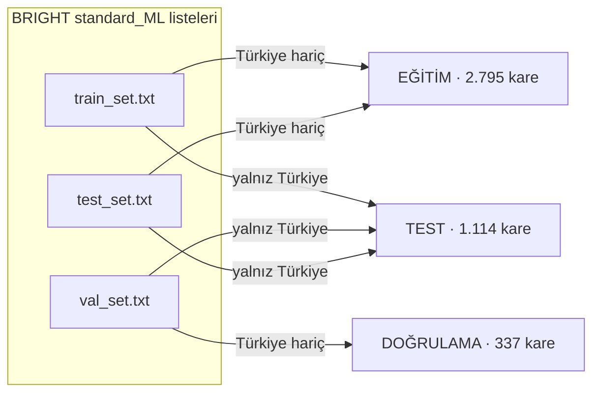

BRIGHT'ın üç hazır listesi var. Bu listelerde Türkiye kareleri üç kümeye de dağılmış (777/113/224). Biz BRIGHT'ın
`cross_event/zero_shot` mantığını kullanıyoruz: Türkiye'nin nerede olursa olsun bütün kareleri teste gider,
standart test listesinin geri kalanı eğitime katılır.

Eğitimdeki 13 olay: bata-explosion, beirut-explosion, congo-volcano, **haiti-earthquake**, hawaii-wildfire,
la_palma-volcano, libya-flood, marshall-wildfire, mexico-hurricane, **morocco-earthquake**, myanmar-hurricane,
**noto-earthquake**, ukraine-conflict. Yalnız üçü deprem. Model "hasarı" çok farklı afetlerden öğrenecek; Türkiye
gerçek bir genelleme sınavı.

**Akılda kalsın**

- Bir kare = optik + SAR + etiket; etiket 0–3.
- Piksellerin %90'ı arka plan; genel doğruluk yanıltır.
- Nodata eğitimde yok sayılır, değerlendirmede resmî kodla aynı işlenir.
- Bölme: 2.795 / 337 / 1.114; Türkiye'nin bütün kareleri teste gider.

**Kendini sına**

<details><summary>1. <code>turkey-earthquake_00000262_post_disaster.tif</code> dosyasının olay adını adım adım çıkar.</summary>

Uzantıyı at: `turkey-earthquake_00000262_post_disaster`. Eki at: `turkey-earthquake_00000262`. Sondan bir kez böl:
`["turkey-earthquake", "00000262"]`. Olay adı `turkey-earthquake`.
</details>

<details><summary>2. Doğrulama kümesi ile test kümesinin farkı ne?</summary>

İkisini de model öğrenmez. Ama doğrulama kümesine eğitim boyunca defalarca bakılır ve kararlar (hangi kayıt noktası,
hangi eşik) ona göre verilir. Test kümesine yalnız en sonda, kararlar kilitlendikten sonra bir kez bakılır.
</details>

---

## Ders 4: Görev: bilgisayara tam olarak ne yaptırıyoruz?

**Bu derste:** Semantik segmentasyonu, değişim tespitini, iki alt görevi ve piksel düzeyi ile bina düzeyinin farkını.

### 4.1 Üç tür görüntü görevi

```
 SINIFLANDIRMA                 NESNE TESPİTİ                 SEMANTİK SEGMENTASYON
 "Bu resimde yıkık bina var"   "Şu kutularda bina var"       "Her pikselin sınıfı şu"
 ┌──────────┐                  ┌──────────┐                  ┌──────────┐
 │          │ → "evet"         │ ┌─┐  ┌──┐│                  │0011100000│
 │  ▢  ▢▢   │                  │ └─┘  └──┘│                  │0011103300│
 └──────────┘                  └──────────┘                  └──────────┘
```

Biz **semantik segmentasyon** yapıyoruz: Her piksele bir sınıf veriyoruz. Çıktımız girdiyle aynı boyda bir haritadır.

### 4.2 Değişim tespiti

İki zamanın görüntüsünü karşılaştırıp neyin değiştiğini bulmaya **değişim tespiti** denir. Bizim işimiz bunun özel
bir hâli: Öncesi ve sonrası **farklı türde** görüntüler (optik ve radar). Doğrudan "farkını al" diyemeyiz; model iki
farklı dili birbirine çevirmeyi öğrenmeli.

### 4.3 İki alt görev

Hasar haritası iki soruya ayrılabilir:

1. **Konum (localization):** Bu piksel bina mı? Bunun cevabı afetten önce de bellidir; en iyi optikten bulunur.
2. **Sınıflandırma (classification):** Bina ise ne durumda: sağlam, hasarlı, yıkık? Bunun için hem öncesi hem
   sonrası gerekir.

ChangeMamba bu iki görevi iki ayrı başlıkla çözer (Ders 7). Model iki çıktı verir: `loc` (2 sınıf) ve `clf`
(4 sınıf).

### 4.4 Piksel düzeyi ve bina düzeyi

Piksel düzeyinde büyük bir fabrika binlerce piksel, küçük bir ev birkaç yüz pikseldir; fabrikanın sonucu metriği
domine eder. Arama-kurtarma için ise asıl soru "kaç bina yıkık?"tır. Bu yüzden başlık metriği piksel düzeyinde
olsa da ayrıca **bina düzeyi** metrik raporlanacak (Ders 15).

**Akılda kalsın**

- Görev: iki farklı türde görüntüden piksel düzeyi hasar haritası.
- İki alt görev: bina nerede (`loc`) ve bina ne durumda (`clf`).
- Piksel düzeyi büyük binalara ağırlık verir; bina düzeyi her binaya bir oy.

**Kendini sına**

<details><summary>Neden "bina nerede?" sorusu için radar gerekmez?</summary>

Bina depremden önce de oradaydı ve optikte ayak izi nettir. Radar bu soruya yalnız gürültü katar. Bu yüzden
ChangeMamba'nın bina çözücüsü yalnız optiği görür.
</details>

---

# Bölüm II · Derin öğrenme ve model

## Ders 5: Bir sinir ağı nasıl öğrenir?

**Bu derste:** Nöronu, katmanı, kaybı, gradyanı, geri yayılımı ve adım-batch-epoch kavramlarını; elle yapılmış
tek adımlık bir öğrenme örneğiyle.

### 5.1 En küçük parça: nöron

Bir nöron girdisini bir ağırlıkla çarpar, bir sabit ekler, sonra çoğu zaman doğrusal olmayan bir fonksiyondan
geçirir:

```
y = aktivasyon(w · x + b)
```

`w` (ağırlık) ve `b` (sabit) öğrenilen sayılardır. Bir sinir ağı, milyonlarca böyle nöronun katmanlar hâlinde
dizilmesidir. "Öğrenmek", bu sayıları doğru cevabı verecek şekilde ayarlamaktır.

### 5.2 Kayıp: ne kadar yanlışız?

Modelin cevabının doğru cevaptan ne kadar uzak olduğunu tek bir sayıyla ölçen fonksiyona **kayıp** (loss) denir.
Kayıp küçükse model iyidir. Eğitimin tek amacı kaybı küçültmektir.

### 5.3 Gradyan ve gradyan inişi: elle bir adım

En basit örnek: Tek ağırlıklı bir model `y = w · x`. Girdi `x = 2`, doğru cevap `t = 10`. Başlangıçta `w = 3`.

```
1) İleri geçiş:     y = 3 · 2 = 6
2) Kayıp:           L = (y − t)² = (6 − 10)² = 16
3) Gradyan:         dL/dw = 2 · (y − t) · x = 2 · (−4) · 2 = −16
                    (w'yi artırırsam kayıp azalır, çünkü eğim negatif)
4) Güncelleme:      w ← w − lr · dL/dw = 3 − 0,1 · (−16) = 4,6     (lr = öğrenme oranı = 0,1)
5) Kontrol:         y = 4,6 · 2 = 9,2     L = (9,2 − 10)² = 0,64    ✓ kayıp 16'dan 0,64'e indi
```

**Gradyan**, kaybın her ağırlığa göre eğimidir: "Bu ağırlığı biraz artırırsam kayıp ne kadar değişir?" **Gradyan
inişi**, her ağırlığı eğimin tersi yönünde küçük bir adım oynatmaktır. **Öğrenme oranı** (lr) bu adımın boyudur:
Çok büyükse hedefi aşar, çok küçükse öğrenme sürünür.

### 5.4 Geri yayılım

Gerçek bir ağda milyonlarca ağırlık var. Her birinin gradyanını tek tek hesaplamak yerine **geri yayılım**
(backpropagation) kullanılır: Kayıptan başlayıp zincir kuralıyla katman katman geriye doğru giderek bütün
gradyanlar tek geçişte hesaplanır. PyTorch bunu `loss.backward()` ile otomatik yapar.

### 5.5 Batch, adım, epoch

- **Batch:** Bir güncellemede birlikte işlenen örnek grubu. Bizde 16 kırpılmış kare.
- **Adım (step):** Bir batch için ileri geçiş, kayıp, geri yayılım ve bir güncelleme.
- **Epoch:** Eğitim kümesinin bir kez baştan sona görülmesi.

Bizim plan: **40.000 adım × 16 = 640.000 örnek.** Eğitim kümesi 2.795 kare olduğu için bu yaklaşık 229 epoch
demek. Ama her seferinde karenin farklı bir 640'lık parçası, farklı bir yönde görüldüğü için model aynı şeyi 229 kez
görmüş olmaz.

### 5.6 Aşırı uyum (overfitting)

Model eğitim verisini **ezberlerse** eğitimde kusursuz, yeni veride kötü olur. Buna aşırı uyum denir. Ona karşı
kullandığımız araçlar: veri artırımı (Ders 9), ağırlık sönümü ve EMA (Ders 11), doğrulama kümesiyle seçim (Ders 13).

**Akılda kalsın**

- Öğrenmek = ağırlıkları kaybı küçültecek yönde küçük adımlarla oynatmak.
- Gradyan "hangi yöne?" sorusunu, öğrenme oranı "ne kadar?" sorusunu cevaplar.
- Bizde bir adım 16 örnek; toplam 40.000 adım.

**Kendini sına**

<details><summary>1. Yukarıdaki örnekte lr = 1 olsaydı ne olurdu?</summary>

`w ← 3 − 1 · (−16) = 19`, `y = 38`, `L = (38 − 10)² = 784`. Kayıp 16'dan 784'e çıkar: adım hedefi çok aştı. Çok
büyük öğrenme oranı eğitimi patlatır.
</details>

<details><summary>2. 40.000 adım × 16 batch kaç örnek eder, BRIGHT'ın resmî 800.000 örneğinin yüzde kaçı?</summary>

640.000 örnek; resmî miktarın %80'i. Bütçe yüzünden bilinçli bir kısaltma (ChangeMamba'nın kendi reçetesi 80.000 ×
8 = 640.000 ile aynı).
</details>

---

## Ders 6: Görüntü ağları: CNN, Transformer, Mamba

**Bu derste:** Kodlayıcı-çözücü yapısını, özellik haritalarını, ön eğitimi ve CNN'den Mamba'ya mimarilerin neden
değiştiğini.

### 6.1 Kodlayıcı-çözücü

Segmentasyon ağları genelde iki parçadır:

```
 GİRDİ 640×640                                                         ÇIKTI 640×640
   │                                                                       ▲
   ▼              KODLAYICI (encoder)                ÇÖZÜCÜ (decoder)      │
 ┌─────┐ 160×160 ┌─────┐ 80×80 ┌─────┐ 40×40 ┌─────┐ 20×20                 │
 │  1  │────────►│  2  │──────►│  3  │──────►│  4  │──── büyüt, birleştir ─┘
 └─────┘ ince    └─────┘       └─────┘       └─────┘ kaba
         ayrıntı                                     anlam
```

- **Kodlayıcı** görüntüyü adım adım küçültür ve her adımda daha soyut **özellikler** çıkarır. İlk katmanlar kenar
  ve doku, son katmanlar "bina", "moloz" gibi kavramlar görür.
- **Çözücü** bu özellikleri tekrar büyütüp piksel düzeyinde haritaya çevirir. Kodlayıcının farklı ölçeklerdeki
  çıktılarını da kullanır: ince ayrıntı (sınırlar) ve kaba anlam (ne olduğu) birleşir.

Bir **özellik haritası**, her konum için bir sayı vektörü taşıyan küçültülmüş bir görüntüdür. Örneğin `96 × 160 ×
160`: 160×160 konumun her biri için 96 sayı.

### 6.2 Ön eğitim ve transfer öğrenme

Kodlayıcıyı sıfırdan eğitmek çok veri ister. Bunun yerine milyonlarca fotoğraftan oluşan **ImageNet**'te önceden
eğitilmiş ağırlıklarla başlarız. Kenarı, dokuyu, şekli tanıyan bu katmanlar uydu görüntüsünde de işe yarar. Buna
**transfer öğrenme** denir. Bizim kodlayıcılar `vssm_tiny` ImageNet ağırlıklarıyla başlar.

Neden ImageNet normalizasyonu kullandığımızı da bu açıklar: Önceden eğitilmiş ağ girdinin ImageNet
istatistikleriyle ölçeklenmiş olmasını bekler (Ders 9).

**Dikkat:** Başlangıç ağırlığı da sızıntı kaynağı olabilir. Türkiye'yi görmüş bir ağırlıkla başlarsak zero-shot
bozulur. Bu yüzden `*_standard_ML_split.pth` checkpoint'leri ve 2023 Türkiye sahnelerini görmüş olabilecek MaRS
yasak (kural 2).

### 6.3 CNN → Transformer → Mamba

| Aile | Nasıl bakar | Güçlü yanı | Zayıf yanı |
|---|---|---|---|
| **CNN** (ör. UNet) | Küçük pencerelerle (3×3) kayarak | Hızlı, yerel desenlerde çok iyi | Uzak bağlamı görmek için çok katman gerekir |
| **Transformer** (ör. Swin) | Her parça her parçaya bakar (dikkat) | Uzun menzilli bağlam | Maliyet parça sayısının **karesiyle** büyür |
| **Mamba** (ör. VMamba) | Diziyi bir "hafıza durumu" taşıyarak okur | Uzun bağlam, maliyet **doğrusal** | Görece yeni; özel CUDA çekirdeği ister |

**Bir sayıyla fark.** 640×640'lık bir görüntüyü 4×4'lük parçalara bölersek 160 × 160 = **25.600** parça olur.

- Tam dikkat: her parça her parçaya bakar → 25.600² ≈ **655 milyon** ilişki.
- Mamba: diziyi bir kez tarar → ~**25.600** adım.

**Mamba nasıl çalışır (sezgi)?** Bir kitabı okurken her cümlede bütün eski cümlelere geri dönmezsin; kafanda bir
özet taşırsın ve her yeni cümleyle güncellersin. Mamba da böyle bir **durum** (state) taşır. "Seçici" (selective)
olması, neyi hatırlayıp neyi unutacağına girdiye bakarak karar vermesidir. **VMamba** bunu 2B görüntüye uyarlar:
görüntüyü dört farklı yönde tarar (soldan sağa, sağdan sola, yukarıdan aşağı, aşağıdan yukarı) ki her piksel her
yönden bağlam alsın.

Hasar için neden önemli? Bir binanın yıkık olup olmadığını anlamak için çevresine de bakmak gerekir: moloz yola
taşmış mı, komşu binalar ne durumda? Uzun bağlamı ucuza görmek burada işe yarar.

**Akılda kalsın**

- Kodlayıcı küçültüp anlam çıkarır, çözücü büyütüp harita yapar.
- ImageNet ön eğitimiyle başlarız; Türkiye'yi görmüş ağırlık yasak.
- Mamba uzun bağlamı doğrusal maliyetle görür; bedeli özel CUDA çekirdeği.

**Kendini sına**

<details><summary>Parça sayısı iki katına çıkarsa dikkatin ve Mamba'nın maliyeti nasıl değişir?</summary>

Dikkat dört katına çıkar (karesel), Mamba iki katına çıkar (doğrusal).
</details>

---

## Ders 7: ChangeMamba-MMBDA içeriden

**Bu derste:** Ana modelimizin parçalarını, bir batch'in model içindeki yolculuğunu tensör boyutlarıyla, iki
çıktının nasıl haritaya döndüğünü ve yedek modeli.

### 7.1 Ad ne demek?

- **ChangeMamba:** VMamba kodlayıcılarını değişim tespitine uyarlayan model ailesi.
- **MambaBDA:** Ailenin bina hasarı (Building Damage Assessment) üyesi.
- **MMBDA:** BRIGHT ekibinin optik + SAR için uyarladığı çok modlu (multimodal) sürüm.
- **Tiny:** En küçük boy.

### 7.2 Mimari

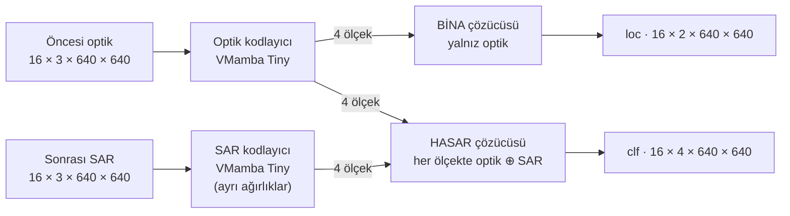

### 7.3 Bir batch'in yolculuğu

Aşağıdaki ara boyutlar VMamba-Tiny'nin tipik değerleridir (kanal sayısı 96'dan başlayıp her ölçekte ikiye katlanır).
Bunları ezberlemen gerekmez; önemli olan desen: **çözünürlük küçülür, kanal sayısı büyür.**

```
Girdi          16 × 3   × 640 × 640    (optik ve SAR ayrı ayrı)
Ölçek 1 (1/4)  16 × 96  × 160 × 160    kenar, doku
Ölçek 2 (1/8)  16 × 192 ×  80 ×  80
Ölçek 3 (1/16) 16 × 384 ×  40 ×  40
Ölçek 4 (1/32) 16 × 768 ×  20 ×  20    "bina", "moloz" gibi kavramlar

Hasar çözücüsü her ölçekte optik ve SAR özelliklerini kanal boyunda yan yana koyar (concat):
  ölçek 4'te 768 + 768 = 1536 kanal → çözücü ikisinden nasıl sonuç çıkaracağını öğrenir

Çıktılar       loc 16 × 2 × 640 × 640    clf 16 × 4 × 640 × 640
```

### 7.4 Parçaların gerekçesi

| Parça | Ne yapar | Neden böyle |
|---|---|---|
| İki ayrı kodlayıcı | Her görüntü türünden ayrı özellik çıkarır | Optik ışığı, radar mikrodalga yankısını kaydeder; "dilleri" farklı |
| Bina çözücüsü yalnız optik | "Bina nerede?" | Bina afetten önce de oradaydı; radar gürültü katar |
| Hasar çözücüsü optik + SAR | "Bina ne durumda?" | Bina şekli (öncesi) ve radar izi (sonrası) birlikte gerekir |
| Basit birleştirme (concat) | İki özelliği yan yana koyar | Daha karmaşık füzyonların görülmemiş olayda yararı gösterilmedi |
| Ayrık başlıklar | İki alt görevi ayrı öğrenir | BRIGHT'ta ayrık modeller zero-shot'ta daha iyi; kanıt kontrollü değil, olası |

### 7.5 Logit, softmax, argmax

Model **olasılık** değil **logit** (ham puan) verir. Bir pikselin `clf` logitleri örneğin şöyle olsun:

```
logit:        [ 2,0   0,5   0,1  −1,0 ]      (arka plan, sağlam, hasarlı, yıkık)
e^logit:      [ 7,39  1,65  1,11  0,37 ]     toplam = 10,51
softmax:      [ 0,70  0,16  0,11  0,04 ]     her biri / toplam → toplamı 1 olan olasılıklar
argmax:       0  → "arka plan"
```

**Softmax** logitleri olasılığa çevirir, **argmax** en yüksek olanı seçer.

### 7.6 İki çıktıdan haritaya: iki yol

```
YOL A (başlık sonucu, resmî kod):   tahmin = argmax(clf)                 ← 41,28 bununla kıyaslanır
YOL B (ikincil satır, bina maskeli): loc "bina değil" diyorsa → 0
                                     değilse → argmax(clf[1:]) + 1       (sağlam/hasarlı/yıkık arasından seç)
```

ChangeMamba'nın eğitim kodu mIoU'yu Yol A ile hesaplıyor, makale ise Yol B'yi anlatıyor. İkisi farklı sayı
verebilir. Hangisinin başlık olacağına Türkiye'ye dokunmadan karar verdik: Yol A ([ADR-0005](adr/0005-baslik-metrigi.md)).
Yol B önceden ilan edilmiş ikincil satır.

### 7.7 Neden ChangeMamba? Yedek ne?

BRIGHT makalesinde dört depremin dördünde en iyi zero-shot sonucu almış. Ama asıl neden şu: **Aynı modeli aynı
kurguyla eğitirsek sonucumuz 41,28 ile doğrudan kıyaslanabilir.** Başka bir model seçseydik elimizde doğrudan bir
çıpa olmazdı.

Riski mühendislikte: Mamba'nın seçici tarama işlemi için özel bir CUDA çekirdeği derlenmeli ve bunun Colab'ın güncel
ortamında çalıştığı doğrulanmadı. Bu yüzden önceden kabul edilmiş, otomatik bir kural var:

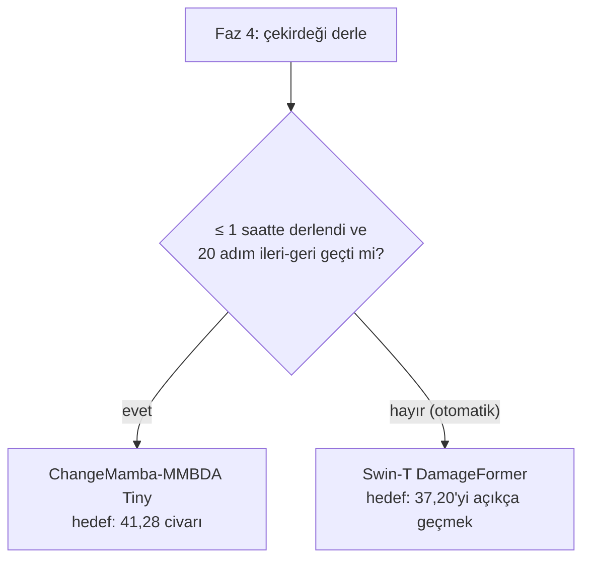

Mantığı: Belirsiz süreli bir hata ayıklamaya kontrolsüz GPU bütçesi harcamak, önceden tanımlanmış bir yedeğe
geçmekten daha pahalıdır.

**Akılda kalsın**

- İki kodlayıcı, iki çözücü, iki çıktı: `loc` (2) ve `clf` (4).
- Bina çözücüsü yalnız optiği, hasar çözücüsü ikisini görür.
- Başlık sonucu `argmax(clf)`, maskesiz; maskeli hâl ikincil satır.
- Çekirdek derlenmezse otomatik olarak DamageFormer.

**Kendini sına**

<details><summary>1. Logitler [0, 0, 0, 0] ise softmax nedir? Bu hangi ön kontrol kapısıyla ilgili?</summary>

Her sınıf 0,25. Eğitimin başında model rastgele olduğu için yaklaşık böyle tahmin eder; o zaman kayıp
−ln(0,25) = ln 4 ≈ 1,386 olur. Kapı 4 başlangıç kaybının buna yakın olmasını bekler (Ders 23).
</details>

<details><summary>2. Yol A ile Yol B hangi piksellerde farklı sonuç verir?</summary>

`clf`'nin "sağlam/hasarlı/yıkık" dediği ama `loc`'un "bina değil" dediği piksellerde (Yol B arka plan yapar) ve
`clf`'nin "arka plan" dediği ama `loc`'un "bina" dediği piksellerde (Yol B bir bina sınıfı seçer).
</details>

---

## Ders 8: Model sözleşmesi ve kayıt defteri

**Bu derste:** Ana model, yedek ve varyantın neden aynı arayüzü uyguladığını ve bunun kodda nasıl kurulduğunu.

### 8.1 Sorun

Projede en az beş model çalışacak: ana ChangeMamba, yedek DamageFormer, tek fikirli varyant ve Faz 3'te yeniden
üretilecek hazır modeller (SiamCRNN, UNet). Eğitim ve değerlendirme kodu her model için ayrı yazılırsa hata riski
katlanır ve iki modelin adil kıyası zorlaşır.

### 8.2 Çözüm: tek sözleşme

`src/hasar/models/base.py` bir **sözleşme** tanımlar: Her model `forward(pre, post)` çağrısına şu sözlükle cevap verir:

```python
{"loc": B × 2 × H × W,   # bina / değil logitleri
 "clf": B × 4 × H × W}   # arka plan / sağlam / hasarlı / yıkık logitleri
```

`validate_output` fonksiyonu anahtarları ve boyutları denetler; uymazsa hangi anahtarın yanlış olduğunu söyleyen bir
hata verir. Çıktılar logittir, olasılık değil; kayıp ve metrik kendi aktivasyonunu uygular.

### 8.3 Kayıt defteri

`src/hasar/models/registry.py` modelleri **adıyla** kurar:

```python
@register("changemamba_mmbda_tiny")
def build_changemamba(**kwargs): ...

model = build(cfg.model.name)     # YAML'daki tek satır hangi modelin kurulacağını belirler
```

Eğitim kodu hiçbir model sınıfını doğrudan import etmez. Yedeğe geçmek YAML'da tek satır değiştirmek demek
(`model.name: damageformer_swin_t`).

> **Açık nokta (Faz 4'te kapanacak).** Sözleşmenin belgesi SAR'ın modele tek kanal (`B × 1 × H × W`) gireceğini ve
> 3 kanala kopyalamanın model sarmalayıcısında yapılacağını söylüyor. Veri katmanındaki `sar_to_input` ise resmî
> modda 3 kanal üretiyor. İkisi çelişmiyor ama kopyalamanın **tek bir yerde** yapılması gerekiyor; Faz 4'te model
> sarmalayıcısı yazılırken bu bağlanacak ve bir testle korunacak.

**Akılda kalsın**

- Bütün modeller aynı girdiyi alır, aynı biçimde çıktı verir.
- Model adla kurulur; eğitim kodu modelden habersizdir.

**Kendini sına**

<details><summary>Sözleşme olmasaydı varyant ile ana modeli kıyaslarken ne ters gidebilirdi?</summary>

Örneğin bir model olasılık, öteki logit döndürse ya da sınıf sırası farklı olsa metrik kodu sessizce yanlış sayı
üretirdi. Sözleşme ve `validate_output` bu farkları baştan yakalar.
</details>

---

# Bölüm III · Eğitim

## Ders 9: Veri hattı: diskten modele

**Bu derste:** Bir karenin diskten okunup modele girene kadar geçtiği her adımı ve her adımın neden var olduğunu.

### 9.1 Büyük resim

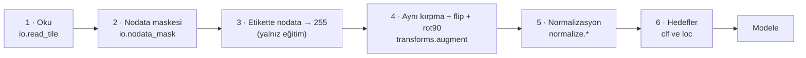

Bütün bu adımları `BrightDataset` (`src/hasar/data/dataset.py`) birleştirir.

### 9.2 Adım 1: Okuma ve Türkiye kapısı

`io.read_tile(root, name, access)` üç dosyayı okur. Ama önce bir şey yapar: Kare Türkiye'ye aitse ve elde bir
`TurkeyAccess` jetonu yoksa **diske hiç dokunmadan** hata verir. Bu kapının neden ve nasıl çalıştığı Ders 17'de.

### 9.3 Adım 2–3: Nodata

```python
valid = ~nodata_mask(pre, post)      # optiğin 3 bandı da 0 VE SAR 0 ise nodata
label = np.where(valid, label, 255)  # eğitimde nodata pikseli yok sayılır
```

### 9.4 Adım 4: Eşleşik artırım

Eğitimde her örnekte rastgele:

1. 1024'lük kareden **640 × 640**'lık bir pencere kesilir,
2. yatay çevirme (yazı tura),
3. dikey çevirme (yazı tura),
4. 0, 90, 180 ya da 270 derece döndürme.

**Altın kural:** Aynı pencere ve aynı dönüşüm **dört diziye birden** uygulanır: optik, SAR, etiket ve geçerlilik
maskesi. Optiği çevirip etiketi çevirmezsek model yanlış konumları öğrenir ve bu hata eğitim sırasında fark
edilmez. Bu yüzden `transforms.augment` hepsini tek çağrıda alır ve bunu sınayan birim testleri var.

```
        optik            SAR             etiket
      ┌──────┐        ┌──────┐        ┌──────┐
      │ ▢▢   │        │ ▓░   │        │ 12   │        aynı pencere (y, x)
      │   ▢  │        │   ░  │        │   1  │        aynı flip
      └──────┘        └──────┘        └──────┘        aynı rot90
         │               │               │
         ▼               ▼               ▼
      ┌──────┐        ┌──────┐        ┌──────┐
      │  ▢▢  │        │  ░▓  │        │  21  │        ✓ hizalı kaldılar
      │ ▢    │        │ ░    │        │ 1    │
      └──────┘        └──────┘        └──────┘
```

**Neden renk/parlaklık artırımı yok?** Resmî reçetede yok ve radar parlaklığı fiziksel bir anlam taşır: Çift sekmenin
parlaklığı hasar ipucudur. Rastgele parlaklık oynamak bu bilgiyi bozabilir. Uydu görüntüsünde "yukarı" diye bir şey
olmadığı için çevirme ve döndürme etiketi bozmaz.

**Rastgelelik nereden?** `rng = sampler.rng_for(seed, sample_no)`. Aynı `(seed, örnek numarası)` her zaman aynı
kırpmayı ve aynı dönüşümü verir. Bunun neden çok önemli olduğu Ders 12'de.

### 9.5 Adım 5: Normalizasyon

Sinir ağları girdileri yaklaşık "ortalama 0, standart sapma 1" civarındayken daha iyi öğrenir:

```
normalize(x) = (x − ortalama) / standart_sapma
```

- **Optik:** ImageNet istatistikleri. Kanal başına ortalama 123,675 / 116,28 / 103,53 ve standart sapma 58,395 /
  57,12 / 57,375 (0–255 ölçeğinde). Kodlayıcı ImageNet'le ön eğitildiği için.
- **SAR, resmî biçim (varsayılan):** Tek bant üç kez kopyalanıp 3 kanal yapılır ve aynı ImageNet istatistikleriyle
  normalize edilir. Fiziksel olarak garip (radarın ImageNet fotoğraflarıyla ilgisi yok), ama 41,28 bu biçimle elde
  edildi ve SAR kodlayıcısı da ImageNet ağırlıklarıyla başlıyor. Elma-elma kıyas için bunu kullanıyoruz
  ([ADR-0004](adr/0004-sar-girdisi.md), onayını bekliyor).
- **SAR, eğitim istatistiği (A3 fikri):** SAR'ın kendi ortalaması ve standart sapmasıyla. Bu istatistik **yalnız 13
  olaydan** hesaplanır; `compute_sar_stats` Türkiye karesi görürse hiçbir şey yüklemeden hata verir. Faz 4'te kısa
  bir provada denenecek.

**Akışlı istatistik.** 2.795 kare × ~1 milyon piksel belleğe tek dizi olarak sığmaz (Colab'da High-RAM kapalı).
`compute_sar_stats` her kareyi tek tek okuyup ortalama ve varyansı **birleştirerek** günceller (Chan'ın formülü);
bellekte aynı anda tek kare durur. (Bu, orkestra agent'ının ilk yazdığı sürümde yoktu; Faz 2 doğrulamasında
yakalanıp düzeltildi.)

### 9.6 Adım 6: Hedefler

```python
clf = label                                   # 0..3, nodata 255
loc = 1 if label in {1, 2, 3} else label      # bina sınıfları → 1; 0 → 0; 255 → 255
```

### 9.7 `BrightDataset` bir örnekte ne döndürür?

```python
ds = BrightDataset(root, names, mode="train", crop=640)
item = ds[(index, sample_no)]

item["pre"]    # float32 [3, 640, 640]   normalize optik
item["post"]   # float32 [3, 640, 640]   resmî biçim SAR (train_stats modunda 1 kanal)
item["clf"]    # int64   [640, 640]      0..3, nodata 255
item["loc"]    # int64   [640, 640]      0/1, nodata 255
item["valid"]  # bool    [640, 640]      nodata olmayan pikseller
item["name"]   # "noto-earthquake_00000032"
```

Değerlendirme modunda (`mode="eval"`) anahtar tek bir tam sayıdır, kare **1024 × 1024 tam** döner, artırım yapılmaz
ve etikete dokunulmaz (resmî değerlendirme yolu).

**Akılda kalsın**

- Oku → nodata → aynı artırım → normalize → hedefler.
- Artırım dört diziye birden, aynı rastgele sayılarla.
- SAR resmî biçimde 3 kanala kopyalanır; A3 istatistiği yalnız 13 olaydan.

**Kendini sına**

<details><summary>1. Artırımda yalnız optik ve SAR çevrilip etiket çevrilmeseydi ne olurdu, bunu nasıl fark ederdik?</summary>

Model her iki örnekten birinde yanlış konumda hasar öğrenirdi; kayıp düşmekte zorlanır, sonuç sessizce kötüleşirdi.
Eğitimin ortasında fark etmek çok zordur. Bu yüzden birim testleri ve kapı 5 (8 kareyi ezberleme) var.
</details>

<details><summary>2. Türkiye'nin SAR ortalamasını normalizasyona katmak neden yasak? Etiket kullanmıyoruz ki.</summary>

Etiketsiz de olsa Türkiye hakkında bir bilgi modelin girdisine sızmış olur; sonuç artık "hiç görmediği deprem"
sonucu değildir. Bunun etkisi ayrı bir deneyde (Y3) ve ayrı bir tabloda ölçülecek, başlık sonucuna karışmayacak.
</details>

---

## Ders 10: Kayıp fonksiyonu: CE ve Lovász

**Bu derste:** Toplam kaybın dört terimini, çapraz entropiyi elle hesaplamayı, Lovász'ın neden gerektiğini ve
yok sayılan pikselleri.

### 10.1 Formül

```
Kayıp = CE_loc + CE_clf + 0,5 · Lovász_loc + 0,75 · Lovász_clf
```

İki çıktı (`loc`, `clf`) × iki kayıp türü (CE, Lovász). Katsayılar resmî değerler.

### 10.2 Çapraz entropi (CE): elle hesap

CE, doğru sınıfa verilen olasılığın logaritmasının eksisidir: `CE = −ln(p_doğru)`.

Ders 7'deki pikseli düşünelim: softmax `[0,70 0,16 0,11 0,04]`.

```
Doğru sınıf "arka plan" ise:   CE = −ln(0,70) = 0,36    (iyi tahmin, küçük ceza)
Doğru sınıf "sağlam" ise:      CE = −ln(0,16) = 1,85    (kötü tahmin, büyük ceza)
Doğru sınıf "yıkık" ise:       CE = −ln(0,04) = 3,29    (çok kötü, çok büyük ceza)
Rastgele model (her biri 0,25): CE = −ln(0,25) = ln 4 = 1,386
```

Model doğru sınıfa ne kadar az olasılık verirse ceza o kadar büyür. Bir batch'in CE'si bütün (yok sayılmayan)
piksellerin ortalamasıdır.

### 10.3 CE'nin dengesizlik sorunu

Piksellerin %90'ı arka plan. CE her pikseli eşit saydığı için kaybın büyük kısmı arka plandan gelir. Modelin CE'yi
düşürmesinin kolay yolu "her yere arka plan" demektir; yıkık piksellerin (%1'den az) kayıptaki payı küçüktür.

### 10.4 Lovász-Softmax: IoU'yu doğrudan hedeflemek

Değerlendirmede IoU kullanıyoruz (Ders 14), ama IoU sayma işlemlerinden oluşur ve türevlenemez; gradyanla doğrudan
iyileştirilemez. Berman ve arkadaşları (2018), Lovász genişlemesi adlı bir matematik aracıyla IoU'nun
**türevlenebilir bir vekilini** kurdu.

Sezgisi: Lovász kaybı her sınıf için hataları büyükten küçüğe sıralar ve IoU'yu en çok bozan hatalara en büyük
gradyanı verir. Her sınıfı **eşit önemde** ele aldığı için nadir sınıfları CE'den daha iyi korur.

İkisi birlikte: CE kararlı ve hızlı öğrenme sağlar, Lovász modeli değerlendirme metriğine yaklaştırır.

### 10.5 Ayrıntılar

- **Sınıf ağırlığı yok** (`[1, 1, 1, 1]`). "Yıkık sınıfı 10 kat ağırlıklandıralım" cazip görünür, ama Türkiye'de bina
  piksellerinin %93'ü sağlam; ağırlıklandırma yanlış alarmları artırabilir. Resmî reçeteye sadık kalıyoruz.
- **Lovász fp32'de.** İçindeki sıralama düşük hassasiyette kararsızlaşabilir (Ders 11'deki bf16'ya bakın).
- **ignore_index = 255.** Nodata pikselleri kayba hiç katılmaz.

**Akılda kalsın**

- CE = −ln(doğru sınıfın olasılığı); rastgele başlangıçta 4 sınıf için ln 4 ≈ 1,386.
- CE dengesiz veride arka plana kayar; Lovász IoU'yu hedefleyip nadir sınıfları korur.
- Sınıf ağırlığı yok; 255 kayba girmez.

**Kendini sına**

<details><summary>Bina başlığının (2 sınıf) başlangıç kaybı ne olmalı?</summary>

Rastgele modelde her sınıf 0,5 → −ln(0,5) = ln 2 ≈ 0,693. Kapı 4 bunu da denetler.
</details>

---

## Ders 11: Optimizasyon: AdamW, zamanlama, bf16, EMA, kırpma

**Bu derste:** Ağırlıkların nasıl güncellendiğini ve eğitimi kararlı ve hızlı yapan dört yardımcıyı, sayılı
örneklerle.

### 11.1 AdamW

Ders 5'teki gradyan inişi her ağırlığı aynı öğrenme oranıyla günceller. **Adam** daha akıllıdır: Her ağırlık için
iki şeyi takip eder:

- `m`: gradyanın hareketli ortalaması (hangi yöne gidiyoruz?),
- `v`: gradyanın karesinin hareketli ortalaması (bu ağırlığın gradyanı ne kadar oynak?).

Adım ≈ `lr · m / √v`. Gradyanı tutarlı olan ağırlıklar emin adımlarla, oynak olanlar temkinli adımlarla güncellenir.

**AdamW**, buna **ağırlık sönümü** (weight decay) ekler: Her adımda bütün ağırlıklar biraz küçültülür. Bu, modelin
aşırı karmaşık çözümlere kaçmasını frenler. "W", sönümün gradyandan ayrı uygulandığını belirtir.

Bizde: `lr = 1e-4`, `weight_decay = 5e-3` (resmî).

### 11.2 Öğrenme oranı zamanlaması: ısınma + kosinüs

```
lr
1e-4 │      ●───╮
     │     /     ╲
     │    /       ╲
5e-5 │   ●         ●
     │  /           ╲
     │ /             ╲___
1e-6 │●                  ╲______●
     └┴───┴──────────┴──────────┴── adım
      0  1.500     ~20.750    40.000
```

| Adım | Öğrenme oranı (yaklaşık) | Ne oluyor |
|---|---|---|
| 0 | 0 | Ağırlıklar rastgele, Adam'ın `m` ve `v`'si boş |
| 750 | 5e-5 | Isınmanın ortası |
| 1.500 | 1e-4 | Tepe |
| ~20.750 | ~5e-5 | Kosinüsün ortası |
| 40.000 | 1e-6 | İnce ayar |

- **Isınma:** Başta büyük adımlar rastgele ağırlıkları ve oturmamış Adam istatistiklerini bozabilir; lr yavaşça
  açılır.
- **Kosinüs:** Önce büyük adımlarla kabaca doğru bölgeye gidilir, sonda küçük adımlarla ince ayar yapılır.

### 11.3 bf16: karma hassasiyet

Sayılar normalde 32 bitle (fp32) saklanır. **bf16** 16 bit kullanır: fp32 ile aynı **aralığı** korur ama daha az
**ondalık hassasiyet** taşır.

- **Kazanç:** Bellek ve süre yaklaşık yarıya iner; A100 bf16'yı donanımda hızlı çalıştırır.
- **Neden güvenli:** Derin öğrenme küçük yuvarlama hatalarına dayanıklıdır; fp16'nın aksine taşma nadir olduğu için
  "kayıp ölçekleme" hilesine gerek yok.
- **İstisna:** Hassasiyetin önemli olduğu yerler (Lovász) fp32'de kalır. Bu karışık kullanıma **karma hassasiyet**
  denir.

### 11.4 EMA: ağırlıkların hareketli ortalaması

Ağırlıklar her adımda biraz zıplar. **EMA** bunların yumuşatılmış bir gölge kopyasını tutar:

```
θ_EMA ← 0,999 · θ_EMA + 0,001 · θ
```

**Sayılarla:** Gölge kopya her adımda gerçek ağırlıklara %0,1 yaklaşır. 1.000 adım önceki bir ağırlığın gölgede
kalan payı `0,999^1000 ≈ 0,37`'dir. Yani EMA kabaca **son birkaç bin adımın ortalaması** gibi davranır. Ortalama
model genelde daha kararlıdır ve yeni veride biraz daha iyi genelleşir. Doğrulama ve kayıt noktası seçimi EMA
ağırlıklarıyla yapılır.

### 11.5 Gradyan kırpma

Arada bir kötü bir batch çok büyük bir gradyan üretir ve tek adım modeli bozabilir. **Gradyan kırpma**, gradyanın
toplam büyüklüğü (normu) bir eşiği aşarsa onu eşiğe ölçekler:

```
norm = ‖g‖ = 12,   eşik = 3   →   g ← g · (3 / 12)     yön aynı, boy 3
```

Eşiği tahmin etmiyoruz, ölçüyoruz: Ön kontrolde 2 katı öğrenme oranıyla 500 adım koşulur ve gradyan normlarının %90'lık
dilimi (p90) eşik olur (kapı 9). Bu yüzden `configs/ana.yaml`'da `clip: null`; değer ölçümden sonra yazılacak.

**Akılda kalsın**

- AdamW: her ağırlığa kendi adım boyu + ağırlık sönümü.
- lr: 1.500 adım ısınma, sonra kosinüsle 1e-4'ten 1e-6'ya.
- bf16 hız ve bellek kazandırır; Lovász fp32'de.
- EMA ≈ son birkaç bin adımın ortalaması; seçim onunla.
- Kırpma eşiği ölçülerek bulunur.

**Kendini sına**

<details><summary>Isınma olmasaydı ilk adımlarda ne olabilirdi?</summary>

Adam'ın `v` istatistiği henüz oturmadığı için bazı ağırlıklar çok büyük adımlar atabilir ve önceden eğitilmiş
kodlayıcının iyi ağırlıkları ilk birkaç yüz adımda bozulabilir.
</details>

---

## Ders 12: Eğitim döngüsü baştan sona

**Bu derste:** Bir eğitim koşusunun bütününü, örnekleyicinin nasıl çalıştığını, `max_iters` tuzağını ve Colab
koptuğunda nasıl "aynen" devam ettiğimizi.

### 12.1 Döngü (Faz 4'te yazılacak, planlanan biçim)

```python
cfg     = load_config("configs/ana.yaml")          # dondurulmuş ayar; run_id = ana-<hash>
split   = make_zero_shot_split(*load_standard_lists())   # 2.795 / 337 / 1.114, sızıntı denetimli
ds      = BrightDataset(root, split.train, mode="train", crop=cfg.data.crop, seed=cfg.train.seed)
model   = build(cfg.model.name)                    # kayıt defterinden
opt     = AdamW(model.parameters(), lr=1e-4, weight_decay=5e-3)
ema     = EMA(model, 0.999)

state   = load_latest_checkpoint_if_any()          # model, EMA, opt, zamanlayıcı, adım, RNG durumları
sampler = StepSampler(len(ds), batch=16, seed=42, total_steps=40_000, start_step=state.step)

for step, batch in enumerate(loader(ds, sampler), start=state.step):
    with autocast(bf16):
        out  = model(batch.pre, batch.post)        # {"loc", "clf"}
        loss = ce(out.loc) + ce(out.clf) + 0.5 * lovasz(out.loc) + 0.75 * lovasz(out.clf)  # Lovász fp32
    loss.backward()
    clip_grad_norm(model, p90_threshold)
    opt.step(); sched.step(); ema.update(model)

    if step % 1_000 == 0: atomic_save(drive)       # son 2 + en iyi
    if step % 2_000 == 0: validate(ema, split.val) # yalnız 13 olay
    if step % 5_000 == 0: push_to_hub()

write("DONE")
```

Bu kodda **Türkiye'yi değerlendirmenin yolu yok.** Resmî ChangeMamba betiği her 500 adımda test olayının skorunu da
yazdırıyor; bu, insanın farkında olmadan Türkiye'ye bakarak karar vermesine yol açar. Bizde bu kapalı.

### 12.2 Örnekleyici: `StepSampler`

Örnekleyici "bu adımda hangi kareler, hangi rastgelelikle?" sorusunu cevaplar. Bizimki **saf bir fonksiyon**:
Sonuç yalnız `(seed, örnek numarası)`'na bağlı, geçmişe bağlı değil.

```
örnek_no = n
epoch    = n // kare_sayısı
sıra     = permütasyon(default_rng([seed, epoch]))
kare     = sıra[n % kare_sayısı]
artırım  = default_rng([seed, n, akış])
```

**Küçük bir örnek:** 5 kare, batch 2, seed 42.

```
adım 0 → örnek 0, 1      epoch 0, sıranın 0. ve 1. elemanı
adım 1 → örnek 2, 3      epoch 0, sıranın 2. ve 3. elemanı
adım 2 → örnek 4, 5      örnek 4 epoch 0'ın son elemanı; örnek 5 epoch 1'in ilk elemanı (yeni permütasyon)
...
```

### 12.3 `max_iters` tuzağı

BRIGHT kodunda `max_iters` **örnek** sayısı (800.000 / 16 = 50.000 adım), ChangeMamba kodunda aynı ad **adım**
sayısı. Biri ötekinin anlamıyla okunursa eğitim **16 kat** kısa ya da uzun olur. Araştırma sırasında iki not aynı
betiği 20 bin ve 80 bin adım diye farklı okudu.

Bizim savunmamız üç katmanlı:

1. Ayar alanının adı `train.steps` ve yorumunda "adım sayısı; örnek sayısı değil" yazıyor.
2. `StepSampler`'ın uzunluğu açıkça `(toplam_adım − başlangıç_adımı) × batch`.
3. Kapı 3: "Veri yükleyicinin uzunluğu hedef adım sayısına eşit mi?"

### 12.4 Kopmaya dayanıklılık: "aynen" devam

Colab oturumu en fazla 12 saat sürer ve bağlantı kopabilir. 9–14 saatlik bir eğitimin en az bir kez kesileceğini
varsayıyoruz. Devam ettiğimizde sonucun **kesintisiz eğitimle aynı** olması gerekir. Bunun için kayıtta şunlar
saklanır:

| Saklanan | Neden |
|---|---|
| Model ağırlıkları | Elbette |
| EMA kopyası | Seçim EMA ile yapılıyor |
| Optimizer durumu (`m`, `v`) | Yoksa Adam her devamda sıfırdan "ısınır" |
| Zamanlayıcı ve adım sayacı | lr eğrisi kaldığı yerden sürmeli |
| Bütün RNG durumları | Rastgelelik aynı akmalı |

Veri tarafında ise örnekleyici saf fonksiyon olduğu için `start_step=25_000` vermek yeter; 25.000 adımı "boşa"
çevirmeden doğrudan 25.000. adımın örneklerini üretir. BRIGHT'ın kendi `--resume` seçeneği yalnız model ağırlıklarını
yüklüyor; bu, devam eden eğitimin kesintisiz eğitimden farklı olması demek.

**Atomik yazma:** Kayıt önce geçici bir dosyaya yazılır, tamamlanınca tek bir işlemle (`os.replace`) asıl adına
taşınır. Yazarken kopma olursa eski kayıt bozulmaz. Kapı 10 bunu sınar: 60. adımda süreç öldürülür, devam edilir ve
her şeyin aynı geri gelmesi beklenir.

**Akılda kalsın**

- Döngü: ileri → kayıp → geri → kırp → güncelle → EMA; 1.000/2.000/5.000 adımda kayıt/doğrulama/yedek.
- Örnekleyici yalnız `(seed, örnek_no)`'ya bağlı; devam etmek `start_step` vermek kadar kolay.
- `max_iters` tuzağına karşı ad, uzunluk ve kapı 3.
- Kayıt tam durumu taşır ve atomik yazılır.

**Kendini sına**

<details><summary>Optimizer durumu kaydedilmeseydi devam eden eğitim neden farklı olurdu?</summary>

Adam'ın `m` ve `v` istatistikleri sıfırlanırdı; ilk adımlar ısınmasız büyük ve yanlış ölçekli adımlar olurdu. Eğri
kesintisiz eğitimden sapar ve sonuç tekrarlanamaz hâle gelirdi.
</details>

---

## Ders 13: Doğrulama ve kayıt noktası seçimi

**Bu derste:** Eğitim sırasında "en iyi" modeli nasıl seçtiğimizi ve bu seçimin neden zayıf olduğunu dürüstçe.

### 13.1 Nasıl seçiyoruz?

- Her **2.000** adımda **EMA** ağırlıkları doğrulama kümesinin (337 kare, 13 olay) tamamında değerlendirilir.
- Yol başlık metriğiyle aynıdır: tam kare, `argmax(clf)`, maskesiz.
- En yüksek doğrulama mIoU'su seçilir; eşitlikte erken adım.
- Ham (EMA'sız) ağırlıkların sonucu da kaydedilir ama seçimde kullanılmaz.

Sonuç dosyalarında bu sayılar `[VAL13 mIoU]` etiketiyle tutulur; başlık sayısıyla karışmaz.

### 13.2 Dürüst uyarı: bu seçim zayıf

2026 CVPR çalıştayı yarışmasında doğrulama sıralaması ile test sıralaması arasındaki korelasyon yalnız **0,35**'ti.
Yani doğrulamada en iyi olan model yeni bir olayda en iyi olmayabilir. Yarışma birincisinin "hasarlı" sınıfı yeni
olayda 9,75 IoU'ya düştü.

Daha iyi bir yol var: olayları sırayla dışarıda bırakarak çok sayıda eğitim yapmak. Ama bu birden çok tam eğitim
ister; bütçeye ve "iki tam eğitim" kuralına sığmaz. Bu yüzden zayıflığı saklamıyor, raporda açıkça yazıyoruz.

**Akılda kalsın**

- Seçim: 2.000 adımda bir, EMA, 13 olayın doğrulaması, başlıkla aynı yol.
- Doğrulama-test korelasyonu düşük (0,35); bu zayıflık raporda yazılır.

**Kendini sına**

<details><summary>Neden kayıt noktasını Türkiye'de seçmiyoruz? En doğru sonucu verirdi.</summary>

Çünkü o zaman Türkiye seçimi yönlendirmiş olur; seçtiğimiz modelin Türkiye skoru artık görülmemiş deprem sonucu
olmaz. Kural 1 kayıt noktası seçiminde Türkiye'yi açıkça yasaklar.
</details>

---

# Bölüm IV · Ölçmek ve dürüstlük

## Ders 14: Metrikler: karışıklık matrisi, IoU, mIoU

**Bu derste:** Başlık metriğimizi elle hesaplamayı, genel doğruluğun neden yanılttığını, olay düzeyi biriktirmeyi
ve metrik etiketlerini.

### 14.1 Karışıklık matrisi

Her piksel için (gerçek sınıf, tahmin edilen sınıf) çifti bir tabloya sayılır. 4 sınıf olduğu için tablo 4×4'tür.
Köşegen doğru tahminlerdir.

**Elle bir örnek** (100 piksellik küçük bir kare):

```
                        TAHMİN
                 0      1      2      3   │ satır toplamı (gerçek)
            ┌──────┬──────┬──────┬──────┐ │
         0  │  80  │   3  │   1  │   0  │ │  84
 GERÇEK  1  │   4  │   6  │   1  │   0  │ │  11
         2  │   1  │   1  │   1  │   0  │ │   3
         3  │   0  │   0  │   1  │   1  │ │   2
            └──────┴──────┴──────┴──────┘ │
 sütun       85     10      4      1        (tahmin toplamı)
```

### 14.2 IoU: kesişim / birleşim

Bir sınıf için: "Bu sınıf dediğim yerler" ile "gerçekten bu sınıf olan yerler" ne kadar örtüşüyor?

```
IoU_k =            C[k,k]                         kesişim
        ─────────────────────────────────    =   ─────────
        satır_k + sütun_k − C[k,k]                birleşim
```

Örnekte:

```
IoU_0 (arka plan) = 80 / (84 + 85 − 80) = 80 / 89 = 0,899
IoU_1 (sağlam)    =  6 / (11 + 10 −  6) =  6 / 15 = 0,400
IoU_2 (hasarlı)   =  1 / ( 3 +  4 −  1) =  1 /  6 = 0,167
IoU_3 (yıkık)     =  1 / ( 2 +  1 −  1) =  1 /  2 = 0,500

mIoU = (0,899 + 0,400 + 0,167 + 0,500) / 4 = 0,492
```

IoU hem **kaçırmayı** (satırdaki köşegen dışı sayılar) hem **yanlış alarmı** (sütundaki köşegen dışı sayılar)
cezalandırır.

### 14.3 Genel doğruluk neden yanıltır?

```
Bu model:             doğruluk = (80 + 6 + 1 + 1) / 100 = %88      mIoU = 0,492
"Hep arka plan":      doğruluk = 84 / 100            = %84      mIoU = 0,84 / 4 = 0,210
```

Hiçbir bina bulmayan model %84 doğruluk alıyor; doğruluk iki modeli neredeyse aynı gösteriyor. mIoU ise farkı açıkça
gösteriyor. Bu yüzden ağırlıklı F1 ya da genel doğruluk asla başlık sayısı olmaz (tasarımda anti-hedef).

**Gerçek veriyle:** Doğrulama kümesinde arka plan %90,34 (`results/veri/bolme.json`). "Hep arka plan" modelinin mIoU'su
`0,9034 / 4 ≈ 0,226`. Metrik kodumuz bu sayıyı vermezse hatalıdır (kapı 7).

### 14.4 Başlık metriği: kilitli yol

1. Türkiye'nin her karesi **1024 × 1024 tam**, kırpmadan modele verilir.
2. `tahmin = argmax(clf)`; TTA yok, bina maskesi yok, sıcaklık yok.
3. 4×4 matris **bütün 1.114 kare boyunca biriktirilir** (tek matris). Etiketi 0–3 dışında kalan pikseller girmez.
4. Her sınıfın IoU'su, paydaya `1e-7` eklenerek; dört sınıfın ortalaması.

Bu yol BRIGHT ve ChangeMamba'nın resmî değerlendirme kodu okunarak yazıldı ([protokol.md](protokol.md) §3).

### 14.5 Neden olay düzeyi biriktirme?

İki yol var:

- **Olay düzeyi:** Bütün karelerin matrislerini topla, sonra bir kez IoU hesapla. (Bizim ve resmî yol.)
- **Kare ortalaması:** Her karenin mIoU'sunu hesapla, ortalamasını al.

İkincisi sorunludur: İçinde hiç yıkık bina olmayan ve modelin de yıkık demediği bir karede yıkık IoU'su `0 / 0` olur.
Birkaç bina pikseli olan bir karenin hatası, binlerce bina pikseli olan bir kare kadar ağırlık alır. Olay düzeyi
biriktirme bu sorunları yaşamaz ve resmî sayılarla kıyaslanabilir.

Her karenin kendi matrisi de ayrıca saklanır; bootstrap (Ders 16) ve bütün alt kırılımlar bu matrislerden hesaplanır,
model yeniden çalıştırılmaz.

### 14.6 41,28 ne demek?

Arka planın IoU'su ~95 civarındaysa:

```
(95 + 3x) / 4 = 41,28   →   x ≈ 23
```

Yani en iyi modelin bile üç bina sınıfındaki ortalama IoU'su ~23. Görev zor; mütevazı beklenti bu yüzden.

### 14.7 Metrik etiketleri

Aynı adı taşıyan sayılar farklı şeyleri ölçebilir. Kural 4 her sayının yanına türünü yazdırır:

| Etiket | Anlamı | 41,28 ile kıyaslanır mı? |
|---|---|---|
| `[ZS-EVENT mIoU]` | Zero-shot, olay düzeyi; Türkiye eğitimde yok | **Evet, yalnız bu** |
| `[STD-EVENT mIoU]` | Standart bölme, olay düzeyi; Türkiye eğitimde var | Hayır |
| `[STD-SET mIoU]` | Standart bölme, bütün test kümesi | Hayır |
| `[DFC-TEST mIoU]` | DFC25 yarışması test kümesi | Hayır |
| `[CVPR-TEST segm_AP]` | CVPRW26 örnek segmentasyonu (başka görev) | Hayır |
| `[VAL13 mIoU]` | Bizim 13 olaylı doğrulama kümemiz | Hayır |

İkincil satırlar niteleyiciyle yazılır: `[ZS-EVENT mIoU, flip-tta]`. `hasar.results` modülü etiketsiz ya da
tanınmayan etiketli bir kaydı **oluşturmayı bile reddeder** (Ders 20).

**Akılda kalsın**

- IoU = köşegen / (satır + sütun − köşegen); mIoU dört sınıfın ortalaması.
- Genel doğruluk dengesiz veride yanıltır; "hep arka plan" ≈ 0,226 mIoU.
- Matris bütün Türkiye boyunca biriktirilir; başlık yolu kilitli.
- Yalnız `[ZS-EVENT mIoU]` 41,28 ile kıyaslanır.

**Kendini sına**

<details><summary>1. Örnek matriste model bütün "hasarlı" tahminlerini "yıkık"a çevirseydi ne olurdu?</summary>

Sütun 2'deki 4 tahmin sütun 3'e geçer. Yıkık için kesişim 1'den 2'ye çıkar (gerçek yıkık pikseldeki "hasarlı" tahmini
artık doğru), ama sütun toplamı 5 olur: IoU = 2 / (2 + 5 − 2) = 0,40. Önceden 0,50'ydi; yanlış alarmlar arttığı için
düştü. Hasarlı IoU'su da 0'a iner. mIoU kötüleşir.
</details>

<details><summary>2. Bir makalede "%60 IoU" görürsen neyi sorarsın?</summary>

Hangi bölme (zero-shot mı standart mı), hangi düzey (olay mı küme mi), kaç sınıf (ikili mi dört sınıf mı), arka plan
ortalamaya giriyor mu. Etiket yoksa sayı 41,28 ile kıyaslanamaz.
</details>

---

## Ders 15: Bina düzeyi, TTA ve oylama

**Bu derste:** Pikselden binaya geçmeyi, "bina nedir?" sorusunun neden zor olduğunu ve önceden ilan edilmiş ikincil
satırları.

### 15.1 Neden bina düzeyi?

```
 Piksel düzeyi                                    Bina düzeyi
 ┌────────────────────┐ ┌──┐                      ┌────────────────────┐ ┌──┐
 │   büyük fabrika    │ │ev│ → fabrika domine     │       1 bina       │ │1 │ → eşit söz hakkı
 └────────────────────┘ └──┘                      └────────────────────┘ └──┘
```

Arama-kurtarma için soru "kaç bina yıkık, hangileri?"dir. Bu yüzden ikincil olarak **bina düzeyi makro F1**
raporlanır: Her binanın gerçek ve tahmin sınıfı belirlenir; sağlam, hasarlı, yıkık sınıflarının F1'leri eşit
ağırlıkla ortalanır.

### 15.2 "Bina nedir?" sorusu

Etiketteki bitişik bina piksellerini birleştirip her parçayı bir bina saymak (**bağlı bileşen**) ilk akla gelen
yoldur. Faz 2'de 13 olayda ölçtük (`results/arastirma/bina_birlesme.json`):

```
bağlı bileşen sayısı / gerçek bina sayısı = 0,61
→ bitişik binaların ~%39'u komşusuyla tek parça sayılıyor
→ bina piksellerinin %5,9'u birden çok hasar sınıfı içeren parçalarda
```

Bitişik nizam şehirlerde bu daha da kötü olabilir. Bu yüzden öneri: BRIGHT'ın **CVPRW26 örnek etiketleri** (her
binanın ayrı çokgeni). Bunlar Türkiye'nin 1.114 karesinin 1.001'inde var (yalnız dosya adlarından sayıldı). Bina
düzeyi metrik bu 1.001 karede hesaplanır; piksel metrikleri bütün 1.114 karede.

- **Gerçek sınıf:** binanın etiket piksellerinin çoğunluk sınıfı.
- **Tahmin sınıfı:** binanın içindeki piksellerin `argmax(clf)` çoğunluğu; arka plan çoğunluktaysa "kaçırıldı".

### 15.3 TTA (test zamanı artırımı)

Aynı kareyi dört biçimde modele verip (kimlik, yatay çevirme, dikey çevirme, ikisi birden) tahminleri geri çevirir
ve olasılıkların ortalamasını alırız. Tek bakışın şans hatalarını yumuşatır. Bedava bir kazançtır ama başlık
sonucuna girmez; ikincil satırdır.

### 15.4 Bina oylaması

Modelin tahmin ettiği her binada (`loc`'un bina dediği bağlı bileşenler) piksellerin çoğunluk hasar sınıfı bütün
binaya atanır. Böylece yarısı sağlam yarısı yıkık görünen tutarsız binalar ortadan kalkar.

**Dikkat, ince bir sızıntı:** Oylama birimini Türkiye'nin gerçek bina çokgenlerinden alsaydık, test etiketinin bir
parçasını (binaların sınırlarını) tahmine sızdırmış olurduk. Bu yüzden birim modelin kendi tahmininden gelir.

### 15.5 Önceden ilan edilmiş ikincil satırlar

| Satır | Ne yapar | Ayar |
|---|---|---|
| Flip TTA | 4 yön ortalaması | Yok |
| Bina maskeli | `loc` bina değil dediği yerde arka plan | Yok |
| Bina oylaması | Tahmin edilen binada çoğunluk | Yok |
| Nodata yok sayılmış | Boş SAR pikselleri matrise girmez | Yok |
| Topluluk (B2/B3) | Birden çok modelin ortalaması | KN1'de seçilirse, ağırlıklar 13 olayda |

**Neden önceden?** Türkiye sonucunu gördükten sonra "TTA ekleyince daha iyi çıkıyor, onu da yazalım" dersek, işe
yarayanı seçmiş oluruz. Hangi satırların raporlanacağı kilitten önce yazılır ve hepsi raporlanır.

Bütün satırlar Faz 6'daki **tek çıkarımın önbelleğinden** hesaplanır; model Türkiye'de ikinci kez çalışmaz.

**Akılda kalsın**

- Bina düzeyi metrik: CVPRW26 örnekleri, 1.001 kare, makro F1.
- Bağlı bileşen binaların ~%39'unu birleştirir; bina birimi olarak zayıf.
- İkincil satırlar önceden ilan edilir, hepsi raporlanır, hepsi önbellekten.

**Kendini sına**

<details><summary>Oylama birimi için neden Türkiye'nin gerçek bina çokgenlerini kullanmıyoruz?</summary>

Çünkü o çokgenler test etiketinin parçası. Onları tahmin üretmekte kullanmak, modele "binalar tam olarak burada"
bilgisini testten vermek olur; sonuç şişer.
</details>

---

## Ders 16: Güven aralığı ve bootstrap

**Bu derste:** Tek bir sayının neden yetmediğini, bootstrap'ı elle bir örnekle, neden blok kullandığımızı ve "eşit"
kuralını.

### 16.1 Tek sayı yanıltır

Türkiye'de 42,1 aldığımızı düşünelim. Bu sayı 1.114 karelik **belirli bir örneklemden** geliyor. Biraz farklı
mahalleler çekilmiş olsaydı 40 de 44 de çıkabilirdi. 41,28 ile aradaki 0,8 puan gerçek bir fark mı, şans mı? Bunu
bilmeden "geçtik" diyemeyiz.

### 16.2 Bootstrap: veriden yeni örneklemler üretmek

Fikir basit: Elimizdeki birimlerden **yerine koyarak** rastgele çekip "başka olası Türkiye örneklemleri" üretiriz;
her birinde metriği yeniden hesaplarız.

**Elle bir örnek:** Kareleri 5 bloğa ayırmış olalım: A, B, C, D, E. (Sayılar örnektir.)

```
Örneklem 1:  B, B, D, A, E    → bu blokların 4×4 matrislerini topla → mIoU = 41,9
Örneklem 2:  C, A, A, E, D    → topla → mIoU = 40,7
Örneklem 3:  E, B, C, C, B    → topla → mIoU = 42,6
...
Örneklem 10.000
```

10.000 mIoU'yu sırala; 2,5. ve 97,5. yüzdelikler **%95 güven aralığı**dır: "Ana model 42,1, %95 aralık [40,3; 43,8]."

Model yeniden çalıştırılmaz: Her karenin matrisi önbellekte; bootstrap yalnız matrisleri toplar. Bu yüzden ucuzdur.

### 16.3 Neden kare değil blok?

Komşu kareler birbirine benzer: aynı mahalle, aynı yapı tipi, aynı uydu geçişi. Kareleri tek tek çekersek birbirinin
kopyası gibi olan kareleri bağımsız sayarız ve aralık **yapay olarak daralır**; olmayan bir kesinlik iddia ederiz.

Faz 2'de Türkiye karelerinin yalnız GeoTIFF başlıklarındaki koordinatları okuduk (piksel ve etikete dokunmadan,
`results/arastirma/turkiye_bloklar.json`):

```
Gaziantep 181 · Osmaniye 179 · Adıyaman 171 · Malatya 168 · Kahramanmaraş 160 · Antakya 130 · İslahiye 125
2 km'lik ızgarada 64 blok, blok başına 1–42 kare
```

Yalnız 7 şehirle şehir düzeyi bootstrap güvenilir olmaz (7 birimden çekim çok kaba). Öneri: **şehre göre katmanlı
blok bootstrap**. Her örneklemde her şehrin blokları kendi içinde yerine koyarak çekilir; şehirlerin payı sabit kalır.

### 16.4 İki modeli kıyaslamak: eşleştirilmiş bootstrap

Ana model ile varyantı kıyaslarken her örneklemde **aynı bloklarla** ikisinin farkı hesaplanır. Böylece "bu örneklem
zor mahallelerden oluştu" etkisi iki modelden de aynı biçimde düşer ve fark daha kesin ölçülür.

```
Örneklem k:  fark_k = mIoU_varyant(bloklar_k) − mIoU_ana(bloklar_k)
farkların %95 aralığı 0'ı içeriyorsa fark kanıtlanamadı
```

### 16.5 "Eşit" kuralı (öneri, onayını bekliyor)

> İki sayı arasındaki fark **1,0 puanın altındaysa** veya eşleştirilmiş bootstrap farkının %95 aralığı **0'ı
> içeriyorsa** sonuç "eşit" yazılır.

41,28 ile kıyasta eşleştirme yapılamaz (yayımlanmış modelin kare çıktıları yok); orada yalnız bizim aralığımız
verilir ve 41,28 aralığın içindeyse "eşit" denir.

**Akılda kalsın**

- Bootstrap = yerine koyarak yeniden çek, metriği yeniden hesapla, 10.000 kez.
- Birim blok, şehre göre katmanlı. Kare birimi aralığı yapay daraltır.
- İki model eşleştirilmiş bootstrap ile kıyaslanır.
- Küçük fark "eşit" yazılır.

**Kendini sına**

<details><summary>Aralık [40,3; 43,8] ise "41,28'i geçtik" diyebilir miyiz?</summary>

Hayır. 41,28 aralığın içinde; fark şansla açıklanabilir. Kurala göre "eşit" yazılır.
</details>

---

## Ders 17: Sızıntı ve kilitler

**Bu derste:** Test sızıntısının sinsi türlerini, Türkiye kilidinin kodda nasıl uygulandığını, git etiketlerini ve
"iki tam eğitim" kuralının mantığını.

### 17.1 Sızıntı nedir, neden sinsi?

**Sızıntı**, test verisi hakkındaki herhangi bir bilginin eğitime ya da bir karara karışmasıdır. Sonuç olduğundan iyi
görünür ve çoğu zaman kimse fark etmez. Türleri:

| Tür | Örnek | Bizdeki önlem |
|---|---|---|
| Doğrudan | Türkiye kareleri eğitim listesinde | `check_no_leak` → `SplitLeakError` |
| Seçim | Kayıt noktasını Türkiye'de seçmek | Seçim yalnız 13 olayda |
| Ayar | Eşik ya da sıcaklığı Türkiye'de ayarlamak | Bütün ayarlar 13 olayda |
| İstatistik | Normalizasyona Türkiye'yi katmak | `compute_sar_stats` Türkiye'yi reddeder |
| Ağırlık | Türkiye'yi görmüş checkpoint'le başlamak | Kural 2 |
| İnsan | Sonuca bakıp bir şeyi değiştirip tekrar bakmak | Tek değerlendirme, git kilitleri |
| Çok deneme | 10 model eğitip Türkiye'de en iyisini raporlamak | Kural 3: iki tam eğitim |
| Etiket | Oylama birimini test çokgenlerinden almak | Birim tahminden gelir |

En sinsileri son üçü: Hiçbir kod satırı Türkiye'yi eğitime koymaz, ama insan kararı ya da deneme sayısı sonucu
Türkiye'ye göre şekillendirir.

### 17.2 Kilit kodda: `guard`

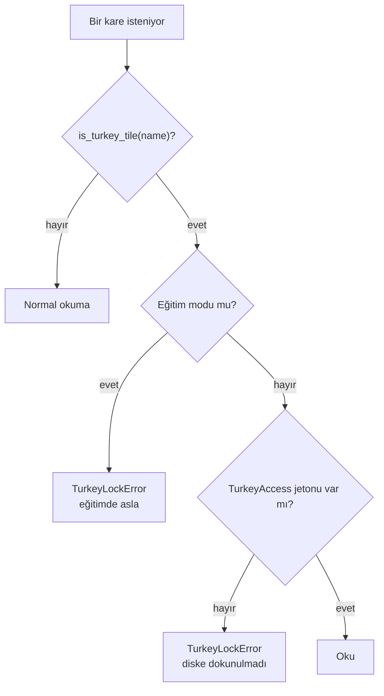

Jeton yalnız bir yerden çıkar: `hasar.guard.require_turkey_access(repo_root)`. Bu fonksiyon dört şeyi denetler:

```text
1. git rev-parse --verify protokol-kilidi^{commit}   → etiket var mı?
2. git rev-parse HEAD                                → şu an hangi commit'teyiz?
3. etiket == HEAD                                    → tam olarak kilitli commit'te miyiz?
4. git status --porcelain boş mu                     → çalışma ağacı temiz mi? (izlenmeyen dosya da kirli sayılır)
→ hepsi tamamsa TurkeyAccess(tag, commit) döner; jeton commit SHA'sını taşır ve sonuç dosyasına yazılır
```

**Neden temiz çalışma ağacı?** Kilitli commit'te olup bir dosyayı elle değiştirmek kilidi delmenin en kolay yolu
olurdu. Temiz ağaç şartı, değerlendirmede çalışan kodun tam olarak etiketlenmiş kod olduğunu garanti eder.

**Neden diske dokunmadan?** Kontrol dosya adına bakılarak, okumadan önce yapılır. Türkiye pikseli yanlışlıkla bile
belleğe girmez.

### 17.3 Git etiketleri: önceden kayıt

**Önceden kayıt** (preregistration), hesap kurallarını sonucu görmeden yazıp kilitlemektir. Bizde iki etiket var:

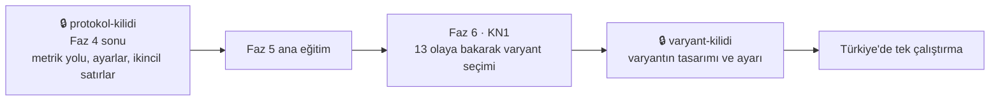

Varyant neden ana modelin Türkiye sonucundan **önce** kilitleniyor? Ana modelin Türkiye'deki hatalarını görüp ona
göre bir iyileştirme seçersek, varyant Türkiye'ye göre ayarlanmış olur.

### 17.4 İki tam eğitim kuralı

On farklı model eğitip Türkiye'de en iyisini raporlarsan, en iyi çıkanın bir kısmı şanstır. Bu, "çatallanan yollar
bahçesi" denen bir sızıntı türüdür. Kural 3: **ana model** (ChangeMamba olduğu gibi) ve **tek fikirli bir varyant**,
her biri bir kez. İki model de raporlanır; Türkiye sonucuna bakarak aralarından seçim yapılmaz.

Neden varyant "tek fikirli"? Bir koşuda üç değişiklik yaparsan hangisinin işe yaradığını ayıramazsın.

### 17.5 İndüktif ve transdüktif

- **İndüktif:** Test verisine hiç bakmadan. Başlık sonucumuz böyle.
- **Transdüktif:** Test verisinin etiketsiz bilgisini kullanarak (ör. Türkiye'nin SAR istatistiği).

Transdüktif işler yasak değil, ama **ayrı bir tabloda** raporlanır ve başlıkla karışmaz. Kural 1'in iki istisnası
var, ikisi de başlığı etkilemez:

1. Faz 3'te hazır zero-shot checkpoint'lerin Türkiye'de yeniden üretimi (bizim eğitimimiz yok, amaç hattı sınamak).
2. Faz 7'de Türkiye'nin etiketsiz SAR istatistikleriyle yapılan Y3 analizi (transdüktif tablo).

**Akılda kalsın**

- Sızıntının en sinsi türleri insan kararı ve deneme sayısıdır.
- `guard`: etiket = HEAD ve temiz ağaç → jeton; jetonsuz Türkiye okunamaz, eğitimde hiç.
- Önceden kayıt: `protokol-kilidi`, sonra `varyant-kilidi`, sonra tek Türkiye çalıştırması.
- Transdüktif işler ayrı tabloda.

**Kendini sına**

<details><summary>Türkiye sonucunu gördükten sonra yeni bir fikir aklına geldi. Ne yaparsın?</summary>

Fikir havuzuna yazarım. Kullanıcı üçüncü bir tam eğitime karar verirse (kural 3 onun kararı) o eğitimin Türkiye
sonucu temiz zero-shot sayılmaz; ayrı bir "keşif" tablosunda raporlanır.
</details>

---

## Ders 18: Belirsizlik ve kalibrasyon

**Bu derste:** Modelin "ne kadar emin olduğunu" ölçmeyi ve bunun neden işe yaradığını.

### 18.1 Güven dürüst mü?

Model bir piksel için "%90 yıkık" diyorsa, böyle dediği piksellerin gerçekten %90'ı yıkık mı? Buna **kalibrasyon**
denir. Derin ağlar genelde **aşırı özgüvenlidir**: %90 dediklerinin örneğin %70'i doğru çıkar.

### 18.2 ECE

**ECE** (beklenen kalibrasyon hatası): Tahminler güvenlerine göre 15 eşit genişlikte kutuya ayrılır; her kutuda
ortalama güven ile gerçek doğruluk arasındaki fark, kutunun büyüklüğüyle ağırlıklandırılıp toplanır.

```
kutu [0,87–0,93]:  ortalama güven 0,90   gerçek doğruluk 0,70   → fark 0,20 (aşırı özgüven)
```

Bizde bina pikselleri (etiket 1–3) üzerinde hesaplanır.

### 18.3 Sıcaklık ölçekleme

Logitleri tek bir sayıya böleriz: `softmax(logit / T)`. `T > 1` güveni yumuşatır, `T < 1` keskinleştirir; argmax'ı
değiştirmez, yalnız güveni düzeltir. T **yalnız 13 olayın doğrulamasında** seçilir; Türkiye'de yalnız ölçülür.

### 18.4 Bina belirsizliği ve risk-kapsam eğrisi

Flip TTA'nın dört tahmini birbirini tutmuyorsa model kararsızdır. Ortalama olasılığın **entropisi** her bina için bir
belirsizlik puanı verir. Sonra:

```
Binaları en emin olduğumuzdan en az emin olduğumuza sırala.
En emin %10'da hata oranı? %20'de? ... %100'de?
→ risk-kapsam eğrisi; altındaki alan AURC (küçük = iyi)
```

Bu eğri Y2'nin (analist bütçesi) temelidir: "Uzman yalnız %10 binaya bakabiliyorsa, modelin en emin olmadığı %10'u
mu, en yıkık gördüğü %10'u mu göstermeli?"

**Akılda kalsın**

- Kalibrasyon: güven ile doğruluğun uyumu; ECE ile ölçülür.
- Sıcaklık 13 olayda seçilir, Türkiye'de yalnız ölçülür.
- TTA entropisi → bina belirsizliği → risk-kapsam eğrisi → Y2.

---

# Bölüm V · Mühendislik

## Ders 19: Kod mimarisi

**Bu derste:** Paketleri, aralarındaki tek yönlü bağımlılığı ve bu düzenin hangi hataları imkânsız kıldığını.

### 19.1 Paketler

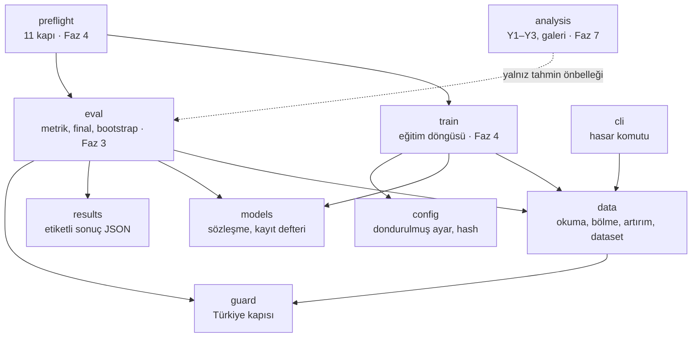

### 19.2 Kurallar ve gerekçeleri

| Kural | Neyi önler |
|---|---|
| `data` ve `models` birbirini bilmez | Veri hattının belirli bir modele göre şekillenmesi; model değişince veri kodunun bozulması |
| `train` ikisini birleştirir | Birleştirme mantığı tek yerde kalır |
| `eval`, `train`'i import etmez | Değerlendirmenin eğitim koduna (ve onun hatalarına) bağımlı olması |
| `analysis` modeli değil tahmin dosyalarını okur | Türkiye'de modelin ikinci kez çalıştırılması |
| Türkiye karesine her yol `guard`'dan geçer | Kilidin bir yan kapıdan delinmesi |

**Tek çıkarım, çok analiz:**

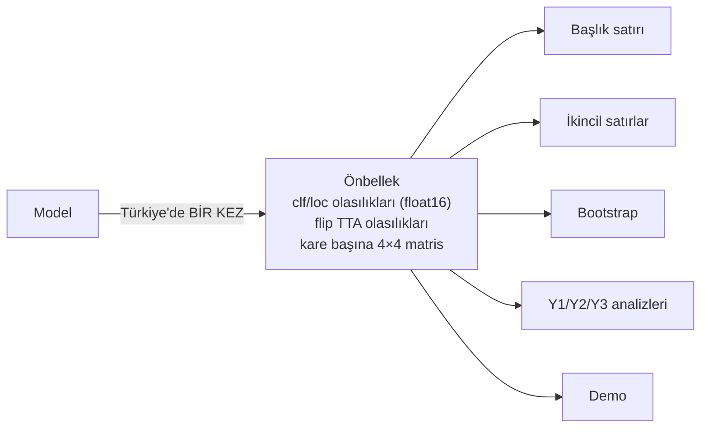

### 19.3 Bilerek eklenmeyenler

Hydra (ayar çerçevesi), eklenti sistemi, soyut Trainer sınıf hiyerarşisi. Tek kişilik, 16 haftalık bir projede bunlar
okunurluğu düşürür. Kural: **en basit çalışan yapı.**

### 19.4 Dosya dosya bugünkü kod

| Dosya | Görevi |
|---|---|
| `config.py` | YAML → dondurulmuş dataclass'lar; bilinmeyen anahtarı reddeder; `config_hash`, `run_id` |
| `results.py` | `ResultRecord`; etiket zorunlu; atomik yazma |
| `guard.py` | `is_turkey_tile`, `require_turkey_access` → `TurkeyAccess` |
| `models/base.py` | Model sözleşmesi, `validate_output` |
| `models/registry.py` | `register`, `build`, `available` |
| `data/events.py` | Olay adı, zero-shot bölme, sızıntı denetimi, liste özeti |
| `data/io.py` | GeoTIFF okuma, nodata maskesi, coğrafi meta veri |
| `data/transforms.py` | Eşleşik kırpma, flip, rot90 |
| `data/sampler.py` | `rng_for`, `StepSampler` |
| `data/normalize.py` | ImageNet, SAR'ın iki biçimi, akışlı SAR istatistiği |
| `data/dataset.py` | `BrightDataset` |
| `data/download.py` | HF'ten indirme, `.done` işaretli güvenli açma |
| `data/summary.py` | Sınıf histogramı, bölme raporu |
| `cli.py` | `hasar indir`, `hasar veri-ozet` |

---

## Ders 20: Yapılandırma, config hash ve sonuç şeması

**Bu derste:** Ayarların nasıl dondurulduğunu, bir koşunun kimliğini ve her sayının nasıl kaynağıyla birlikte
saklandığını.

### 20.1 Tek YAML, dondurulmuş

Bütün ayarlar `configs/ana.yaml`'da, her alan açıkça yazılı. Yükleyici (`load_config`):

- Her bölümü (`data`, `optim`, `train`, ...) **dondurulmuş** (`frozen=True`) bir dataclass'a çevirir. Yüklendikten
  sonra hiçbir kod bir ayarı sessizce değiştiremez.
- **Bilinmeyen anahtarı reddeder** ve yolunu söyler: `train.stpes` gibi bir yazım hatası sessizce varsayılana düşmez.
- Tip denetimi yapar (sayı beklenen yerde `true` kabul edilmez) ve değerleri sınar (ör. `data.test_event` yalnız
  `turkey-earthquake` olabilir).

### 20.2 Config hash ve run_id

```
config_hash = sha256(ayarların anahtar sıralı JSON'u) → ilk 12 hane
run_id      = "<deney>-<config_hash>"         biçim: ana-xxxxxxxxxxxx
```

Tek bir ayar değişirse kimlik de değişir. Bir sonuç dosyasındaki `config_hash`, o sayının tam olarak hangi ayarlarla
üretildiğini söyler. Ön kontrol sonuçları da hash'e bağlıdır; ayar değişmediyse tekrar koşulmaz.

### 20.3 Sonuç kaydı

Her raporlanan sayı bir `ResultRecord` olarak `results/` altına yazılır. Alanları:

```text
metric_tag    "[ZS-EVENT mIoU]"                  zorunlu, tanınan bir taban
values        {"miou": ..., "iou_bg": ..., ...}  boş olamaz, her değer sonlu sayı
model         "changemamba_mmbda_tiny"
split         hangi küme
commit        kilitli commit SHA'sı
config_hash   12 hane
seed          42
extra         ek bilgi
created_at    UTC zaman damgası
```

Kurallar kodda: `metric_tag` yoksa ya da tanınmıyorsa kayıt **oluşturulamaz** ve okunamaz; `NaN` yazılamaz; `model`,
`split`, `commit`, `config_hash` boş olamaz.

**Atomik yazma:** Metin önce aynı klasörde geçici bir dosyaya yazılır, `flush` ve `fsync` ile diske indirilir, sonra
`os.replace` ile tek hamlede asıl adına taşınır. Yarım yazılmış bir sonuç dosyası asla kalmaz.

**Metrik olmayan dosyalar:** `results/veri/` ve `results/arastirma/` altındaki sayım ve araştırma dosyaları metrik
etiketi yerine `kind` alanı taşır (`data-summary`, `research`). Onlardaki sayılar 41,28 ile kıyaslanmaz.

**Kural 5'in anlamı:** README'deki her sayı bu dosyalardan üretilecek. Elle yazılmış bir sayı, kaynağı belirsiz bir
sayıdır.

---

## Ders 21: Test, kalite ve orkestra

**Bu derste:** Testlerimizin nasıl kurulduğunu, neden kısa ve verisiz olduğunu ve kodun nasıl yazıldığını.

### 21.1 Verisiz, kısa testler

- **288 test, ~4 saniye.** Hiçbiri gerçek veri istemez: Testler küçük **sentetik GeoTIFF**'ler üretir.
- Gerçek dosya olarak yalnız git'teki BRIGHT bölme listeleri okunur (2.795 / 337 / 1.114 sayıları bununla sınanır).
- Uzun test yok. Uzun ve pahalı kontroller ön kontrol kapılarında, Colab'da koşar.

### 21.2 Neyi sınıyoruz? Birkaç örnek

| Test | Neyi garanti eder |
|---|---|
| `event_of("la_palma-volcano_00000001") == "la_palma-volcano"` | Olay adı tuzağı |
| Zero-shot bölme 2.795 / 337 / 1.114 | Bölme mantığı |
| Türkiye karesi eğitim listesinde → `SplitLeakError` | Sızıntı denetimi |
| Jetonsuz Türkiye okuma → hata, dosya açılmadı | Kapı diske dokunmadan çalışıyor |
| Artırımdan sonra optik, SAR, etiket hâlâ hizalı | Eşleşik artırım |
| Aynı `(seed, örnek_no)` → aynı kırpma | Tekrarlanabilirlik |
| `start_step` ile devam = kesintisiz dizinin kuyruğu | Kopmaya dayanıklılık |
| Etiketsiz `ResultRecord` → hata | Kural 4 |
| CRLF ve LF listelerinin özeti aynı | Windows ve Colab'da aynı kimlik |

### 21.3 TDD: önce kırmızı, sonra yeşil

**Test güdümlü geliştirme:** Önce davranışı tarif eden ve şimdilik **başarısız olan** (kırmızı) test yazılır, sonra
testi geçirecek (yeşil) en basit kod yazılır. Test, kodun ne yapması gerektiğinin yazılı tanımı olur.

### 21.4 Orkestra: kodu kim yazıyor?

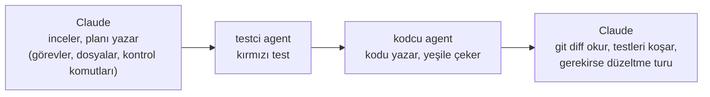

**Faz 2'den ders:** Testler geçtiği hâlde agent kodunda üç sorun vardı ve inceleme sırasında yakalandı: SAR
istatistiği bütün pikselleri belleğe topluyordu (Colab'da taşardı), `BrightDataset` varsayılanları reçeteden
farklıydı, indirme fonksiyonunda bir parametre eksikti. Ders: **Testler gerekli ama yetmez; kodu okumak da gerekir.**

### 21.5 Kalite araçları

- `ruff`: biçim ve hata denetimi (satır uzunluğu 120).
- `pytest`: testler.
- `nbstripout`: notebook çıktılarını git'e sokmaz.
- GitHub Actions: her push'ta CPU'da `ruff` + `pytest`.

---

## Ders 22: Colab ortamı ve kopmaya dayanıklılık

**Bu derste:** Eğitimin koşacağı ortamı, notebook'un yapısını ve bütçeyi.

### 22.1 Ortam

- **Eğitim:** Colab, A100 GPU. Colab'ın kurulu `torch` ve `timm` sürümleri kullanılır; yeniden kurulmaz.
- **High-RAM kapalı:** Açmak CU yakımını ~%39 artırır. Bu yüzden kod bellekte tutumlu (akışlı istatistik gibi).
- **Veri:** Her oturumda Hugging Face'ten VM diskine indirilir (~13,2 GB).
- **Yerel:** RTX 4060 8 GB yalnız hata ayıklama ve küçük denemeler için.

### 22.2 İnce notebook: 7 hücre

Notebook mantık içermez; `src/hasar` paketini çağırır. "Run All" ile baştan sona koşar ve kopmadan sonra tekrar
"Run All" aynı sonucu verir.

| Hücre | İş | Kopmadan sonra |
|---|---|---|
| 1 | Drive'ı bağla, etiketli commit'i klonla, `pip install -e .`, sırları oku | Commit SHA kaydedilir, kirli ağaç reddedilir |
| 2 | Ortam kapısı: A100, VRAM, High-RAM kapalı, disk ≥ 60 GB | Koşul tutmazsa durur |
| 3 | Veriyi indir, aç, bütünlüğü denetle | `.done` işareti varsa atlanır |
| 4 | Ön kontrol kapıları → `preflight.json` | Config hash aynıysa atlanır |
| 5 | Ana eğitim | `latest.pt` varsa tam durumla devam |
| 6 | Türkiye'de tek değerlendirme | Eğitim `DONE` değilse çalışmaz |
| 7 | Kopyalar doğrulanınca çalışma zamanını bırak | CU yakımı durur |

### 22.3 Güvenli indirme

`hasar indir` (`data/download.py`):

- Zip'i indirir ve açar; bittiğinde `.<ad>.done` işareti bırakır. İşaret varsa tekrar açmaz.
- **Zip-slip** korumalı: Arşivdeki bir dosya adı `../../` ile hedef klasörün dışına yazmaya çalışırsa reddedilir.

### 22.4 Bütçe (henüz ölçülmedi, tahmin)

| Adım | Süre | CU |
|---|---|---|
| Ortam, veri, yeniden üretim | 1–1,5 sa | 5–8 |
| Çekirdek derleme kapısı | ≤ 1 sa | ≤ 5,4 |
| Ön kontrol + 2.000 adım prova | 1–1,5 sa | 5–8 |
| **Ana eğitim, 40.000 adım** | 9–14 sa | **50–75** |
| Türkiye değerlendirmesi, TTA, ONNX | 0,5–1 sa | 3–5 |

Colab Pro ayda 100 CU (₺165,60), oturum en çok 12 saat, tarayıcı açık kalmalı. Pro+ ayda 600 CU (₺826,80), tarayıcı
kapalıyken 24 saat. İki tam eğitim (~115–175 CU) aynı aya düşmemeli: hazırlık birinci ayda, ana eğitim ikinci ayın
taze CU'suyla.

---

## Ders 23: Ön kontrol kapıları

**Bu derste:** Pahalı ve tek seferlik eğitimden önce koşan 11 kontrolü ve her birinin neyi yakaladığını.

Ana eğitim 50–75 CU ve tek seferlik. Bir hata eğitimin ortasında fark edilirse bütçe gider; kural 3 yüzünden de
tekrar şansı kısıtlıdır. Bu yüzden eğitimden önce ~1–1,5 saatlik bir kontrol listesi koşar; biri kırmızıysa eğitim
başlamaz.

| # | Kapı | Beklenen | Neyi yakalar |
|---|---|---|---|
| 1 | Hazır checkpoint'ler Türkiye'de | 38,32 / 37,82 / 37,20'ye yakın | Veri ya da metrik hattındaki hata |
| 2 | Bölme | 2.795 / 337 / 1.114, eğitimde Türkiye yok | Bölme hatası, sızıntı |
| 3 | Yükleyici uzunluğu | adım × batch | `max_iters` tuzağı |
| 4 | Başlangıç kaybı | hasar ≈ ln 4 = 1,386, bina ≈ ln 2 = 0,693 | Yanlış başlatma, yanlış etiket |
| 5 | Ezberleme | Artırım kapalı 8 kare, 300–500 adımda ezberlenmeli | Model öğrenemiyor (kopuk bağlantı, yanlış kayıp) |
| 6 | SAR bağlı mı | SAR sıfırlanınca hasar çıktısı değişmeli | SAR dalı modele bağlı değil |
| 7 | Metrik uç durumları | Kusursuz = 1,0; hep arka plan ≈ 0,226 | Metrik hatası |
| 8 | Hız ve bütçe | 200 adımda hız, VRAM, CU projeksiyonu | Bütçe aşımı |
| 9 | Gradyan normu | 2× lr ile 500 adım, p90 | Kırpma eşiği |
| 10 | Devam testi | 60. adımda öldür, devam et; her şey aynı | Kopma sonrası tutarsızlık |
| 11 | Çekirdek derleme | ≤ 1 saat | Yedeğe geçiş kararı |

**Kapı 5'in mantığı:** Sağlıklı bir model 8 kareyi kolayca ezberleyebilmelidir. Ezberleyemiyorsa sorun veride,
kayıpta ya da modelin bağlantısındadır; büyük eğitim de öğrenemez.

**Kapı 6'nın mantığı:** SAR dalı yanlışlıkla bağlanmamışsa model yalnız optikten tahmin yapar ve eğitim yine
"çalışır"; hata fark edilmez. SAR'ı sıfırlayınca çıktı hiç değişmiyorsa radar kullanılmıyor demektir.

---

# Bölüm VI · Yol haritası

## Ders 24: Fazlar 0–9 hikâye olarak

**Bu derste:** Projenin baştan sona akışını; her fazın neden o sırada olduğunu.

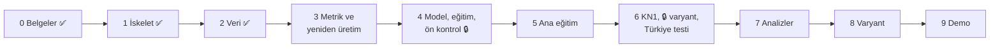

**Faz 0 · Belgeler (bitti).** Kod yazılırken sessizce karara dönüşecek belirsizlikleri önceden yazıya geçirdik: 6
ADR, protokol taslağı, lisans tablosu, risk kaydı, SAR notu. BRIGHT ve ChangeMamba kodunu okuyunca üç şey öğrendik:
gerçek bölme 2.795 eğitim karesi (eski tahmin 2.141), resmî kod SAR'ı ImageNet istatistikleriyle normalize ediyor,
"hep arka plan" mIoU'su sabit değil, arka plan oranı / 4.

**Faz 1 · İskelet (bitti).** Kuralları insan dikkatine değil koda emanet ettik: dondurulmuş ayar, etiketsiz sonucu
reddeden şema, Türkiye jetonu, model sözleşmesi, CI. 125 test.

**Faz 2 · Veri katmanı (bitti).** Modelin gördüğü her piksel buradan geçer; veri hatası en sinsi hatadır (model yine
eğitilir, yalnız yanlış şeyi öğrenir). 8 modül, iki komut, dört araştırma (SAR ölçeği, bina örnekleri, Türkiye
blokları, Sentinel-1 fizibilitesi). 288 test.

**Faz 3 · Metrik ve yeniden üretim (sırada, ilk Colab, ~5–8 CU).** Kendi modelimizi eğitmeden önce hattın doğru
olduğunu kanıtlarız: Zenodo'daki hazır zero-shot checkpoint'leri (SiamCRNN, UNet, DamageFormer) bizim veri ve metrik
kodumuzdan geçirip yayımlanmış sayıları (38,32 / 37,82 / 37,20 `[ZS-EVENT mIoU]`) ±0,3 içinde almalıyız. Tutmazsa
hata bizdedir ve sonraki faza geçilmez. Aynı checkpoint'lerin 13 olaydaki çıktıları da saklanır (topluluk adayı B2).

**Faz 4 · Model, eğitim motoru, ön kontrol (~10–15 CU).** Çekirdek derleme kapısı, 10 dakikalık ONNX denemesi, eğitim
döngüsü, A3 ölçümü, notebook, 11 kapı. Protokolün son hâli → **`protokol-kilidi`**.

**Faz 5 · Ana eğitim (50–75 CU).** ChangeMamba olduğu gibi, 40.000 adım, yeni ayın CU'suyla. Türkiye'ye dokunulmaz.

**Faz 6 · Karar ve Türkiye (< 5 CU).** Sıra kritik: Önce KN1'de 13 olayın sonuçlarına bakarak varyant seçilir, sonra
**`varyant-kilidi`**, ancak ondan sonra ana model Türkiye'de bir kez çalışır. Sonuç ne olursa olsun yazılır.

**Faz 7 · Analizler (2–5 CU).** Önbellekten Y1, Y2, Y3, SAR hata galerisi. KN2: raporlama derinliği.

**Faz 8 · Varyant (50–75 CU).** Kilitli varyant aynı reçeteyle bir kez eğitilir, Türkiye'de bir kez test edilir. Fark
"eşit" kuralına göre yazılır. KN3: README ve demoya ne girer.

**Faz 9 · Demo (< 2 CU).** Gerçek 6 Şubat verisiyle (BRIGHT'ın Türkiye kareleri) harita demosu: önce/sonra, tahmin,
üç referans. Model kartı, lisans tablosu, README (her sayı `results/`'tan). İstanbul hasar demosu yok: deprem
olmadığı için afet sonrası görüntü yok.

---

## Ders 25: Yenilik paketi ve fikir havuzu

**Bu derste:** Projenin yeniliğinin nerede olduğunu ve fikirlerin nasıl seçileceğini.

### 25.1 Araştırmanın üç dersi

1. "Türkiye'yi görmeden test" tek başına özgün değil; başkaları da yaptı.
2. Mimariler arası fark Türkiye'de gürültü düzeyinde (1–3 puan, tek koşu).
3. Sonucu asıl belirleyen değerlendirme kararları.

Bu yüzden yenilik, tek doğru eğitimin üstüne kurulan **değerlendirme işlerinde**:

| # | Soru | Neden değerli |
|---|---|---|
| **Y1** | Aynı binalarda BRIGHT etiketi, HOT/OSM yıkık bina katmanı ve öğrenmesiz radar haritası (ARIA DPM) ne kadar anlaşıyor? | "Doğru cevap" da tartışmalı olabilir; model etikete göre yanlış, radara göre doğru olabilir. Çerçeve: iki optik yorum + bir radar sinyali |
| **Y2** | Uzman binaların yalnız %5/%10/%20'sine bakabiliyorsa model hangilerini göstermeli? | Gerçek kullanım: model insanın yanında çalışır. Taban: rastgele sıra ve DPM sırası |
| **Y3** | Türkiye'nin etiketsiz SAR istatistikleriyle giriş yeniden ölçeklenirse ne değişir? | SAR olaydan olaya farklı gerilmiş (Faz 2 ölçümü); transdüktif tablo |
| **Y4** | Tek bir fikir ChangeMamba'yı iyileştiriyor mu? | Kendi mimari katkımız, kilitli ve adil koşullarda |

### 25.2 Fikir havuzu

Fikirler şimdi seçilmedi; ana eğitimin 13 olaydaki sonucuna göre KN1'de seçilecek. Varyant adayları:

| Kod | Fikir | Sezgi |
|---|---|---|
| **A1** | Sentinel-1 koherans kanalı | İki radar çekiminin faz tutarlılığı yıkımda düşer; ek fiziksel kanıt. Fizibilite geçti (14/14 olay) ama 40–80 m pikselde: mahalle ölçeğinde ipucu |
| C2 | Olay dengeli örnekleme | Büyük olaylar eğitimi domine etmesin |
| C3 | Sıralı kayıp | sağlam < hasarlı < yıkık sırasını modele öğretmek |
| **D1** | Ayrı güçlü bina bulucu | Bina bulma hatası hasar metriğini de batırır |
| D2 | Ayak izinde havuzlayan başlık | Bina içinde tek karar |
| D4 | Modalite bırakma | SAR'ın gerçek katkısını ölçmek ve sağlamlaştırmak |

Öncelik: A1, sonra D1. Seçim kuralı: **13 olayın sonucu belirler, Türkiye sonucu belirlemez.** Bütün liste:
[fikir-havuzu.md](fikir-havuzu.md).

### 25.3 Karar noktaları

| Kod | Ne zaman | Karar |
|---|---|---|
| KN1 | Faz 6 başı (Türkiye görülmedi) | Varyant, topluluk, analiz listesi → `varyant-kilidi` |
| KN2 | Faz 7 sonu | Raporlama derinliği; üçüncü eğitim isteniyor mu (keşif etiketiyle) |
| KN3 | Faz 8 sonu | README ve demoya ne girer |

---

## Ders 26: Projeyi anlatmak ve savunmak

**Bu derste:** Projeyi iki dakikada anlatmayı ve en olası soruları cevaplamayı.

### 26.1 İki dakikalık anlatım

> Depremden önceki optik ve depremden sonraki radar uydu görüntüsünden binaların hasar durumunu piksel piksel
> haritalayan bir model eğitiyorum. BRIGHT veri setinin 13 olayıyla eğitip 6 Şubat 2023 depreminde, eğitimde hiç
> görmediği hâlde bir kez test ediyorum; çıpa yayımlanmış ChangeMamba sonucu 41,28 `[ZS-EVENT mIoU]`.
>
> Projenin farkı skor kovalamak değil, sonucun güvenilirliğini kanıtlamak. Değerlendirme kurallarını Türkiye'yi
> görmeden yazıp git etiketiyle kilitliyorum; Türkiye verisine kod düzeyinde yalnız kilitli commit'ten, temiz çalışma
> ağacıyla erişilebiliyor. Önce başkalarının hazır modelleriyle yayımlanmış sayıları yeniden üretip hattımı
> doğruluyorum. Sonucu blok bootstrap güven aralığıyla, sınıf ve bina düzeyinde ve üç farklı referansa göre
> raporluyorum. Küçük farkları "eşit" yazıyorum; olumsuz sonucu da yazıyorum.

### 26.2 Olası sorular

<details><summary>"Neden genel doğruluk değil de mIoU?"</summary>

Piksellerin %90'ı arka plan; hiçbir bina bulmayan model %90 doğruluk alır. mIoU her sınıfa eşit ağırlık verir ve
kaçırmayı da yanlış alarmı da cezalandırır. "Hep arka plan" modelinin mIoU'su ~0,226.
</details>

<details><summary>"Türkiye'yi görmediğinizi nasıl garanti ediyorsunuz?"</summary>

Üç katman: Bölme kodu Türkiye eğitimde bulunursa hata verir. Veri katmanı Türkiye karesini `TurkeyAccess` jetonu
olmadan diske dokunmadan reddeder; jeton yalnız `protokol-kilidi` etiketli, temiz bir çalışma ağacında verilir.
Eğitim modu Türkiye'yi jetonla bile reddeder. Normalizasyon istatistiği ve kayıt noktası seçimi de yalnız 13 olaydan.
Türkiye'yi görmüş başlangıç ağırlıkları yasak.
</details>

<details><summary>"41,28'i geçemezseniz proje başarısız mı?"</summary>

Hayır. Amaç aynı modeli aynı protokolle dürüstçe yeniden eğitip sonucun ne kadar güvenilir olduğunu göstermek. Güven
aralığı 41,28'i içeriyorsa "eşit" yazılır ve bu da bir bulgudur. Yenilik değerlendirme işlerinde (Y1–Y3).
</details>

<details><summary>"Neden yalnız iki eğitim? Daha çok deneseniz daha iyi model bulurdunuz."</summary>

Çok model eğitip Türkiye'de en iyisini raporlamak bir sızıntı türüdür: En iyi çıkanın bir kısmı şanstır. Ayrıca bütçe
sınırlı. Ana model ve tek fikirli bir varyant; ikisi de raporlanır, Türkiye'ye bakarak seçim yapılmaz.
</details>

<details><summary>"Bootstrap'ı neden kare değil blok üzerinden yapıyorsunuz?"</summary>

Komşu kareler ilişkilidir (aynı mahalle, aynı uydu geçişi). Kare birimi onları bağımsız sayar ve aralığı yapay
daraltır. 7 şehir ve 2 km'lik 64 blokla şehre göre katmanlı blok bootstrap öneriyoruz.
</details>

<details><summary>"SAR'ı neden ImageNet istatistikleriyle normalize ediyorsunuz? Fiziksel anlamı yok."</summary>

Doğru, fiziksel anlamı yok. Ama 41,28 bu biçimle elde edildi ve SAR kodlayıcısı ImageNet ağırlıklarıyla başlıyor;
elma-elma kıyas için resmî biçimi koruyoruz. Fiziksel olarak daha anlamlı z-skoru (A3) ayrı bir provada ölçülüyor.
Ayrıca Faz 2'de SAR değerlerinin log/dB benzeri ölçekte olduğunu ölçtük.
</details>

<details><summary>"Modeliniz yeni bir depremde kullanılabilir mi?"</summary>

Bu projenin iddiası bu değil. "Gerçek zamanlı", "saha doğrulamalı", "yeni depremlere genelleniyor" gibi kanıtsız
iddialar anti-hedef. Ölçtüğümüz şey tek bir görülmemiş depremdeki performans ve ona ne kadar güvenilebileceği.
</details>

<details><summary>"Doğrulamada en iyi kayıt noktası testte de en iyi mi?"</summary>

Garantisi yok; CVPRW26'da doğrulama-test sıralama korelasyonu 0,35'ti. Daha iyi yol çok eğitim gerektirdiği için
bütçeye sığmıyor; bu zayıflığı raporda açıkça yazıyoruz.
</details>

### 26.3 Bundan sonra

- Bir terimi unutursan: [proje-haritasi.md](proje-haritasi.md) sonundaki sözlük.
- Bir konuyu derinlemesine okumak için: [ogrenme-rehberi.md](ogrenme-rehberi.md).
- Bir kuralın kesin hâli için: [protokol.md](protokol.md) ve [adr/](adr/README.md).
- Sırada Faz 3 var: metrik kodu ve hazır checkpoint'lerle yeniden üretim (ilk Colab oturumu).

---

*Bu kitap bir anlatımdır. Sayılar `results/` dosyalarından, kurallar [tasarim.md](tasarim.md) ve
[protokol.md](protokol.md)'den gelir. Teknik bir karar değişince ilgili ders de güncellenir.*
