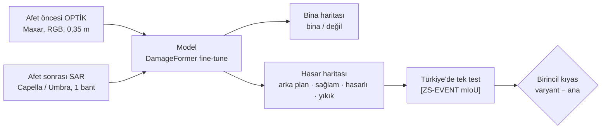
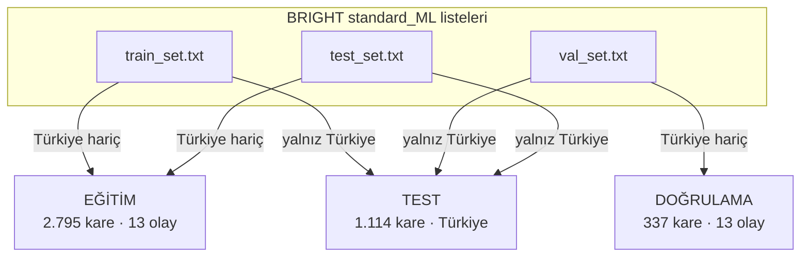
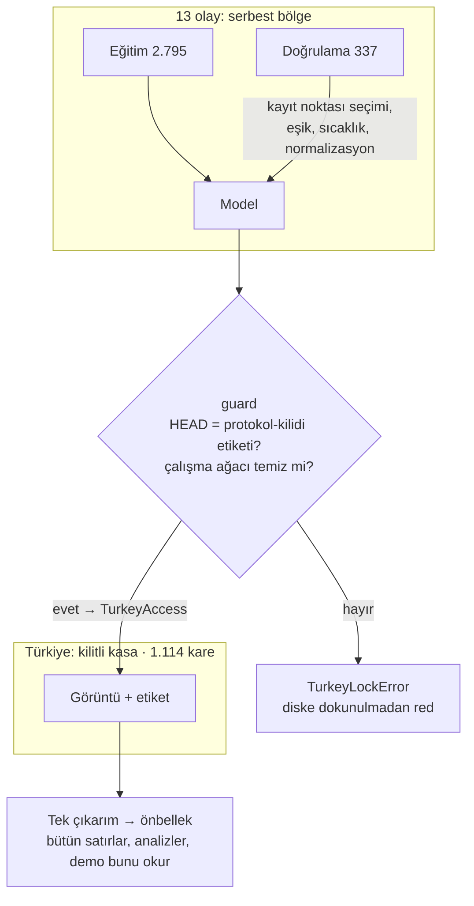
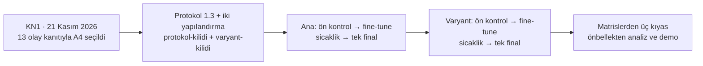
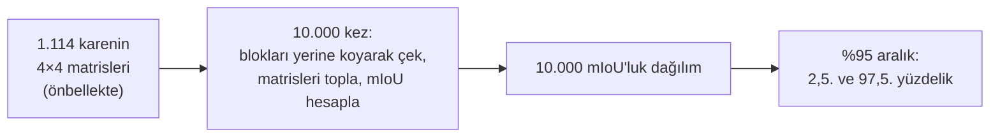
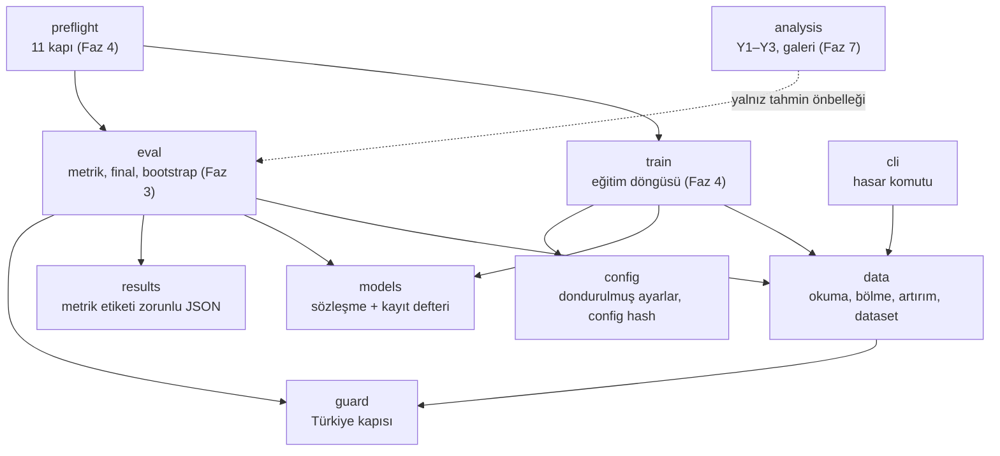
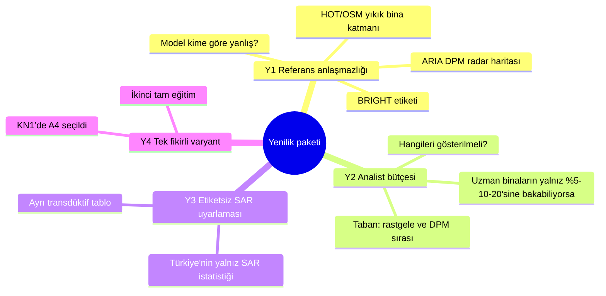

# Proje Haritası: Deprem Hasar Haritası'nın bütün resmi

**Güncelleme:** 21 Kasım 2026; hazır DamageFormer fine-tune planı (ADR-0007).

Bu belge projenin tamamını tek yerde, görsellerle anlatır: ne yapıyoruz, neden böyle yapıyoruz, her parça neye
yarıyor, her faz ne üretiyor. Amacı, projeyi baştan sona savunabilecek kadar hâkim olman.

> **Nasıl okunur?** Bölüm 1–3 büyük resmi verir (10 dakika). Bölüm 4–8 teknik parçaları tek tek açar. Bölüm 9
> fazların yol haritası, Bölüm 10–12 yenilikler, kararlar ve bugüne kadar ölçülenler. Sonda bir sözlük var.
>
> Diyagramlar [Mermaid](https://mermaid.js.org/) ile çizildi. GitHub'da ve VS Code'da (Markdown Preview Mermaid
> eklentisiyle) resim olarak görünür.
>
> **Ders ders öğrenmek için:** [dersler.md](dersler.md) (fine-tune dersi, elle çözülmüş örnekler ve sorular).
> **Derinlemesine anlatım:** [ogrenme-rehberi.md](ogrenme-rehberi.md) (1.500+ satır, her tekniğin "neden"i).
> **Bağlayıcı kararlar:** [tasarim.md](tasarim.md), [protokol.md](protokol.md), [adr/](adr/README.md).
> Bu belge onların haritasıdır; çelişki olursa onlar geçerlidir.

---

## İçindekiler

1. [Tek cümlede proje](#1-tek-cümlede-proje)
2. [Problem ve veri](#2-problem-ve-veri)
3. [Altın kural: Türkiye kilidi](#3-altın-kural-türkiye-kilidi)
4. [Model: hazır DamageFormer](#4-model-hazır-damageformer)
5. [Eğitim reçetesi: her ayar neye yarıyor](#5-eğitim-reçetesi-her-ayar-neye-yarıyor)
6. [Değerlendirme: başarıyı nasıl ölçüyoruz](#6-değerlendirme-başarıyı-nasıl-ölçüyoruz)
7. [Kod mimarisi: hangi modül ne iş yapar](#7-kod-mimarisi-hangi-modül-ne-iş-yapar)
8. [Ön kontrol kapıları: GPU yakmadan önceki 11 sigorta](#8-ön-kontrol-kapıları-gpu-yakmadan-önceki-11-sigorta)
9. [Faz yol haritası (0–9)](#9-faz-yol-haritası-09)
10. [Yenilik paketi ve fikir havuzu](#10-yenilik-paketi-ve-fikir-havuzu)
11. [Bütçe](#11-bütçe)
12. [Bugüne kadar ölçülenler ve açık kararlar](#12-bugüne-kadar-ölçülenler-ve-açık-kararlar)
13. [Sözlük](#13-sözlük)

---

## 1. Tek cümlede proje

**Depremden önce çekilmiş optik uydu fotoğrafı ile depremden sonra çekilmiş radar (SAR) görüntüsünü alıp her
binanın sağlam mı, hasarlı mı, yıkık mı olduğunu piksel piksel haritalayan bir model eğitiyoruz; modeli 6 Şubat
2023 Türkiye depreminde, eğitimde hiç görmediği hâlde, bir kez test ediyoruz.**



Projenin sorusu yalnız "ne kadar iyi?" değil:

> **Model eğitimde hiç görmediği bir depremde ne kadar işe yarıyor ve bu sonuca ne kadar güvenebiliriz?**

Bu yüzden projenin yarısı model eğitmek, öbür yarısı **sonucun dürüstlüğünü garanti eden düzen**: kilitler,
protokol, güven aralıkları, yeniden üretim, üç farklı referansla kıyas.

### Neden bu proje değerli?

| Soru | Cevap |
|---|---|
| Gerçek bir sorun mu? | Depremden sonraki ilk saatlerde hangi binanın yıkıldığını bilmek arama-kurtarmanın önceliğini belirler. Bulut ve gece optik görüntüyü engeller; radar engellenmez. |
| Neden öncesi optik + sonrası radar? | Afet öncesi arşivde optik görüntü neredeyse her yer için var. Afetten hemen sonra en hızlı ve havadan bağımsız gelen görüntü radar. Gerçekçi senaryo bu. |
| Rakiplerden farkı ne? | Rakipler tek bir skor yayımlıyor. Biz skoru **kilitli protokolle**, **güven aralığıyla**, **sınıf ve bina düzeyinde** ve **üç referansa göre** veriyoruz (Bölüm 10). |
| Gerçekçi hedef ne? | SAR fikrinin etkisini kontrol koşusundan ayırmak; farkı ve belirsizliği dürüstçe raporlamak. |

---

## 2. Problem ve veri

### 2.1 İki göz: optik ve radar

```
   OPTİK (pasif)                                   SAR / RADAR (aktif)
   ─────────────                                   ───────────────────
   Güneş ışığının yansımasını kaydeder              Uydu kendi mikrodalgasını gönderir,
   → insan gözünün gördüğüne benzer                 geri dönen yankıyı kaydeder
   ✗ bulut, duman, gece = görüntü yok               ✓ bulut ve geceden etkilenmez
   ✓ binanın ayak izi net                           ✗ benek (speckle), bindirme (layover),
                                                      gölge; yorumlaması zor
   Bizde: AFET ÖNCESİ, 3 bant (RGB)                 Bizde: AFET SONRASI, 1 bant
```

**Hasar radarda nasıl görünür?** Sağlam bir bina duvarı ile zemin, radar dalgasını uyduya geri yansıtan bir köşe
oluşturur (**çift sekme**, parlak iz). Bina yıkılınca bu köşe bozulur, parlak iz dağılır ya da kaybolur. Model bu
farkı öncesi optikteki binanın yerine bakarak öğrenmeye çalışır.

**Dikkat edilecek geometri:** Radar yana bakarak çeker. 5 katlı bir binanın tepe yankısı 0,35 m pikselde yaklaşık
60 piksel kayabilir (**layover**). Yani SAR'daki iz, optikteki ayak izinin tam üstünde olmayabilir. Ayrıntı:
[sar-temelleri.md](sar-temelleri.md).

### 2.2 Veri seti: BRIGHT

| Özellik | Değer |
|---|---|
| Olay | 14 afet: deprem, patlama, yanardağ, yangın, kasırga, sel, savaş |
| Kare | 4.246 çift; her kare 1024 × 1024 piksel, uint8 GeoTIFF |
| Kare başına dosya | `pre-event` (optik, 3 bant), `post-event` (SAR, 1 bant), `target` (etiket) |
| Etiket | Her piksel `0` arka plan, `1` sağlam, `2` hasarlı, `3` yıkık |
| Türkiye | 1.114 kare, 135.033 bina; UTM 37N |
| Boyut | ~13,2 GB zip, açılmış ~22,3 GB; her Colab oturumunda Hugging Face'ten indirilir |
| Lisans | Veri CC BY-SA 4.0; kod Apache-2.0 |

Bir karenin içi:

```
 pre-event (optik)          post-event (SAR)           target (etiket)
 ┌──────────────┐           ┌──────────────┐           ┌──────────────┐
 │ ▢▢  ▢▢▢   ▢  │           │ ░▓░ ░░▓ ░  ░ │           │ 11  122   1  │   0 = arka plan (boş)
 │ ▢▢▢   ▢▢    │           │ ▓░░  ░▒  ░  │           │ 111   33     │   1 = sağlam
 │   ▢▢▢   ▢▢▢ │           │  ░▓░  ░░▓░  │           │   112   111  │   2 = hasarlı
 └──────────────┘           └──────────────┘           └──────────────┘   3 = yıkık
   3 × 1024 × 1024            1 × 1024 × 1024            1024 × 1024
```

**Sınıf dengesizliği büyük.** Eğitim kümesinde piksellerin %90,76'sı arka plan; sağlam %6,67, hasarlı %1,65, yıkık
yalnız %0,92 (`results/veri/bolme.json`). Bu yüzden "genel doğruluk" anlamsızdır (hep "arka plan" diyen model %90
doğru çıkar), metrik olarak mIoU kullanılır (Bölüm 6).

### 2.3 Bölme: 13 olayla öğren, Türkiye'de sına



Bu, BRIGHT'ın `cross_event/zero_shot` mantığıdır ([ADR-0001](adr/0001-zero-shot-bolme.md)). Eğitimdeki 13 olayın
yalnız üçü deprem (Haiti, Fas, Noto). Yani model "deprem hasarını" az örnekle, "hasarı" ise patlamadan selde kadar
farklı afetlerden öğrenir. Türkiye'deki sonuç bu yüzden gerçek bir genelleme sınavıdır.

> **Tuzak:** `standard_ML` bölmesinin kendisinde Türkiye eğitimde de var (777/113/224). Biz o bölmeyi değil,
> zero-shot mantığını kullanıyoruz; kod Türkiye eğitime sızarsa `SplitLeakError` fırlatır.

---

## 3. Altın kural: Türkiye kilidi

Projenin bütün değeri tek bir şeye dayanır: **Türkiye sonucu temiz olmalı.** Türkiye'ye bir kez bakıp bir ayarı
değiştirirsen, ikinci bakışta çıkan sayı artık "görülmemiş deprem" sonucu değildir. Buna **test sızıntısı** denir
ve yayımlanmış birçok çalışmanın sessiz hatasıdır.

### 3.1 Kilit nasıl uygulanıyor?



Kilit üç katmanlı:

| Katman | Ne yapar | Nerede |
|---|---|---|
| **Bölme** | Türkiye karesi eğitim/doğrulamada bulunursa hata | `hasar.data.events.check_no_leak` |
| **Erişim jetonu** | Türkiye karesini okumak için `TurkeyAccess` gerekir; yalnız git `protokol-kilidi` etiketinde ve temiz ağaçta verilir | `hasar.guard`, `hasar.data.io`, `BrightDataset` |
| **Eğitim yasağı** | Eğitim modunda Türkiye jetonla bile reddedilir | `BrightDataset(mode="train")` |

Ret **diske dokunmadan** olur: dosya adına bakılır, Türkiye ise okuma hiç başlamaz. Böylece yanlışlıkla bile
Türkiye pikseli belleğe girmez.

### 3.2 Kilitlerin zaman çizelgesi



İki etiket kullanıcı tarafından aynı commit'e konur. Varyant ana modelin Türkiye sonucundan önce kilitlenir.
Defter `origin/main` kullanır; dal değişiklikleri oraya alınmış olmalı. Ayrıntı: [colab.md](colab.md).

### 3.3 Öteki değişmez kurallar (CLAUDE.md)

| # | Kural | Neyi engeller |
|---|---|---|
| 1 | Türkiye kilitli | Test sızıntısı |
| 2 | Türkiye'yi görmüş ağırlık yok (`*_standard_ML_split.pth`, MaRS) | Önceden eğitilmiş ağırlık yoluyla sızıntı |
| 3 | İki fine-tune: kontrol ve SAR varyantı, her biri bir kez | "Tutana kadar dene" (çok deneyip iyisini seçmek de sızıntıdır) |
| 4 | Her sayının metrik etiketi var | Farklı ölçümleri karıştırıp yanlış kıyas |
| 5 | Sayılar `results/**/*.json`'dan gelir | Elle yazılmış, kaynağı belirsiz sayı |
| 6 | Olumsuz sonuç da yazılır; küçük fark "eşit" | Gürültüyü başarı diye satmak |

---

## 4. Model: hazır DamageFormer

[ADR-0007](adr/0007-ana-model-hazir-damageformer-fine-tune.md), ADR-0002'nin ana model kararının yerine geçti.
Hazır DamageFormer zero-shot checkpoint'i Türkiye'yi görmedi; md5 denetlenir. Özel ChangeMamba çekirdeği gerekmez.

| Satır | Ne yapar? |
|---|---|
| Referans | Hazır model, eğitim yok; 37,20 `[ZS-EVENT mIoU, repro]` (`results/yeniden-uretim/damageformer_test.json`) |
| Ana | Aynı checkpoint'ten kontrol fine-tune'u; SAR artırımı yok |
| Varyant | Aynı checkpoint ve reçete; yalnız eğitimde SAR artırımı |

Model `loc` bina ve `clf` hasar çıktısı verir. Başlık metriği `argmax(clf)` ile maskesiz ve TTA'sız hesaplanır.
Birincil kıyas varyant − ana'dır. İkincil kıyaslar iki koşunun referansa farkıdır. ChangeMamba
41,28 `[ZS-EVENT mIoU]` yalnız bağlamdır. Mimari geçmişi [ders kitabında](dersler.md) anlatılır.

## 5. Eğitim reçetesi: her ayar neye yarıyor

| Ayar | Değer | Amaç |
|---|---|---|
| Kırpma / batch / adım | 512 / 8 / 4.000 | İki koşuda aynı eğitim miktarı |
| AdamW | lr 2e-5, weight decay 5e-3 | Hazır ağırlıkları küçük adımlarla güncellemek |
| Zamanlama | 200 adım ısınma, kosinüs, min lr 1e-7 | Başlangıçta ani güncellemeyi azaltmak |
| EMA / hassasiyet | 0,999 / bf16 | EMA checkpoint'ten başlar |
| Doğrulama | Her 500 adım, yalnız 13 olay | Yalnız izleme; seçim yok |
| Kayıt noktası | Son adımın EMA'sı | Kontrol ve varyanta eşit kural |
| Varyant SAR | p 0,8; gama logUniform[0,67, 1,5], kazanç logUniform[0,657, 1,657] | Olaylar arası radyometrik farka dayanıklılık |

Kaynak: `configs/ana.yaml`, `configs/varyant.yaml`, [tasarım §7](tasarim.md).
SAR sınırları `results/arastirma/sar_olcek.json` ölçümlerinden gelir. Geometri aynı kalır;
SAR artırımı normalizasyondan önce, yalnız eğitimde uygulanır. Nodata 0 korunur.
Hesap örneği: [Fine-tune ve SAR dayanıklılığı](dersler.md#ders-27-fine-tune-ve-sar-dayanıklılığı).

## 6. Değerlendirme: başarıyı nasıl ölçüyoruz

### 6.1 Karışıklık matrisi → IoU → mIoU

Her piksel için (gerçek sınıf, tahmin) çifti 4×4 bir tabloya sayılır. **Bütün Türkiye kareleri boyunca tek tablo
biriktirilir** (olay düzeyi).

```
                      TAHMİN
                 0      1      2      3
            ┌──────┬──────┬──────┬──────┐
         0  │  TP₀ │      │      │      │   IoU_k =        C[k,k]
 GERÇEK  1  │      │  TP₁ │      │      │           ─────────────────────────────
         2  │      │      │  TP₂ │      │           satır_k + sütun_k − C[k,k]
         3  │      │      │      │  TP₃ │
            └──────┴──────┴──────┴──────┘   mIoU = (IoU₀ + IoU₁ + IoU₂ + IoU₃) / 4
```

**IoU = kesişim / birleşim:** "Bu sınıf dediğim yerlerle gerçekten bu sınıf olan yerler ne kadar örtüşüyor?"
Kaçırma da yanlış alarm da cezalandırılır.

**Somut örnek: "hep arka plan" diyen aptal model** (ön kontrol kapısı 7):

```
Arka plan IoU = arka plan piksel oranı = 0,9034  (doğrulama kümesi, results/veri/bolme.json)
Sağlam / hasarlı / yıkık IoU = 0               (hiç tahmin edilmedi)
mIoU = 0,9034 / 4 ≈ 0,226
```

Metrik kodu bu sayıyı vermezse metrikte hata var demektir.

**41,28 ne demek?** Arka plan IoU'su ~95 civarındaysa, `(95 + 3x) / 4 = 41,28` → bina sınıflarının ortalaması
**x ≈ 23 IoU**. Yani en iyi model bile hasar sınıflarında hâlâ zayıf; görev zor.

### 6.2 Başlık metriği (kilitli yol)

1. Türkiye'nin her karesi 1024 × 1024 tam, kırpmadan.
2. `pred = argmax(clf)`; TTA, maske, sıcaklık yok.
3. 4×4 matris 1.114 kare boyunca biriktirilir; etiketi 0–3 dışındaki pikseller girmez.
4. IoU paydasına `1e-7`; 4 sınıfın ortalaması.

Bu yol BRIGHT ve ChangeMamba'nın resmî değerlendirme kodu okunarak yazıldı ([protokol.md](protokol.md) §3).

### 6.3 Metrik etiketleri: elmayla armudu karıştırmamak

| Etiket | Anlamı | 41,28 ile kıyaslanır mı? |
|---|---|---|
| `[ZS-EVENT mIoU]` | Zero-shot, olay düzeyi (Türkiye eğitimde yok) | **Evet, yalnız bu** |
| `[STD-EVENT mIoU]` | Standart bölme, olay düzeyi (Türkiye eğitimde var) | Hayır |
| `[STD-SET mIoU]` | Standart bölme, bütün test kümesi | Hayır |
| `[DFC-TEST mIoU]` | DFC25 yarışması test kümesi | Hayır |
| `[CVPR-TEST segm_AP]` | CVPRW26 örnek segmentasyonu | Hayır (başka görev) |

Yarışmalarda ve makalelerde bu sayılar sık sık karıştırılıyor; bir makaledeki "%60" başka bir bölmenin sayısı
olabilir. Bizim `hasar.results` modülü etiketsiz metrik kaydını **dosyaya yazmayı reddeder**.

### 6.4 Piksel düzeyi ve bina düzeyi

```
 Piksel düzeyi: büyük bina çok piksel = çok ağırlık        Bina düzeyi: her bina bir oy
 ┌────────────────────┐ ┌──┐                              ┌────────────────────┐ ┌──┐
 │   büyük fabrika    │ │ev│  → fabrika metriği domine     │   1 bina           │ │1 │  → eşit söz hakkı
 └────────────────────┘ └──┘                              └────────────────────┘ └──┘
```

Arama-kurtarma için asıl soru "kaç bina yıkık?". Bu yüzden ikincil olarak **bina düzeyi makro F1** raporlanır.

**Bina nasıl tanımlanır?** Faz 2'de ölçtük: etiketteki bitişik pikselleri birleştirip "bina" saymak (bağlı
bileşen) binaların ~%39'unu komşusuyla birleştiriyor. Bu yüzden öneri: BRIGHT'ın CVPRW26 **örnek etiketlerini**
(her binanın ayrı çokgeni) kullanmak. Türkiye'de 1.114 karenin 1.001'inde var.

### 6.5 Güven aralığı: "41,5" ne kadar kesin?

Tek bir sayı yanıltır. Aynı model biraz farklı bir Türkiye örnekleminde 40 de 43 de alabilirdi. Bunu
**bootstrap** ile ölçeriz:



**Neden blok?** Komşu kareler birbirine benzer (aynı mahalle, aynı uydu geçişi). Kareleri tek tek çekmek aralığı
yapay olarak daraltır. Öneri: Türkiye karelerini **7 şehir** ve **2 km'lik 64 blok** olarak grupla; her şehrin
blokları kendi içinde çekilsin (şehre göre katmanlı blok bootstrap). Bu gruplar yalnız GeoTIFF başlığındaki
koordinatlardan çıkarıldı; Türkiye etiketine bakılmadı.

**"Eşit" kuralı (öneri):** Fark 1,0 puanın altındaysa **veya** eşleştirilmiş bootstrap farkının %95 aralığı 0'ı
içeriyorsa "eşit" yazılır.

### 6.6 İkincil satırlar (önceden ilan edildi)

| Satır | Ne yapar | Neden önceden ilan |
|---|---|---|
| Flip TTA | Görüntüyü 4 yönde çevirip tahminlerin ortalamasını alır | Sonradan eklenirse "işe yarayanı seçtik" olur |
| Bina maskeli | `loc` bina değil dediği yerde arka plan | Makaledeki yol; resmî koddan farklı |
| Bina oylaması | Tahmin edilen her binada çoğunluk sınıfı | Bina içinde tutarlı harita |
| Nodata yok sayılmış | Boş SAR pikselleri matrise girmez | Resmî yolun nodata'yı saydığını göstermek için |

Hepsi Faz 6'daki **tek çıkarımın önbelleğinden** hesaplanır; model Türkiye'de ikinci kez çalışmaz.

### 6.7 Belirsizlik ve kalibrasyon

| Kavram | Soru | Kullanım |
|---|---|---|
| **ECE** | Model "%80 eminim" dediğinde %80 doğru mu? | Güvenin dürüstlüğü |
| **Sıcaklık ölçekleme** | Güveni tek bir T ile düzeltmek | T yalnız 13 olayda seçilir |
| **TTA entropisi** | 4 çevirmede tahminler ne kadar tutarsız? | Bina başına belirsizlik |
| **Risk-kapsam eğrisi** | En emin olduğumuz %k binada hata ne? | Y2 analist bütçesi |

---

## 7. Kod mimarisi: hangi modül ne iş yapar

### 7.1 Paketler ve bağımlılık yönü



**Kurallar** ([ADR-0006](adr/0006-moduler-kod-yapisi.md)):

- `data` ve `models` birbirini bilmez; `train` ikisini birleştirir.
- `eval`, `train`'i import etmez (değerlendirme eğitim koduna bağımlı olmamalı).
- `analysis` modeli değil, tahmin dosyalarını okur (Türkiye'de tek çıkarım ilkesi).
- Türkiye karesine giden her yol `guard`'dan geçer.
- Bilerek eklenmeyenler: Hydra, eklenti sistemi, soyut Trainer hiyerarşisi. Basit ve okunur kalsın.

### 7.2 Bugün var olan dosyalar (Faz 1–2)

| Dosya | Ne işe yarar |
|---|---|
| `src/hasar/config.py` | YAML'ı dondurulmuş dataclass'lara okur; `config_hash`, `run_id = <deney>-<hash>` |
| `src/hasar/results.py` | Sonuç JSON şeması; metrik etiketi yoksa ya da tanınmıyorsa yazmaz; atomik yazma |
| `src/hasar/guard.py` | `is_turkey_tile`, `require_turkey_access` → `TurkeyAccess` jetonu (etiket + temiz ağaç) |
| `src/hasar/models/base.py` | Model sözleşmesi: `{"loc": B×2×H×W, "clf": B×4×H×W}` |
| `src/hasar/models/registry.py` | Modeli adıyla kurar (YAML'da tek satır) |
| `src/hasar/data/events.py` | Olay adı (`la_palma-volcano` tuzağı), zero-shot bölme, sızıntı denetimi, liste özeti |
| `src/hasar/data/io.py` | GeoTIFF okuma, nodata maskesi, coğrafi meta veri; Türkiye kapısı diske dokunmadan önce |
| `src/hasar/data/transforms.py` | Optik, SAR, etiket ve maskeye **aynı** kırpma/flip/rot90 |
| `src/hasar/data/sampler.py` | Kopmaya dayanıklı, `adım × batch` uzunluklu örnekleyici |
| `src/hasar/data/normalize.py` | ImageNet normalizasyonu, SAR'ın iki biçimi, akışlı SAR istatistiği (bellekte tek kare) |
| `src/hasar/data/dataset.py` | `BrightDataset`: yukarıdakileri birleştirir; eğitim ve değerlendirme modu |
| `src/hasar/data/download.py` | Hugging Face'ten indirme, `.done` işaretli güvenli açma (zip-slip korumalı) |
| `src/hasar/data/summary.py` | Sınıf histogramı, bölme raporu (yalnız eğitim/doğrulama) |
| `src/hasar/cli.py` | `hasar indir`, `hasar veri-ozet` komutları |
| `configs/ana.yaml` | Bütün varsayılanların açık yazıldığı tek yapılandırma |
| `third_party/bright/` | BRIGHT bölme listeleri, sabit commit'ten |
| `scripts/arastirma/` | Faz 2 araştırma betikleri (paket kullanmaz) |

### 7.3 `BrightDataset` bir örnekte ne döndürür?

```python
ds = BrightDataset(root, names, mode="train", crop=512)
item = ds[(index, sample_no)]     # eğitim: (kare, örnek numarası); değerlendirme: ds[index]

item = {
    "name":  "noto-earthquake_00000032",
    "pre":   float32[3, 512, 512],   # ImageNet ile normalize optik
    "post":  float32[3, 512, 512],   # resmî biçim SAR (train_stats modunda 1 kanal)
    "clf":   int64[512, 512],        # 0..3, nodata = 255
    "loc":   int64[512, 512],        # 0 arka plan, 1 bina, 255 yok say
    "valid": bool[512, 512],         # nodata olmayan pikseller
}
```

### 7.4 Kalite düzeni

- **Testler:** 288 kısa test, ~4 saniye, veri gerektirmez (sentetik GeoTIFF'ler). Uzun test yok.
- **CI:** GitHub Actions, CPU'da `ruff` + `pytest`.
- **Kod nasıl yazılıyor:** Claude inceleyip plan yazar, **orkestra** agent'ları önce kırmızı testi (TDD) sonra
  kodu yazar, Claude doğrular. Faz 2'de agent kodunda testlerin yakalamadığı 3 hata elle düzeltildi (bellek
  taşması, yanlış varsayılanlar, eksik parametre).

---

## 8. Ön kontrol kapıları: GPU yakmadan önceki 11 sigorta

Her fine-tune tek seferliktir. ≤ 15 CU hedefi ölçülmedi; kapı 8 ölçer. Bir kapı kırmızıysa eğitim başlamaz.

| # | Kapı | Neyi yakalar |
|---|---|---|
| 1 | Hazır SiamCRNN / UNet / DamageFormer checkpoint'leri Türkiye'de 38,32 / 37,82 / 37,20'ye yakın | Veri veya metrik hattındaki hata |
| 2 | Kare sayıları 2.795 / 337 / 1.114; eğitimde tek Türkiye karesi yok | Bölme hatası, sızıntı |
| 3 | Veri yükleyici uzunluğu = adım × batch | `max_iters` tuzağı |
| 4 | Yükleme: 74,48 `[VAL13 mIoU, repro]` değerine ±0,3 yakınlık, fp32 ve TTA yok | Yanlış checkpoint veya girdi |
| 5 | Artırım kapalı, 8 kare 300–500 adımda ezberlenmeli | Model öğrenemiyor (bağlantı/kayıp hatası) |
| 6 | SAR sıfırlanınca hasar çıktısı değişmeli | SAR dalı kopuk |
| 7 | Kusursuz tahmin = 1,0; hep arka plan ≈ 0,226 | Metrik hatası |
| 8 | Hız, VRAM ve 15 CU eğitim bütçesi projeksiyonu | Bütçe aşımı |
| 9 | 2× lr ile 500 adımda p90 gradyan normu | Gradyan kırpma eşiği |
| 10 | 60. adımda süreci öldür, devam et; her şey aynı geri gelmeli | Kopma sonrası tutarsızlık |
| 11 | DamageFormer: özel çekirdek gerekmiyor, “uygulanmaz” | Model kaydı |

---

## 9. Faz yol haritası (0–9)

Faz numaraları korunur. Önceki uzun ChangeMamba eğitimi ve daha sonra varyant seçimi planının yerini
iki kilitle başlayan tek Colab akışı aldı. Ayrıntılı plan: [fazlar.md](fazlar.md).

| Faz | İş | Güncel durum / sıra |
|---|---|---|
| 0–2 | Belgeler, iskelet, veri | Tamamlandı |
| 3 | Metrik ve hazır checkpoint yeniden üretimi | Tamamlandı; DamageFormer referansı saklanır |
| 4 | Eğitim motoru, ön kontrol, kilitler | Tamamlandı; protokol 1.3 ve varyant kilitlendi |
| 5 | Ana kontrol fine-tune | Bitti (22 Kasım 2026): 4.000 adım, son adım EMA |
| 6 | Türkiye değerlendirmesi ve kıyas | Bitti: her koşuda `sicaklik` → tek `final` |
| 8 | SAR varyantı fine-tune | Bitti: ana sonrası aynı “Run All” |
| 7 | Analizler | Sonuçlar ve önbellekler hazır olunca |
| 9 | Demo ve ürünleştirme | Önbellekten; README sayıları dosyadan |
| Ek | Türkiye few-shot A/B (protokol 1.4) | Kod bitti; `fewshot-kilidi` ve Colab koşusu kullanıcıda |

`hasar kiyas` ile varyant − ana birincil; ana − referans ve varyant − referans ikincildir.
Üçü de saklanan kare matrislerinden, eşleştirilmiş blok bootstrap ile hesaplanır. “Eşit” kuralı
[protokol §9](protokol.md)'dadır. Türkiye sonucu yeni ayar veya model seçtirmez.

## 10. Yenilik paketi ve fikir havuzu

### 10.1 Yenilik nerede?

Araştırma üç şey gösterdi: "Türkiye'yi görmeden test" tek başına özgün değil; mimariler arası fark Türkiye'de
gürültü düzeyinde; sonucu asıl değerlendirme kararları belirliyor. Bu yüzden yenilik, **tek doğru yapılmış
eğitimin üstüne kurulan değerlendirme işlerinde**:



| # | Soru | Neden değerli | Ek tam eğitim |
|---|---|---|---|
| **Y1** | Aynı binalarda üç referans ne kadar anlaşıyor? | "Doğru cevap" da tartışmalı olabilir; model belki etikete göre yanlış, radara göre doğru. Çerçeve: iki optik yorum + bir radar sinyali | 0 |
| **Y2** | Sınırlı uzman zamanında model hangi binaları göstermeli? | Gerçek kullanım senaryosu: model insanın yerine değil, yanında çalışır | 0 |
| **Y3** | Türkiye'nin etiketsiz SAR istatistikleriyle giriş yeniden ölçeklenirse ne olur? | SAR olaydan olaya farklı gerilmiş (Faz 2 ölçümü); ayrı tabloda, başlığı etkilemez | 0 |
| **Y4** | SAR artırımı kontrol fine-tune’una göre ne değiştiriyor? | A4, aynı checkpoint ve reçeteyle kilitli koşullarda | 1 |

### 10.2 Fikir havuzu ve karar noktaları

KN1 kapandı: kullanıcı A4 SAR radyometrik dayanıklılığını 21 Kasım 2026'da seçti. Kanıt yalnız 13 olayın
SAR ölçeği ve hazır model doğrulaması. Topluluk 1.3 kapsamı dışında; diğer adaylar
[fikir-havuzu.md](fikir-havuzu.md)'de saklanır. KN2 analizlerin derinliğini, KN3 README ve demoda raporlanacak
bulguları ele alır. Türkiye sonucuna göre yeniden eğitim veya ayar yapılmaz.

## 11. Bütçe

ChangeMamba için Colab L4 kapı 8 projeksiyonu 164,6 CU > 75 CU çıktı; uzun eğitim başlamadı.
Yeni hedef her fine-tune için yaklaşık 1–2 saat, ≤ 15 CU. **Ölçülmedi, kapı 8 ölçer.**
Kapı 8'in eğitim projeksiyonuna ön kontrol dahil değildir. İki koşu ve ön kontrollerle toplam hedef
Colab Pro'nun aylık 100 CU'su içinde kalmak. Süre ve maliyet gerçekleşmiş sonuç gibi yazılmaz.

## 12. Bugüne kadar ölçülenler ve açık kararlar

### 12.1 Faz 2 ölçümleri

Hepsi 13 olaydan ya da Türkiye'nin yalnız dosya adı/koordinatından; Türkiye etiketine ve pikseline bakılmadı.

| Konu | Bulgu | Ne değiştirdi | Kaynak |
|---|---|---|---|
| Bölme | 2.795 / 337 / 1.114; doğrulamada arka plan %90,34 | Kapı 7'nin beklenen değeri ≈ 0,226 | `results/veri/bolme.json` |
| SAR ölçeği | Doğrusal genlik değil, log/dB benzeri (benek eğimi 0,2; çarpımsal benekte ~1 beklenir); olay ortalamaları 41–104 | dB dönüşümü gerekmez; A3 (z-skoru) desteklendi | `results/arastirma/sar_olcek.json` |
| Bina örnekleri | CVPRW26 örnek etiketleri 10 eğitim olayında, Türkiye'de 1.001/1.114 karede | Bina düzeyi metrik önerisi | `ornek_etiket_kapsami.json` |
| Bitişik binalar | Bağlı bileşen / bina = 0,61 (~%39 birleşiyor) | Bağlı bileşen bina birimi olamaz | `bina_birlesme.json` |
| Türkiye'nin dağılımı | 7 şehir, 2 km'de 64 blok | Şehre göre katmanlı blok bootstrap önerisi | `turkiye_bloklar.json` |
| A1 fizibilitesi | 14/14 olayda Sentinel-1 çifti; ilk sonrası çekim 0–8 gün | A1 varyant adayı olarak yaşıyor | `s1_kapsam.json` |

### 12.2 Güncel karar ve sıradaki iş

İki zero-shot fine-tune'u bitti ve Türkiye'de birer kez değerlendirildi (22 Kasım 2026). Ana model hazır referansı
geçti; SAR varyantı ana ile "eşit" çıktı. Kazanç sağlam sınıfından geldi, hasarlı ve yıkık sınıflar hâlâ çok zayıf.
Sayılar [durum.md](durum.md)'de ve `results/` dosyalarında.

Kullanıcı 23 Kasım 2026'da bu açığı hedefleyen few-shot ek deneyini onayladı (protokol 1.4 §15,
[ADR-0008](adr/0008-turkiye-few-shot-ek-deneyi.md)): Türkiye'nin blok bazlı ~%20'lik uyarlama bölgesiyle iki kol,
A düz kayıp, B hasar ağırlıklı kayıp. Zero-shot sonuçları bundan etkilenmez; few-shot sonuçları `[FS-EVENT mIoU]`
etiketiyle ayrı tabloda raporlanır. Sırada kullanıcının `fewshot-kilidi` etiketi ve Colab koşusu var.

## 13. Sözlük

| Terim | Anlamı |
|---|---|
| **SAR** | Sentetik açıklıklı radar. Uydunun kendi gönderdiği mikrodalganın yankısını kaydeder; bulut ve gece fark etmez |
| **Benek (speckle)** | SAR'daki tuz-biber görünümlü, çarpımsal gürültü |
| **Layover / bindirme** | Yüksek yapının tepesinin radarda yere göre kaymış görünmesi |
| **Çift sekme** | Duvar + zemin köşesinden dönen parlak radar yankısı; yıkımda bozulur |
| **Koherans** | İki radar çekiminin faz tutarlılığı; yüzey değişince düşer (A1) |
| **GeoTIFF / EPSG** | Koordinatlı görüntü dosyası / koordinat sisteminin kodu (Türkiye EPSG:32637, UTM 37N) |
| **Nodata** | Görüntünün boş (0) kısmı; eğitimde yok sayılır |
| **Zero-shot** | Test olayını eğitimde hiç görmeden değerlendirmek |
| **Sızıntı (leakage)** | Test bilgisinin herhangi bir yoldan eğitime ya da seçime karışması |
| **Semantik segmentasyon** | Her piksele bir sınıf atamak |
| **Kodlayıcı / çözücü** | Görüntüden özellik çıkaran / özellikten haritaya geri dönen ağ parçası |
| **Mamba / VMamba** | Uzun bağlamı doğrusal maliyetle işleyen durum-uzay modeli; VMamba görüntü sürümü |
| **Logit / softmax / argmax** | Ham puan / puanı olasılığa çeviren fonksiyon / en yüksek olasılıklı sınıfı seçmek |
| **CE / Lovász** | Çapraz entropi kaybı / IoU'yu doğrudan iyileştiren kayıp |
| **AdamW** | Uyarlanır öğrenme oranlı optimizer, ağırlık bozunumu ayrık |
| **Isınma + kosinüs** | Öğrenme oranını önce yavaşça artırıp sonra kosinüs eğrisiyle azaltmak |
| **bf16** | 16 bitlik sayı biçimi; hız ve bellek kazancı |
| **EMA** | Ağırlıkların üstel hareketli ortalaması |
| **Kayıt noktası (checkpoint)** | Eğitimin kaydedilmiş anlık durumu |
| **TTA** | Test zamanı artırımı: görüntüyü çevirip tahminleri ortalamak |
| **IoU / mIoU** | Kesişim / birleşim; sınıfların IoU ortalaması |
| **Olay düzeyi** | Karışıklık matrisini bir olayın bütün kareleri boyunca biriktirmek |
| **Makro F1** | Her sınıfın F1'inin eşit ağırlıklı ortalaması |
| **Bootstrap** | Veriyi yerine koyarak yeniden örnekleyip belirsizliği ölçmek |
| **Eşleştirilmiş bootstrap** | İki modelin farkını aynı örneklemlerle ölçmek |
| **ECE** | Beklenen kalibrasyon hatası: güven ile doğruluk arasındaki fark |
| **İndüktif / transdüktif** | Test verisine hiç bakmadan / test verisinin etiketsiz bilgisini kullanarak |
| **CU** | Colab hesaplama birimi; A100 saatte ~5,40 CU |
| **ADR** | Mimari karar kaydı: bir kararın neden verildiği |
| **Önceden kayıt** | Hesap kurallarını sonucu görmeden yazıp kilitlemek |
| **KN1–KN3** | Karar noktaları (Bölüm 10.2) |
| **Orkestra** | Kodu yazan agent takımı; Claude plan yazar ve doğrular |

---

*Bu belge bir haritadır. Sayılar `results/` dosyalarından, kurallar [tasarim.md](tasarim.md) ve
[protokol.md](protokol.md)'den gelir; teknik bir karar değişince burası da güncellenir.*
