# Proje Haritası: Deprem Hasar Haritası'nın bütün resmi

**Sürüm:** 1 (7 Kasım 2026, Faz 2 sonu)

Bu belge projenin tamamını tek yerde, görsellerle anlatır: ne yapıyoruz, neden böyle yapıyoruz, her parça neye
yarıyor, her faz ne üretiyor. Amacı, projeyi baştan sona savunabilecek kadar hâkim olman.

> **Nasıl okunur?** Bölüm 1–3 büyük resmi verir (10 dakika). Bölüm 4–8 teknik parçaları tek tek açar. Bölüm 9
> fazların yol haritası, Bölüm 10–12 yenilikler, kararlar ve bugüne kadar ölçülenler. Sonda bir sözlük var.
>
> Diyagramlar [Mermaid](https://mermaid.js.org/) ile çizildi. GitHub'da ve VS Code'da (Markdown Preview Mermaid
> eklentisiyle) resim olarak görünür.
>
> **Ders ders öğrenmek için:** [dersler.md](dersler.md) (26 ders, elle çözülmüş örnekler ve sorular).
> **Derinlemesine anlatım:** [ogrenme-rehberi.md](ogrenme-rehberi.md) (1.500+ satır, her tekniğin "neden"i).
> **Bağlayıcı kararlar:** [tasarim.md](tasarim.md), [protokol.md](protokol.md), [adr/](adr/README.md).
> Bu belge onların haritasıdır; çelişki olursa onlar geçerlidir.

---

## İçindekiler

1. [Tek cümlede proje](#1-tek-cümlede-proje)
2. [Problem ve veri](#2-problem-ve-veri)
3. [Altın kural: Türkiye kilidi](#3-altın-kural-türkiye-kilidi)
4. [Model: ChangeMamba-MMBDA](#4-model-changemamba-mmbda)
5. [Eğitim reçetesi: her ayar neye yarıyor](#5-eğitim-reçetesi-her-ayar-neye-yarıyor)
6. [Değerlendirme: başarıyı nasıl ölçüyoruz](#6-değerlendirme-başarıyı-nasıl-ölçüyoruz)
7. [Kod mimarisi: hangi modül ne iş yapar](#7-kod-mimarisi-hangi-modül-ne-iş-yapar)
8. [Ön kontrol kapıları: GPU yakmadan önceki 11 sigorta](#8-ön-kontrol-kapıları-gpu-yakmadan-önceki-11-sigorta)
9. [Faz yol haritası (0–9)](#9-faz-yol-haritası-09)
10. [Yenilik paketi ve fikir havuzu](#10-yenilik-paketi-ve-fikir-havuzu)
11. [Bütçe](#11-bütçe)
12. [Bugüne kadar ölçülenler ve açık kararlar](#12-bugüne-kadar-ölçülenler-ve-açık-kararlar)
13. [Sözlük](#13-sözlük)

---

## 1. Tek cümlede proje

**Depremden önce çekilmiş optik uydu fotoğrafı ile depremden sonra çekilmiş radar (SAR) görüntüsünü alıp her
binanın sağlam mı, hasarlı mı, yıkık mı olduğunu piksel piksel haritalayan bir model eğitiyoruz; modeli 6 Şubat
2023 Türkiye depreminde, eğitimde hiç görmediği hâlde, bir kez test ediyoruz.**

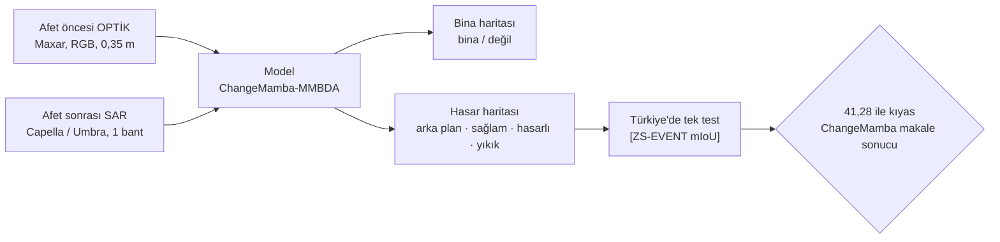

Projenin sorusu yalnız "ne kadar iyi?" değil:

> **Model eğitimde hiç görmediği bir depremde ne kadar işe yarıyor ve bu sonuca ne kadar güvenebiliriz?**

Bu yüzden projenin yarısı model eğitmek, öbür yarısı **sonucun dürüstlüğünü garanti eden düzen**: kilitler,
protokol, güven aralıkları, yeniden üretim, üç farklı referansla kıyas.

### Neden bu proje değerli?

| Soru | Cevap |
|---|---|
| Gerçek bir sorun mu? | Depremden sonraki ilk saatlerde hangi binanın yıkıldığını bilmek arama-kurtarmanın önceliğini belirler. Bulut ve gece optik görüntüyü engeller; radar engellenmez. |
| Neden öncesi optik + sonrası radar? | Afet öncesi arşivde optik görüntü neredeyse her yer için var. Afetten hemen sonra en hızlı ve havadan bağımsız gelen görüntü radar. Gerçekçi senaryo bu. |
| Rakiplerden farkı ne? | Rakipler tek bir skor yayımlıyor. Biz skoru **kilitli protokolle**, **güven aralığıyla**, **sınıf ve bina düzeyinde** ve **üç referansa göre** veriyoruz (Bölüm 10). |
| Gerçekçi hedef ne? | 41,28 civarı. Onu belirgin aşmak değil; aynı protokolde yayımlanmış sonucu dürüstçe yeniden üretmek ve neye ne kadar güvenilir olduğunu göstermek. |

---

## 2. Problem ve veri

### 2.1 İki göz: optik ve radar

```
   OPTİK (pasif)                                   SAR / RADAR (aktif)
   ─────────────                                   ───────────────────
   Güneş ışığının yansımasını kaydeder              Uydu kendi mikrodalgasını gönderir,
   → insan gözünün gördüğüne benzer                 geri dönen yankıyı kaydeder
   ✗ bulut, duman, gece = görüntü yok               ✓ bulut ve geceden etkilenmez
   ✓ binanın ayak izi net                           ✗ benek (speckle), bindirme (layover),
                                                      gölge; yorumlaması zor
   Bizde: AFET ÖNCESİ, 3 bant (RGB)                 Bizde: AFET SONRASI, 1 bant
```

**Hasar radarda nasıl görünür?** Sağlam bir bina duvarı ile zemin, radar dalgasını uyduya geri yansıtan bir köşe
oluşturur (**çift sekme**, parlak iz). Bina yıkılınca bu köşe bozulur, parlak iz dağılır ya da kaybolur. Model bu
farkı öncesi optikteki binanın yerine bakarak öğrenmeye çalışır.

**Dikkat edilecek geometri:** Radar yana bakarak çeker. 5 katlı bir binanın tepe yankısı 0,35 m pikselde yaklaşık
60 piksel kayabilir (**layover**). Yani SAR'daki iz, optikteki ayak izinin tam üstünde olmayabilir. Ayrıntı:
[sar-temelleri.md](sar-temelleri.md).

### 2.2 Veri seti: BRIGHT

| Özellik | Değer |
|---|---|
| Olay | 14 afet: deprem, patlama, yanardağ, yangın, kasırga, sel, savaş |
| Kare | 4.246 çift; her kare 1024 × 1024 piksel, uint8 GeoTIFF |
| Kare başına dosya | `pre-event` (optik, 3 bant), `post-event` (SAR, 1 bant), `target` (etiket) |
| Etiket | Her piksel `0` arka plan, `1` sağlam, `2` hasarlı, `3` yıkık |
| Türkiye | 1.114 kare, 135.033 bina; UTM 37N |
| Boyut | ~13,2 GB zip, açılmış ~22,3 GB; her Colab oturumunda Hugging Face'ten indirilir |
| Lisans | Veri CC BY-SA 4.0; kod Apache-2.0 |

Bir karenin içi:

```
 pre-event (optik)          post-event (SAR)           target (etiket)
 ┌──────────────┐           ┌──────────────┐           ┌──────────────┐
 │ ▢▢  ▢▢▢   ▢  │           │ ░▓░ ░░▓ ░  ░ │           │ 11  122   1  │   0 = arka plan (boş)
 │ ▢▢▢   ▢▢    │           │ ▓░░  ░▒  ░  │           │ 111   33     │   1 = sağlam
 │   ▢▢▢   ▢▢▢ │           │  ░▓░  ░░▓░  │           │   112   111  │   2 = hasarlı
 └──────────────┘           └──────────────┘           └──────────────┘   3 = yıkık
   3 × 1024 × 1024            1 × 1024 × 1024            1024 × 1024
```

**Sınıf dengesizliği büyük.** Eğitim kümesinde piksellerin %90,76'sı arka plan; sağlam %6,67, hasarlı %1,65, yıkık
yalnız %0,92 (`results/veri/bolme.json`). Bu yüzden "genel doğruluk" anlamsızdır (hep "arka plan" diyen model %90
doğru çıkar), metrik olarak mIoU kullanılır (Bölüm 6).

### 2.3 Bölme: 13 olayla öğren, Türkiye'de sına

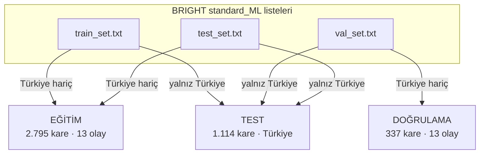

Bu, BRIGHT'ın `cross_event/zero_shot` mantığıdır ([ADR-0001](adr/0001-zero-shot-bolme.md)). Eğitimdeki 13 olayın
yalnız üçü deprem (Haiti, Fas, Noto). Yani model "deprem hasarını" az örnekle, "hasarı" ise patlamadan selde kadar
farklı afetlerden öğrenir. Türkiye'deki sonuç bu yüzden gerçek bir genelleme sınavıdır.

> **Tuzak:** `standard_ML` bölmesinin kendisinde Türkiye eğitimde de var (777/113/224). Biz o bölmeyi değil,
> zero-shot mantığını kullanıyoruz; kod Türkiye eğitime sızarsa `SplitLeakError` fırlatır.

---

## 3. Altın kural: Türkiye kilidi

Projenin bütün değeri tek bir şeye dayanır: **Türkiye sonucu temiz olmalı.** Türkiye'ye bir kez bakıp bir ayarı
değiştirirsen, ikinci bakışta çıkan sayı artık "görülmemiş deprem" sonucu değildir. Buna **test sızıntısı** denir
ve yayımlanmış birçok çalışmanın sessiz hatasıdır.

### 3.1 Kilit nasıl uygulanıyor?

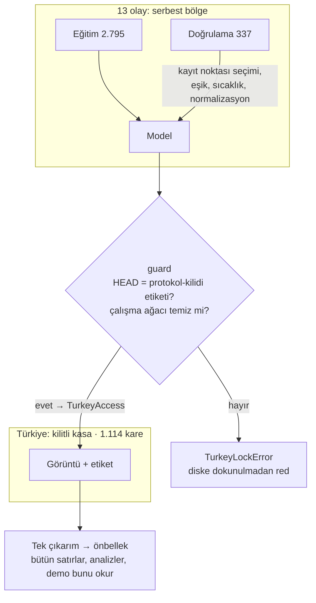

Kilit üç katmanlı:

| Katman | Ne yapar | Nerede |
|---|---|---|
| **Bölme** | Türkiye karesi eğitim/doğrulamada bulunursa hata | `hasar.data.events.check_no_leak` |
| **Erişim jetonu** | Türkiye karesini okumak için `TurkeyAccess` gerekir; yalnız git `protokol-kilidi` etiketinde ve temiz ağaçta verilir | `hasar.guard`, `hasar.data.io`, `BrightDataset` |
| **Eğitim yasağı** | Eğitim modunda Türkiye jetonla bile reddedilir | `BrightDataset(mode="train")` |

Ret **diske dokunmadan** olur: dosya adına bakılır, Türkiye ise okuma hiç başlamaz. Böylece yanlışlıkla bile
Türkiye pikseli belleğe girmez.

### 3.2 Kilitlerin zaman çizelgesi

Sıra atlanamaz. Her ok "öncekini bitirmeden sonrakine geçilmez" demektir.

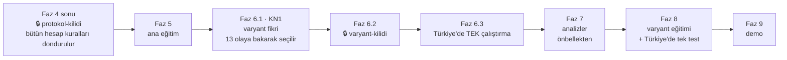

**Neden varyant ana modelin Türkiye sonucundan önce kilitleniyor?** Çünkü ana modelin Türkiye'deki hatalarını
görüp ona göre bir "iyileştirme" seçersek, varyant Türkiye'ye göre ayarlanmış olur. Seçimi yalnız 13 olayın
doğrulama sonuçları yapar.

### 3.3 Öteki değişmez kurallar (CLAUDE.md)

| # | Kural | Neyi engeller |
|---|---|---|
| 1 | Türkiye kilitli | Test sızıntısı |
| 2 | Türkiye'yi görmüş ağırlık yok (`*_standard_ML_split.pth`, MaRS) | Önceden eğitilmiş ağırlık yoluyla sızıntı |
| 3 | Yalnız iki tam eğitim | "Tutana kadar dene" (çok deneyip iyisini seçmek de sızıntıdır) |
| 4 | Her sayının metrik etiketi var | Farklı ölçümleri karıştırıp yanlış kıyas |
| 5 | Sayılar `results/**/*.json`'dan gelir | Elle yazılmış, kaynağı belirsiz sayı |
| 6 | Olumsuz sonuç da yazılır; küçük fark "eşit" | Gürültüyü başarı diye satmak |

---

## 4. Model: ChangeMamba-MMBDA

### 4.1 Mimari

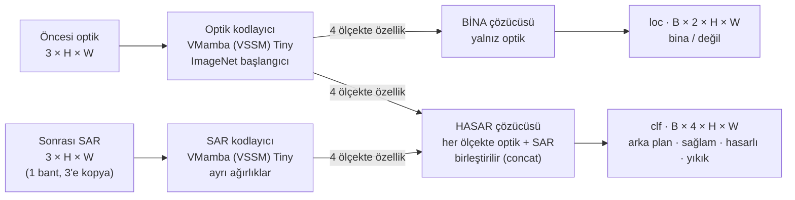

| Parça | Ne işe yarar | Neden böyle |
|---|---|---|
| **İki ayrı kodlayıcı** | Her görüntü türünden özellik çıkarır | Optik ve radar farklı "diller" konuşur; ortak ağırlık ikisini de zayıflatabilir |
| **VMamba (Mamba)** | Görüntüyü uzun menzilli bağlamla okur, Transformer'dan daha ucuz | Bir binanın hasarını anlamak için çevresine de bakmak gerekir |
| **Bina çözücüsü (yalnız optik)** | "Bina nerede?" | Bina afetten önce de oradaydı; radar burada gürültü katar |
| **Hasar çözücüsü (optik + SAR)** | "Bu bina ne durumda?" | Hasar için hem öncesi (bina şekli) hem sonrası (radar izi) gerekir |
| **Ayrık başlıklar** | İki alt görevi ayrı öğrenir | BRIGHT'ta ayrık modeller zero-shot'ta daha iyi; kanıt kontrollü değil, olası |

### 4.2 Çıktıdan haritaya

```
 clf logitleri (4 kanal)  ──softmax──►  olasılıklar  ──argmax──►  her piksele bir sınıf (0–3)
```

- **Başlık sonucu (resmî yol):** `argmax(clf)`, bina maskesi yok, TTA yok. 41,28 yalnız bununla kıyaslanır.
- **İkincil satır "bina maskeli":** `loc` "bina değil" dediği yerde sonuç arka plan, ötekilerde
  `argmax(clf[1:]) + 1`.

Bu ikisi farklı sayı verebilir; hangisinin başlık olduğu Türkiye'ye dokunmadan kilitlendi
([ADR-0005](adr/0005-baslik-metrigi.md)).

### 4.3 Neden ChangeMamba, yedek ne?

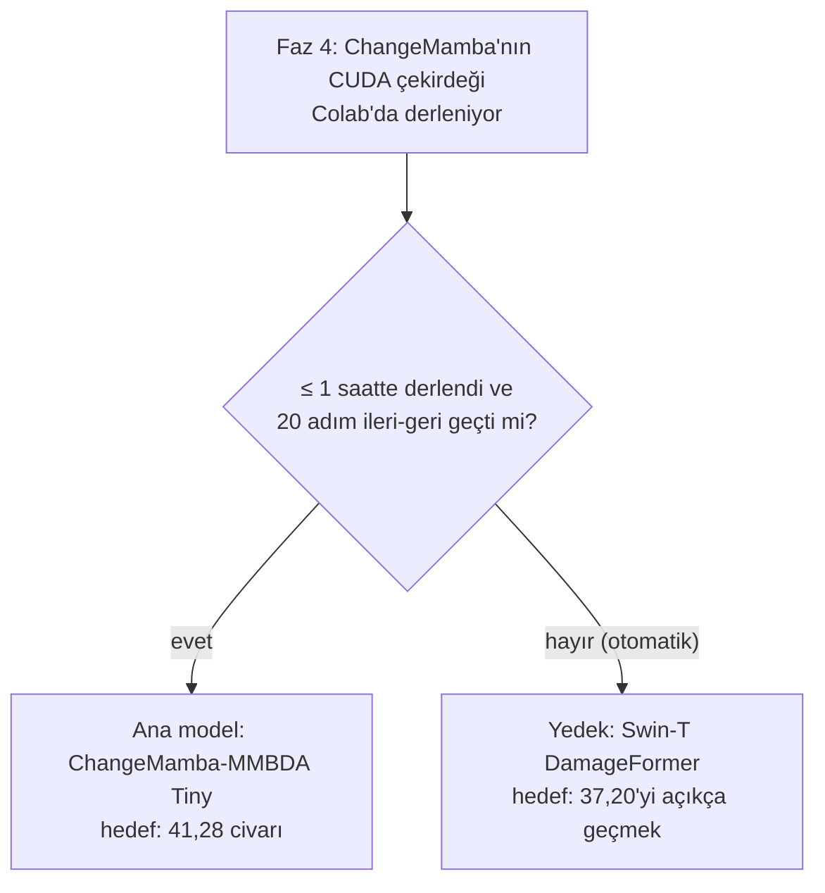

- **Seçim nedeni:** BRIGHT makalesinde dört depremin dördünde en iyi zero-shot sonuç (Türkiye 41,28
  `[ZS-EVENT mIoU]`). Ama asıl neden: **tek doğrudan çıpaya karşı elma-elma kıyas**. Aynı modeli aynı protokolle
  eğitirsek sonucumuz 41,28 ile doğrudan kıyaslanabilir.
- **Kullanılmayanlar:** DINOv3 (lisans askerî kullanımı yasaklıyor), MaRS (Türkiye 2023 sahnelerini görmüş
  olabilir), UDA yöntemleri (beşi de Türkiye'de tabanın altında kaldı).
- **Model sözleşmesi:** Ana model, yedek ve varyant aynı arayüzü uygular (`{"loc", "clf"}` sözlüğü döndürür);
  YAML'da tek satırla değiştirilir (`hasar.models.base`, `hasar.models.registry`).

### 4.4 Türkiye çıpaları

Hepsi aynı protokolde, `[ZS-EVENT mIoU]`:

```
ChangeMamba   ██████████████████████████████████████████  41,28   ← çıpa
ChangeOS      ███████████████████████████████████████     38,45
SiamCRNN      ███████████████████████████████████████     38,32   ← Faz 3'te yeniden üretilecek
UNet          ██████████████████████████████████████      37,82   ← Faz 3'te yeniden üretilecek
DeepLabV3+    ██████████████████████████████████████      37,28
DamageFormer  █████████████████████████████████████       37,20   ← Faz 3'te yeniden üretilecek (yedek)
SiamAttnUNet  █████████████████████████████████████       36,09
```

Modeller arası fark 1–5 puan ve bu sayılar tek koşudan. Bu yüzden "41,28'i 0,5 geçtik" bir başarı değil, gürültü
düzeyinde bir farktır (Bölüm 6.5).

---

## 5. Eğitim reçetesi: her ayar neye yarıyor

Tek bir dondurulmuş yapılandırma: `configs/ana.yaml`. Yapılandırmanın sha256 özetinin ilk 12 hanesi `run_id`'nin
parçasıdır; ayar değişirse kimlik de değişir.

### 5.1 Bir eğitim adımının yolculuğu

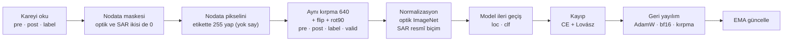

### 5.2 Ayarlar tablosu

| Ayar | Değer | Ne işe yarar | Dayanak |
|---|---|---|---|
| **Kırpma / batch** | 640 / 16 | 1024'lük kareden rastgele 640'lık parça; GPU belleğine sığdırır ve çeşitlilik katar | Resmî |
| **Süre** | 40.000 adım = 640.000 örnek | ChangeMamba resmî reçetesi 80.000 × 8 = aynı örnek sayısı | Resmî ile eşdeğer |
| **Optimizer** | AdamW, lr 1e-4, wd 5e-3 | Ağırlıkları günceller; weight decay aşırı öğrenmeyi frenler | Resmî |
| **Zamanlama** | 1.500 adım ısınma + kosinüs, min 1e-6 | Başta küçük adımlarla kararlı başlar, sonda yavaşça iner | Düşük risk |
| **Kayıp** | CE_loc + CE_clf + 0,5·Lovász_loc + 0,75·Lovász_clf | CE her pikseli doğru sınıfa iter; Lovász doğrudan IoU'yu iyileştirir (az görülen sınıflara yardım) | Resmî |
| **bf16** | Karma hassasiyet | Yaklaşık 2× hız, yarı bellek; Lovász fp32'de (sayısal kararlılık) | Düşük risk |
| **EMA 0,999** | Ağırlıkların hareketli ortalaması | Daha pürüzsüz, genelde daha iyi genelleyen model; seçimde EMA kullanılır | Düşük risk |
| **Gradyan kırpma** | Ön kontrolde ölçülen p90 norm | Ani büyük gradyanların eğitimi patlatmasını önler | Ölçülecek |
| **Artırım** | Flip, rot90; renk oyunu yok | Uydu görüntüsünde yön anlamsız; fotometrik artırım SAR'ı bozabilir | Resmî |
| **Optik normalizasyon** | ImageNet ortalama/std | Önceden eğitilmiş kodlayıcının beklediği ölçek | Resmî |
| **SAR normalizasyonu** | 1 bant → 3 kanal kopya, ImageNet istatistiği | Resmî kodla aynı (elma-elma kıyas); eğitim kümesi z-skoru A3 olarak denenecek | [ADR-0004](adr/0004-sar-girdisi.md), onay bekliyor |
| **Nodata** | Kayıpta yok say (255) | Bazı karelerde SAR tamamen boş; modelin boşluktan "arka plan" öğrenmesini önler | Yargı |
| **Doğrulama** | 2.000 adımda bir, 13 olay | En iyi kayıt noktasını seçer; Türkiye eğitim kodunda hiç yok | Kural 1 |
| **Kayıt** | 1.000 adımda Drive, 5.000 adımda HF Hub; atomik | Colab kopsa da kaldığı yerden aynen devam | Dayanıklılık |

### 5.3 İki ince tuzak ve çözümleri

**`max_iters` tuzağı.** BRIGHT kodunda `max_iters` **örnek** sayısı (800.000 / 16 = 50.000 adım), ChangeMamba
kodunda **adım** sayısı. Karıştırırsan eğitim 16 kat kısa ya da uzun olur. Çözüm: örnekleyicinin uzunluğu açıkça
`adım × batch` (`hasar.data.sampler.StepSampler`); ön kontrol kapısı 3 bunu denetler.

**Kopmadan sonra "aynı" devam.** Colab oturumu 12 saatte kesilir. Devam edince model, optimizer ve EMA'nın yanında
**veri sırası ve artırımlar** da aynı olmalı, yoksa sonuç tekrarlanamaz. Çözüm:

```
her örnek = (kare_index, örnek_no)
artırımın rastgeleliği = default_rng([seed, örnek_no, akış])     → aynı anahtar = aynı kırpma, aynı flip
epoch sırası          = default_rng([seed, epoch]).permutation  → baştan hesaplanabilir
devam: StepSampler(start_step=kaldığı_adım)                     → kaldığı örnekten aynen sürer
```

---

## 6. Değerlendirme: başarıyı nasıl ölçüyoruz

### 6.1 Karışıklık matrisi → IoU → mIoU

Her piksel için (gerçek sınıf, tahmin) çifti 4×4 bir tabloya sayılır. **Bütün Türkiye kareleri boyunca tek tablo
biriktirilir** (olay düzeyi).

```
                      TAHMİN
                 0      1      2      3
            ┌──────┬──────┬──────┬──────┐
         0  │  TP₀ │      │      │      │   IoU_k =        C[k,k]
 GERÇEK  1  │      │  TP₁ │      │      │           ─────────────────────────────
         2  │      │      │  TP₂ │      │           satır_k + sütun_k − C[k,k]
         3  │      │      │      │  TP₃ │
            └──────┴──────┴──────┴──────┘   mIoU = (IoU₀ + IoU₁ + IoU₂ + IoU₃) / 4
```

**IoU = kesişim / birleşim:** "Bu sınıf dediğim yerlerle gerçekten bu sınıf olan yerler ne kadar örtüşüyor?"
Kaçırma da yanlış alarm da cezalandırılır.

**Somut örnek: "hep arka plan" diyen aptal model** (ön kontrol kapısı 7):

```
Arka plan IoU = arka plan piksel oranı = 0,9034  (doğrulama kümesi, results/veri/bolme.json)
Sağlam / hasarlı / yıkık IoU = 0               (hiç tahmin edilmedi)
mIoU = 0,9034 / 4 ≈ 0,226
```

Metrik kodu bu sayıyı vermezse metrikte hata var demektir.

**41,28 ne demek?** Arka plan IoU'su ~95 civarındaysa, `(95 + 3x) / 4 = 41,28` → bina sınıflarının ortalaması
**x ≈ 23 IoU**. Yani en iyi model bile hasar sınıflarında hâlâ zayıf; görev zor.

### 6.2 Başlık metriği (kilitli yol)

1. Türkiye'nin her karesi 1024 × 1024 tam, kırpmadan.
2. `pred = argmax(clf)`; TTA, maske, sıcaklık yok.
3. 4×4 matris 1.114 kare boyunca biriktirilir; etiketi 0–3 dışındaki pikseller girmez.
4. IoU paydasına `1e-7`; 4 sınıfın ortalaması.

Bu yol BRIGHT ve ChangeMamba'nın resmî değerlendirme kodu okunarak yazıldı ([protokol.md](protokol.md) §3).

### 6.3 Metrik etiketleri: elmayla armudu karıştırmamak

| Etiket | Anlamı | 41,28 ile kıyaslanır mı? |
|---|---|---|
| `[ZS-EVENT mIoU]` | Zero-shot, olay düzeyi (Türkiye eğitimde yok) | **Evet, yalnız bu** |
| `[STD-EVENT mIoU]` | Standart bölme, olay düzeyi (Türkiye eğitimde var) | Hayır |
| `[STD-SET mIoU]` | Standart bölme, bütün test kümesi | Hayır |
| `[DFC-TEST mIoU]` | DFC25 yarışması test kümesi | Hayır |
| `[CVPR-TEST segm_AP]` | CVPRW26 örnek segmentasyonu | Hayır (başka görev) |

Yarışmalarda ve makalelerde bu sayılar sık sık karıştırılıyor; bir makaledeki "%60" başka bir bölmenin sayısı
olabilir. Bizim `hasar.results` modülü etiketsiz metrik kaydını **dosyaya yazmayı reddeder**.

### 6.4 Piksel düzeyi ve bina düzeyi

```
 Piksel düzeyi: büyük bina çok piksel = çok ağırlık        Bina düzeyi: her bina bir oy
 ┌────────────────────┐ ┌──┐                              ┌────────────────────┐ ┌──┐
 │   büyük fabrika    │ │ev│  → fabrika metriği domine     │   1 bina           │ │1 │  → eşit söz hakkı
 └────────────────────┘ └──┘                              └────────────────────┘ └──┘
```

Arama-kurtarma için asıl soru "kaç bina yıkık?". Bu yüzden ikincil olarak **bina düzeyi makro F1** raporlanır.

**Bina nasıl tanımlanır?** Faz 2'de ölçtük: etiketteki bitişik pikselleri birleştirip "bina" saymak (bağlı
bileşen) binaların ~%39'unu komşusuyla birleştiriyor. Bu yüzden öneri: BRIGHT'ın CVPRW26 **örnek etiketlerini**
(her binanın ayrı çokgeni) kullanmak. Türkiye'de 1.114 karenin 1.001'inde var.

### 6.5 Güven aralığı: "41,5" ne kadar kesin?

Tek bir sayı yanıltır. Aynı model biraz farklı bir Türkiye örnekleminde 40 de 43 de alabilirdi. Bunu
**bootstrap** ile ölçeriz:

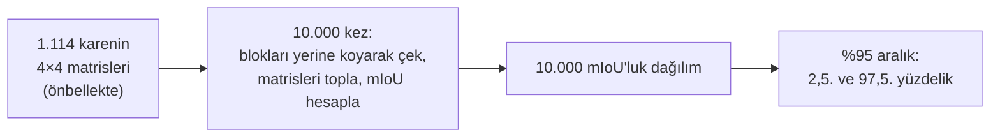

**Neden blok?** Komşu kareler birbirine benzer (aynı mahalle, aynı uydu geçişi). Kareleri tek tek çekmek aralığı
yapay olarak daraltır. Öneri: Türkiye karelerini **7 şehir** ve **2 km'lik 64 blok** olarak grupla; her şehrin
blokları kendi içinde çekilsin (şehre göre katmanlı blok bootstrap). Bu gruplar yalnız GeoTIFF başlığındaki
koordinatlardan çıkarıldı; Türkiye etiketine bakılmadı.

**"Eşit" kuralı (öneri):** Fark 1,0 puanın altındaysa **veya** eşleştirilmiş bootstrap farkının %95 aralığı 0'ı
içeriyorsa "eşit" yazılır.

### 6.6 İkincil satırlar (önceden ilan edildi)

| Satır | Ne yapar | Neden önceden ilan |
|---|---|---|
| Flip TTA | Görüntüyü 4 yönde çevirip tahminlerin ortalamasını alır | Sonradan eklenirse "işe yarayanı seçtik" olur |
| Bina maskeli | `loc` bina değil dediği yerde arka plan | Makaledeki yol; resmî koddan farklı |
| Bina oylaması | Tahmin edilen her binada çoğunluk sınıfı | Bina içinde tutarlı harita |
| Nodata yok sayılmış | Boş SAR pikselleri matrise girmez | Resmî yolun nodata'yı saydığını göstermek için |

Hepsi Faz 6'daki **tek çıkarımın önbelleğinden** hesaplanır; model Türkiye'de ikinci kez çalışmaz.

### 6.7 Belirsizlik ve kalibrasyon

| Kavram | Soru | Kullanım |
|---|---|---|
| **ECE** | Model "%80 eminim" dediğinde %80 doğru mu? | Güvenin dürüstlüğü |
| **Sıcaklık ölçekleme** | Güveni tek bir T ile düzeltmek | T yalnız 13 olayda seçilir |
| **TTA entropisi** | 4 çevirmede tahminler ne kadar tutarsız? | Bina başına belirsizlik |
| **Risk-kapsam eğrisi** | En emin olduğumuz %k binada hata ne? | Y2 analist bütçesi |

---

## 7. Kod mimarisi: hangi modül ne iş yapar

### 7.1 Paketler ve bağımlılık yönü

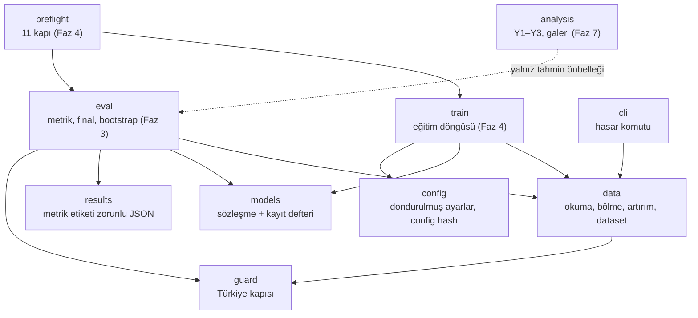

**Kurallar** ([ADR-0006](adr/0006-moduler-kod-yapisi.md)):

- `data` ve `models` birbirini bilmez; `train` ikisini birleştirir.
- `eval`, `train`'i import etmez (değerlendirme eğitim koduna bağımlı olmamalı).
- `analysis` modeli değil, tahmin dosyalarını okur (Türkiye'de tek çıkarım ilkesi).
- Türkiye karesine giden her yol `guard`'dan geçer.
- Bilerek eklenmeyenler: Hydra, eklenti sistemi, soyut Trainer hiyerarşisi. Basit ve okunur kalsın.

### 7.2 Bugün var olan dosyalar (Faz 1–2)

| Dosya | Ne işe yarar |
|---|---|
| `src/hasar/config.py` | YAML'ı dondurulmuş dataclass'lara okur; `config_hash`, `run_id = <deney>-<hash>` |
| `src/hasar/results.py` | Sonuç JSON şeması; metrik etiketi yoksa ya da tanınmıyorsa yazmaz; atomik yazma |
| `src/hasar/guard.py` | `is_turkey_tile`, `require_turkey_access` → `TurkeyAccess` jetonu (etiket + temiz ağaç) |
| `src/hasar/models/base.py` | Model sözleşmesi: `{"loc": B×2×H×W, "clf": B×4×H×W}` |
| `src/hasar/models/registry.py` | Modeli adıyla kurar (YAML'da tek satır) |
| `src/hasar/data/events.py` | Olay adı (`la_palma-volcano` tuzağı), zero-shot bölme, sızıntı denetimi, liste özeti |
| `src/hasar/data/io.py` | GeoTIFF okuma, nodata maskesi, coğrafi meta veri; Türkiye kapısı diske dokunmadan önce |
| `src/hasar/data/transforms.py` | Optik, SAR, etiket ve maskeye **aynı** kırpma/flip/rot90 |
| `src/hasar/data/sampler.py` | Kopmaya dayanıklı, `adım × batch` uzunluklu örnekleyici |
| `src/hasar/data/normalize.py` | ImageNet normalizasyonu, SAR'ın iki biçimi, akışlı SAR istatistiği (bellekte tek kare) |
| `src/hasar/data/dataset.py` | `BrightDataset`: yukarıdakileri birleştirir; eğitim ve değerlendirme modu |
| `src/hasar/data/download.py` | Hugging Face'ten indirme, `.done` işaretli güvenli açma (zip-slip korumalı) |
| `src/hasar/data/summary.py` | Sınıf histogramı, bölme raporu (yalnız eğitim/doğrulama) |
| `src/hasar/cli.py` | `hasar indir`, `hasar veri-ozet` komutları |
| `configs/ana.yaml` | Bütün varsayılanların açık yazıldığı tek yapılandırma |
| `third_party/bright/` | BRIGHT bölme listeleri, sabit commit'ten |
| `scripts/arastirma/` | Faz 2 araştırma betikleri (paket kullanmaz) |

### 7.3 `BrightDataset` bir örnekte ne döndürür?

```python
ds = BrightDataset(root, names, mode="train", crop=640)
item = ds[(index, sample_no)]     # eğitim: (kare, örnek numarası); değerlendirme: ds[index]

item = {
    "name":  "noto-earthquake_00000032",
    "pre":   float32[3, 640, 640],   # ImageNet ile normalize optik
    "post":  float32[3, 640, 640],   # resmî biçim SAR (train_stats modunda 1 kanal)
    "clf":   int64[640, 640],        # 0..3, nodata = 255
    "loc":   int64[640, 640],        # 0 arka plan, 1 bina, 255 yok say
    "valid": bool[640, 640],         # nodata olmayan pikseller
}
```

### 7.4 Kalite düzeni

- **Testler:** 288 kısa test, ~4 saniye, veri gerektirmez (sentetik GeoTIFF'ler). Uzun test yok.
- **CI:** GitHub Actions, CPU'da `ruff` + `pytest`.
- **Kod nasıl yazılıyor:** Claude inceleyip plan yazar, **orkestra** agent'ları önce kırmızı testi (TDD) sonra
  kodu yazar, Claude doğrular. Faz 2'de agent kodunda testlerin yakalamadığı 3 hata elle düzeltildi (bellek
  taşması, yanlış varsayılanlar, eksik parametre).

---

## 8. Ön kontrol kapıları: GPU yakmadan önceki 11 sigorta

Ana eğitim pahalı (50–75 CU) ve tek seferlik. Bir hata eğitimin ortasında fark edilirse bütçe gider. Bu yüzden
eğitimden önce ~1–1,5 saatlik bir kontrol listesi koşar; biri kırmızıysa eğitim başlamaz.

| # | Kapı | Neyi yakalar |
|---|---|---|
| 1 | Hazır SiamCRNN / UNet / DamageFormer checkpoint'leri Türkiye'de 38,32 / 37,82 / 37,20'ye yakın | Veri veya metrik hattındaki hata |
| 2 | Kare sayıları 2.795 / 337 / 1.114; eğitimde tek Türkiye karesi yok | Bölme hatası, sızıntı |
| 3 | Veri yükleyici uzunluğu = adım × batch | `max_iters` tuzağı |
| 4 | Başlangıç kaybı: hasar ≈ ln 4 = 1,386, bina ≈ ln 2 = 0,693 | Yanlış başlatma, yanlış etiket |
| 5 | Artırım kapalı, 8 kare 300–500 adımda ezberlenmeli | Model öğrenemiyor (bağlantı/kayıp hatası) |
| 6 | SAR sıfırlanınca hasar çıktısı değişmeli | SAR dalı kopuk |
| 7 | Kusursuz tahmin = 1,0; hep arka plan ≈ 0,226 | Metrik hatası |
| 8 | 200 adımda hız, VRAM, CU projeksiyonu | Bütçe aşımı |
| 9 | 2× lr ile 500 adımda p90 gradyan normu | Gradyan kırpma eşiği |
| 10 | 60. adımda süreci öldür, devam et; her şey aynı geri gelmeli | Kopma sonrası tutarsızlık |
| 11 | ChangeMamba çekirdeği ≤ 1 saatte derleniyor mu | Yedeğe geçiş kararı |

---

## 9. Faz yol haritası (0–9)

### 9.1 Genel görünüm

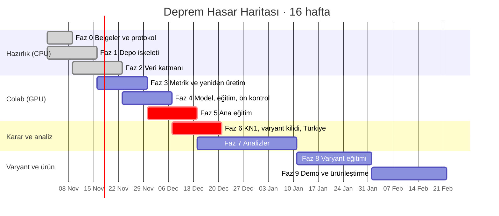

> Tarihler haftalık plana göre yaklaşıktır; Faz 0–2 planlanandan erken (6 Kasım 2026) bitti. Kırmızı çubuklar
> geri dönüşü olmayan adımlar: ana eğitim ve Türkiye'deki tek test.

| Faz | Ad | Tür | CU | Kilit / karar | Durum |
|---|---|---|---|---|---|
| 0 | Belgeler ve protokol taslağı | Belge | 0 | | ✅ Bitti |
| 1 | Depo iskeleti | Kod | 0 | | ✅ Bitti |
| 2 | Veri katmanı | Kod + araştırma | 0 | | ✅ Bitti |
| 3 | Metrik ve yeniden üretim | Kod + Colab | 5–8 | | ⏭ Sırada |
| 4 | Model, eğitim motoru, ön kontrol | Kod + Colab | 10–15 | 🔒 `protokol-kilidi` | |
| 5 | Ana eğitim | Colab | 50–75 | | |
| 6 | Karar, varyant kilidi, Türkiye | Karar + Colab | < 5 | KN1, 🔒 `varyant-kilidi` | |
| 7 | Analizler | Kod (CPU) | 2–5 | KN2 | |
| 8 | Varyant eğitimi | Colab | 50–75 | KN3 | |
| 9 | Demo ve ürünleştirme | Kod + belge | < 2 | | |

### 9.2 Faz kartları

Her kart aynı soruları cevaplar: **Neden var? · Ne yapılır? · Ne üretir? · Çıkış koşulu.**

---

#### Faz 0 · Belgeler ve protokol taslağı ✅

- **Neden:** Kod yazılırken sessizce karara dönüşecek belirsizlikleri (metrik nasıl hesaplanır, nodata ne olur,
  bootstrap birimi ne) önceden yazıya geçirmek. Sonradan verilen karar Türkiye sonucundan etkilenebilir.
- **Ne yapıldı:** 6 ADR (zero-shot bölme, ana model/yedek, dışlanan ağırlıklar, SAR girdisi, başlık metriği, modüler
  yapı), protokol taslağı 0.1, veri-lisans tablosu, risk kaydı, SAR temelleri notu.
- **Önemli keşifler:** Gerçek bölme 2.795 eğitim karesi (eski tahmin 2.141). Resmî kod SAR'ı ImageNet
  istatistikleriyle normalize ediyor (tasarımdan sapma → ADR-0004). "Hep arka plan" mIoU'su sabit değil, arka plan
  oranı / 4.
- **Çıktı:** `docs/adr/`, `docs/protokol.md`, `docs/veri-lisans.md`, `docs/riskler.md`, `docs/sar-temelleri.md`.

#### Faz 1 · Depo iskeleti ✅

- **Neden:** Kuralları (Türkiye kilidi, metrik etiketi, tekrarlanabilirlik) insan dikkatine değil **koda**
  emanet etmek.
- **Ne yapıldı:** `uv` projesi (torch sabitlenmez, Colab'ınki kullanılır), `config` (dondurulmuş ayar + hash),
  `results` (etiketsiz metrik yazılamaz), `guard` (Türkiye jetonu), model sözleşmesi ve kayıt defteri, CI.
- **Çıkış:** CI yeşil; 125 kısa test.

#### Faz 2 · Veri katmanı ✅

- **Neden:** Modelin gördüğü her piksel buradan geçer. Veri hatası en sinsi hatadır: model yine eğitilir, yalnız
  yanlış şeyi öğrenir.
- **Ne yapıldı:** 8 modül (Bölüm 7.2), `hasar indir` ve `hasar veri-ozet` komutları, 4 araştırma
  (Türkiye etiketine ve pikseline bakmadan).
- **Çıktı:** `results/veri/bolme.json`, `results/arastirma/*.json`, protokol 0.2.
- **Çıkış:** 288 kısa test (~4 sn); sayılar ve araştırmalar belgelere işlendi.

#### Faz 3 · Metrik ve yeniden üretim ⏭ (ilk Colab, ~5–8 CU)

- **Neden:** Kendi modelimizi eğitmeden önce **hattın doğru olduğunu kanıtlamak**. Başkalarının yayımladığı hazır
  checkpoint'leri bizim veri ve metrik kodumuzdan geçirip aynı sayıları alırsak hattımız doğrudur.
- **Ne yapılacak:**
  - `eval/` modülü: olay düzeyi mIoU, sınıf başına IoU, bina düzeyi makro F1, blok ve eşleştirilmiş bootstrap.
  - Zenodo 15349462'den hazır zero-shot checkpoint'ler (SiamCRNN, UNet, DamageFormer) Türkiye'de çalıştırılır
    (kural 1'in izinli istisnası; eğitim yok). 13 olaydaki çıktıları da kaydedilir (B2 topluluk adayı için).
  - Metrik uç durum testleri (1,0 ve 0,226).
- **Çıkış:** 38,32 / 37,82 / 37,20 `[ZS-EVENT mIoU]` ±0,3 içinde. **Tutmazsa sonraki faza geçilmez.**

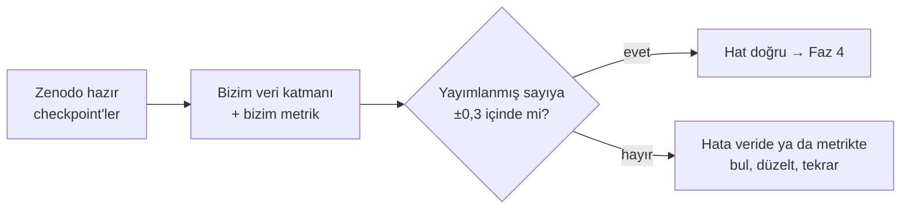

#### Faz 4 · Model, eğitim motoru, ön kontrol (~10–15 CU) 🔒

- **Neden:** Tek seferlik ana eğitimin hatasız koşacağını garanti etmek.
- **Ne yapılacak:**
  - ChangeMamba çekirdek derleme kapısı (≤ 1 saat; geçmezse otomatik DamageFormer).
  - 10 dakikalık ONNX denemesi (Faz 9'daki dışa aktarım yolunu belirler).
  - Eğitim döngüsü: AdamW, ısınma + kosinüs, bf16, EMA, gradyan kırpma, atomik kayıt, tam durumla devam, JSONL log.
  - **A3 ölçümü:** SAR z-skoru kısa provada denenir; reçeteye girip girmeyeceğine 13 olayla karar verilir.
  - 7 hücreli ince notebook ve 11 ön kontrol kapısı.
  - Protokolün son hâli → **`protokol-kilidi` etiketi.**
- **Çıkış:** `preflight.json`'da bütün kapılar yeşil, CU projeksiyonu bütçede.

#### Faz 5 · Ana eğitim (50–75 CU)

- **Neden:** Başlık sonucunu üretecek tek model.
- **Ne yapılacak:** ChangeMamba olduğu gibi, 40.000 adım, yeni ayın taze CU'suyla. Kopma olursa notebook "Run All"
  ile kaldığı yerden aynen devam eder.
- **Çıkış:** `DONE` işareti, doğrulama eğrisi, seçilen kayıt noktası (`results/ana/`). **Türkiye'ye dokunulmadı.**

#### Faz 6 · Karar noktası, varyant kilidi, Türkiye (< 5 CU)

Sıra kritik, adımlar atlanamaz:

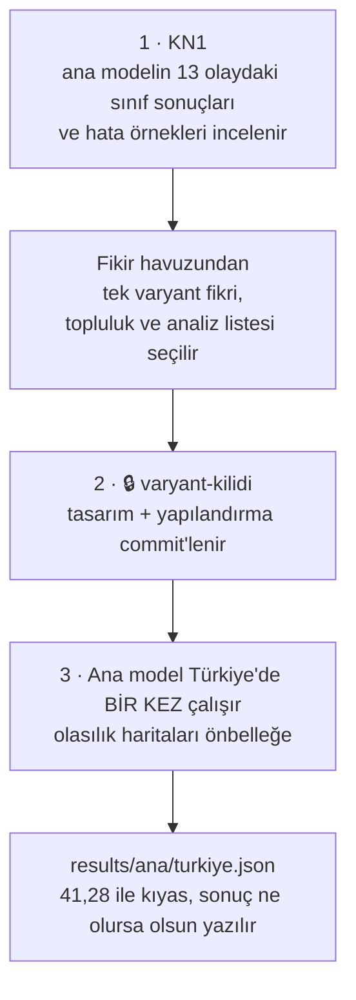

#### Faz 7 · Analizler (2–5 CU, CPU ağırlıklı)

- **Neden:** Projenin yenilikçi kısmı; eğitim gerektirmez, Faz 6 önbelleğini okur.
- **Ne yapılacak:** Y1 referans anlaşmazlığı, Y2 analist bütçesi, Y3 transdüktif tablo, KN1'de seçilen N
  analizleri, SAR hata galerisi (Capella/Umbra, layover, gölge, izole binalar).
- **KN2:** Raporlama derinliği; üçüncü tam eğitim istenir mi (yalnız kullanıcı kararı, "keşif" etiketiyle).
- **Çıkış:** Her analizin JSON'u ve görselleri; olumsuz bulgular dahil `docs/bulgular.md`.

#### Faz 8 · Varyant eğitimi (50–75 CU)

- **Neden:** Kendi mimari katkımızı aynı protokolle, adil biçimde sınamak.
- **Ne yapılacak:** Kilitli varyant aynı reçete ve aynı kapılarla bir kez eğitilir, Türkiye'de bir kez test
  edilir. Kilitliyse ana model + varyant topluluk satırı.
- **KN3:** README'ye ve demoya hangi bulgular girer.
- **Çıkış:** İki model yan yana; fark "eşit" kuralına göre yazılır. **Türkiye sonucuna bakıp seçim yapılmaz.**

#### Faz 9 · Demo ve ürünleştirme (< 2 CU)

- **Neden:** Projeyi yabancı birinin anlayıp çalıştırabileceği hâle getirmek.
- **Ne yapılacak:**
  - **Gerçek 6 Şubat verisiyle demo:** BRIGHT'ın Türkiye kareleri üzerinde harita; önce/sonra görüntüler, model
    tahmini, üç referans, analistin kontrol listesi (tahminler önbellekten).
  - Dışa aktarım (ONNX / `torch.export` / PyTorch) ve bina başına gecikme.
  - Model kartı, lisans ve atıf tablosu, rakip karşılaştırması; README'deki her sayı `results/`'tan üretilir.
- **Yapılmayacak:** İstanbul hasar demosu. Deprem olmadığı için afet sonrası görüntü yok.
- **Çıkış:** Depo tek komutla çalışıyor, demo yayında.

---

## 10. Yenilik paketi ve fikir havuzu

### 10.1 Yenilik nerede?

Araştırma üç şey gösterdi: "Türkiye'yi görmeden test" tek başına özgün değil; mimariler arası fark Türkiye'de
gürültü düzeyinde; sonucu asıl değerlendirme kararları belirliyor. Bu yüzden yenilik, **tek doğru yapılmış
eğitimin üstüne kurulan değerlendirme işlerinde**:

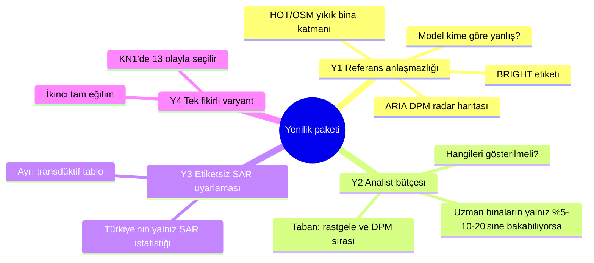

| # | Soru | Neden değerli | Ek tam eğitim |
|---|---|---|---|
| **Y1** | Aynı binalarda üç referans ne kadar anlaşıyor? | "Doğru cevap" da tartışmalı olabilir; model belki etikete göre yanlış, radara göre doğru. Çerçeve: iki optik yorum + bir radar sinyali | 0 |
| **Y2** | Sınırlı uzman zamanında model hangi binaları göstermeli? | Gerçek kullanım senaryosu: model insanın yerine değil, yanında çalışır | 0 |
| **Y3** | Türkiye'nin etiketsiz SAR istatistikleriyle giriş yeniden ölçeklenirse ne olur? | SAR olaydan olaya farklı gerilmiş (Faz 2 ölçümü); ayrı tabloda, başlığı etkilemez | 0 |
| **Y4** | Tek bir fikir ChangeMamba'yı iyileştiriyor mu? | Kendi mimari katkımız, adil ve kilitli koşullarda | 1 |

### 10.2 Fikir havuzu ve varyant adayları

Fikirler şimdi seçilmedi; **ana eğitimin 13 olaydaki sonucuna göre** KN1'de seçilecek
([fikir-havuzu.md](fikir-havuzu.md)).

| Kod | Fikir | Ne işe yarar | Durum |
|---|---|---|---|
| **A1** | Sentinel-1 koherans kanalı | Radar faz tutarlılığı yıkımda düşer; ek fiziksel kanıt (mahalle ölçeğinde) | Aday · fizibilite geçti (14/14 olay) |
| A2 | ShakeMap sarsıntı öncülü | Sarsıntının şiddetli olduğu yerde hasar olasılığını artır | Aday |
| A3 | SAR z-skoru | Olaydan olaya farklı SAR gerilmesini düzelt | Planlı · Faz 4'te ölçülecek |
| B1 | Flip TTA + bina oylaması | Bedava kazanç | Planlı (ikincil satır) |
| B2 / B3 | Topluluk (hazır checkpoint'ler / varyant) | Birden çok modelin ortalaması genelde daha sağlam | Aday |
| C1 | Etiketsiz sınıf oranı düzeltmesi (EM) | Türkiye'de yıkık oranı eğitimden farklıysa düzelt | Aday · transdüktif |
| C2 | Olay dengeli örnekleme | Büyük olaylar eğitimi domine etmesin | Aday (V) |
| C3 | Sıralı kayıp (CORN) | sağlam < hasarlı < yıkık sırasını modele öğret | Aday (V) |
| **D1** | Ayrı güçlü bina bulucu | Bina bulma hatası hasar metriğini de batırır | Aday (V) |
| D2 | Ayak izinde havuzlayan başlık | Bina içinde tek karar | Aday (V) |
| D4 | Modalite bırakma | SAR'ın gerçek katkısını ölç ve sağlamlaştır | Aday (V) |

**Varyant (V) adayları:** A1, C2, C3, D1, D2, D4; KN1'de **tek biri** seçilir. Araştırmanın önceliği: A1, sonra D1.

### 10.3 Karar noktaları

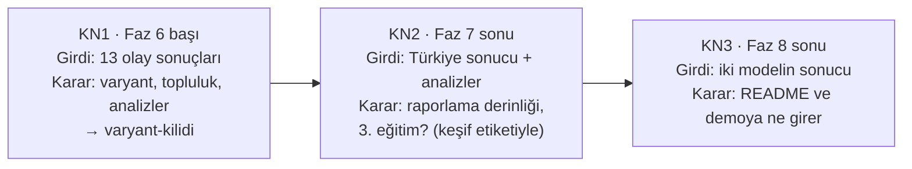

---

## 11. Bütçe

Hiçbir süre Colab'da henüz ölçülmedi; hepsi tahmin, Faz 3–4'te ölçülecek.

| Adım | Süre | CU (A100, 5,40/saat) |
|---|---|---|
| Ortam, veri, hazır checkpoint'lerle yeniden üretim | 1–1,5 sa | 5–8 |
| Çekirdek derleme kapısı | ≤ 1 sa | ≤ 5,4 |
| Ön kontrol + 2.000 adımlık prova | 1–1,5 sa | 5–8 |
| **Ana eğitim, 40.000 adım** | 9–14 sa | **50–75** |
| Türkiye değerlendirmesi, TTA, belirsizlik, ONNX | 0,5–1 sa | 3–5 |
| **Toplam (bir tam eğitim)** | 13–19 sa | ~65–100 |

```
Colab Pro:  100 CU / ay  (₺165,60)  · oturum ≤ 12 sa · tarayıcı açık kalmalı
Colab Pro+: 600 CU / ay  (₺826,80)  · tarayıcı kapalıyken 24 sa

İki tam eğitim ≈ 115–175 CU → aynı aya düşmemeli
  Ay 1: hazırlık (Faz 3–4)        Ay 2: ana eğitim (taze 100 CU)        Ay 3+: varyant
```

High-RAM yakımı ~%39 artırır, kapalı tutulur. Bu yüzden SAR istatistiği akışlı hesaplanıyor (bellekte tek kare).

---

## 12. Bugüne kadar ölçülenler ve açık kararlar

### 12.1 Faz 2 ölçümleri

Hepsi 13 olaydan ya da Türkiye'nin yalnız dosya adı/koordinatından; Türkiye etiketine ve pikseline bakılmadı.

| Konu | Bulgu | Ne değiştirdi | Kaynak |
|---|---|---|---|
| Bölme | 2.795 / 337 / 1.114; doğrulamada arka plan %90,34 | Kapı 7'nin beklenen değeri ≈ 0,226 | `results/veri/bolme.json` |
| SAR ölçeği | Doğrusal genlik değil, log/dB benzeri (benek eğimi 0,2; çarpımsal benekte ~1 beklenir); olay ortalamaları 41–104 | dB dönüşümü gerekmez; A3 (z-skoru) desteklendi | `results/arastirma/sar_olcek.json` |
| Bina örnekleri | CVPRW26 örnek etiketleri 10 eğitim olayında, Türkiye'de 1.001/1.114 karede | Bina düzeyi metrik önerisi | `ornek_etiket_kapsami.json` |
| Bitişik binalar | Bağlı bileşen / bina = 0,61 (~%39 birleşiyor) | Bağlı bileşen bina birimi olamaz | `bina_birlesme.json` |
| Türkiye'nin dağılımı | 7 şehir, 2 km'de 64 blok | Şehre göre katmanlı blok bootstrap önerisi | `turkiye_bloklar.json` |
| A1 fizibilitesi | 14/14 olayda Sentinel-1 çifti; ilk sonrası çekim 0–8 gün | A1 varyant adayı olarak yaşıyor | `s1_kapsam.json` |

### 12.2 Senin onayını bekleyen kararlar

| Karar | Seçenekler ve öneri | Ne zamana kadar |
|---|---|---|
| **ADR-0004 · SAR girdisi** | Öneri C: ana modelde resmî biçim (elma-elma kıyas), eğitim kümesi z-skoru A3 olarak Faz 4'te denenir. Kod iki biçimi de destekliyor | Faz 4 öncesi |
| **Protokol §7 · Bina birimi** | Öneri: CVPRW26 örnek etiketleri, 1.001 karede | Faz 4 öncesi |
| **Protokol §6 · Oylama birimi** | Öneri: modelin kendi tahmin ettiği bina bileşenleri (Türkiye çokgenini kullanmak test etiketini sızdırır) | Faz 4 öncesi |
| **Protokol §8 · Bootstrap birimi** | Öneri: şehre göre katmanlı 2 km blok | Faz 4 öncesi |
| **Protokol §9 · "Eşit" kuralı** | Öneri: fark < 1,0 puan veya %95 aralık 0'ı içeriyor | Faz 4 öncesi |
| **Colab Pro mu Pro+ mı** | Pro: ucuz, tarayıcı açık, 1–2 devam. Pro+: pahalı, tarayıcı kapalı 24 sa | Faz 5 öncesi |

---

## 13. Sözlük

| Terim | Anlamı |
|---|---|
| **SAR** | Sentetik açıklıklı radar. Uydunun kendi gönderdiği mikrodalganın yankısını kaydeder; bulut ve gece fark etmez |
| **Benek (speckle)** | SAR'daki tuz-biber görünümlü, çarpımsal gürültü |
| **Layover / bindirme** | Yüksek yapının tepesinin radarda yere göre kaymış görünmesi |
| **Çift sekme** | Duvar + zemin köşesinden dönen parlak radar yankısı; yıkımda bozulur |
| **Koherans** | İki radar çekiminin faz tutarlılığı; yüzey değişince düşer (A1) |
| **GeoTIFF / EPSG** | Koordinatlı görüntü dosyası / koordinat sisteminin kodu (Türkiye EPSG:32637, UTM 37N) |
| **Nodata** | Görüntünün boş (0) kısmı; eğitimde yok sayılır |
| **Zero-shot** | Test olayını eğitimde hiç görmeden değerlendirmek |
| **Sızıntı (leakage)** | Test bilgisinin herhangi bir yoldan eğitime ya da seçime karışması |
| **Semantik segmentasyon** | Her piksele bir sınıf atamak |
| **Kodlayıcı / çözücü** | Görüntüden özellik çıkaran / özellikten haritaya geri dönen ağ parçası |
| **Mamba / VMamba** | Uzun bağlamı doğrusal maliyetle işleyen durum-uzay modeli; VMamba görüntü sürümü |
| **Logit / softmax / argmax** | Ham puan / puanı olasılığa çeviren fonksiyon / en yüksek olasılıklı sınıfı seçmek |
| **CE / Lovász** | Çapraz entropi kaybı / IoU'yu doğrudan iyileştiren kayıp |
| **AdamW** | Uyarlanır öğrenme oranlı optimizer, ağırlık bozunumu ayrık |
| **Isınma + kosinüs** | Öğrenme oranını önce yavaşça artırıp sonra kosinüs eğrisiyle azaltmak |
| **bf16** | 16 bitlik sayı biçimi; hız ve bellek kazancı |
| **EMA** | Ağırlıkların üstel hareketli ortalaması |
| **Kayıt noktası (checkpoint)** | Eğitimin kaydedilmiş anlık durumu |
| **TTA** | Test zamanı artırımı: görüntüyü çevirip tahminleri ortalamak |
| **IoU / mIoU** | Kesişim / birleşim; sınıfların IoU ortalaması |
| **Olay düzeyi** | Karışıklık matrisini bir olayın bütün kareleri boyunca biriktirmek |
| **Makro F1** | Her sınıfın F1'inin eşit ağırlıklı ortalaması |
| **Bootstrap** | Veriyi yerine koyarak yeniden örnekleyip belirsizliği ölçmek |
| **Eşleştirilmiş bootstrap** | İki modelin farkını aynı örneklemlerle ölçmek |
| **ECE** | Beklenen kalibrasyon hatası: güven ile doğruluk arasındaki fark |
| **İndüktif / transdüktif** | Test verisine hiç bakmadan / test verisinin etiketsiz bilgisini kullanarak |
| **CU** | Colab hesaplama birimi; A100 saatte ~5,40 CU |
| **ADR** | Mimari karar kaydı: bir kararın neden verildiği |
| **Önceden kayıt** | Hesap kurallarını sonucu görmeden yazıp kilitlemek |
| **KN1–KN3** | Karar noktaları (Bölüm 10.3) |
| **Orkestra** | Kodu yazan agent takımı; Claude plan yazar ve doğrular |

---

*Bu belge bir haritadır. Sayılar `results/` dosyalarından, kurallar [tasarim.md](tasarim.md) ve
[protokol.md](protokol.md)'den gelir; teknik bir karar değişince burası da güncellenir.*
